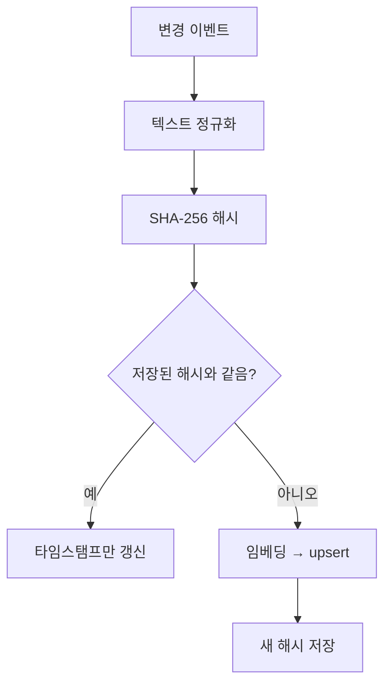
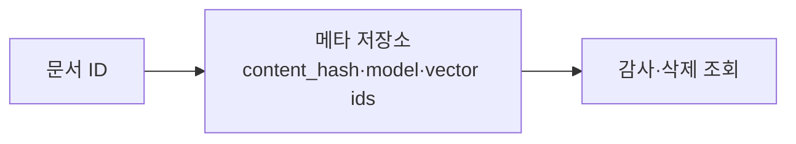

# 청크 내용 해시

> 문서(또는 청크)의 **정규화한 텍스트를 해시(SHA-256 등)해 저장**해 두고, 다음 동기화 때 해시가 같으면 **재임베딩을 건너뛰는** 증분 색인 기법이다. 바뀐 부분만 다시 처리해 임베딩 비용과 시간을 줄인다.

## 쉽게 말하면
택배 상자마다 내용물의 지문(해시)을 적어 둔다. 다음 입고 때 지문이 같으면 열어 보지 않고 그대로 두고, 지문이 달라진 상자만 열어 다시 정리한다. 상자가 수만 개여도 바뀐 몇 개만 손본다.

## 자세히
(dev.to 「Maintaining Index Freshness: Incremental Updates for Vector Databases」를 WebFetch로 직접 확인. 개인 블로그 글이며 아래 코드는 글의 의사코드를 요약한 것이다. **글은 문서 단위 해시를 다루고 청크 단위 해시는 다루지 않는다** — 청크 단위 확장은 이 노드의 해석이다.)
- **패턴(글)**: `sha256(normalize_text(doc))`를 계산해 저장된 `content_hash`와 비교한다. 같으면 **재임베딩을 건너뛰고** 타임스탬프 메타데이터만 갱신한다. 정규화(공백·줄바꿈 정리 등)를 먼저 해야 의미 없는 차이로 해시가 달라지지 않는다.
- **문서별 저장 필드(글)**: `doc_id`, `content_hash`, `embedding_model`, `embedding_timestamp`, `source_timestamp`, `index_namespace`. 벡터 point ID 목록은 Postgres·DynamoDB 같은 **외부 메타 저장소**에 둬 조회·감사에 쓴다.
- **증분 upsert·delete(글)**: upsert는 ID로 덮어쓰므로 **ID가 안정적이면 멱등**이다. Pinecone 가이드를 인용해 요청당 약 1k 벡터 배치를 권한다. 삭제는 대규모에서 물리 삭제가 비싸 **tombstone(`deleted_at`)을 선호**한다. → [Tombstone 삭제](#tombstone-deletion)
- **의사코드(글, 요약)**: 이벤트가 삭제면 벡터 DB에서 지우고 메타를 표시, 아니면 해시를 계산해 이전 해시와 같으면 타임스탬프만 갱신, 다르면 임베딩 후 upsert하고 새 해시 저장.
- **청크 단위로 확장할 때(해석)**: 청크 경계가 바뀌면 (문서→청크 ID) 매핑이 달라져 해시가 의미 없어진다. 글도 **안정적인 청킹 알고리즘**을 유지하고, 청킹 변경은 증분이 아닌 **명시적 재색인**으로 다루라고 한다.
- **함정(글)**: 이벤트가 최소 1회 전달이라 **중복 처리**에 대비해 멱등성 확보, 순서가 중요하면 txn_id·LSN 사용, 삭제와 upsert의 경쟁 조건, **모델·청크 변경은 부분/전체 백필** 필요(벡터에 `embedding_model` 태그), 백필은 섀도 색인+별칭 교체.

## 그림으로 보기

## 예시
- 위키 1만 페이지 중 하루 30페이지만 수정 → 30페이지만 재임베딩해 임베딩 호출 비용을 99% 이상 절감.
- 교육 활동: 두 버전의 문서를 정규화 전/후로 해시해 보고, 정규화가 왜 필요한지 확인.

## 헷갈리는 것과 비교
| 개념 | 차이 |
|---|---|
| 내용 해시 | 내용이 같은지 지문으로 판정 |
| 타임스탬프 비교 | 시간만 보고 판단. 내용이 같아도 갱신으로 오인 |
| [CDC 동기화](#change-data-capture-sync) | 변경 이벤트를 받는 방법 |
| [블루-그린 재색인](#blue-green-reindex) | 모델·청크 변경 같은 전면 교체 |

## 더 읽을거리
- [Maintaining Index Freshness: Incremental Updates for Vector Databases (dev.to)](https://dev.to/beefedai/maintaining-index-freshness-incremental-updates-for-vector-databases-16eb) — CDC, 내용 해시, 증분 upsert/delete(직접 확인, 개인 블로그).
