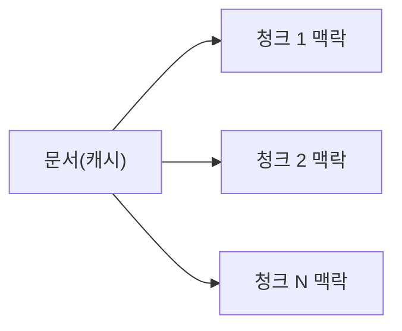
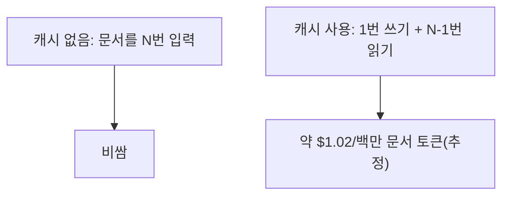

# 맥락 생성 비용과 캐싱

> 청크마다 LLM으로 맥락을 만들면 색인 비용이 크다. **프롬프트 캐싱**으로 같은 문서를 반복 입력하는 비용을 줄이면 Anthropic 추정 기준 **백만 문서 토큰당 약 $1.02**(일회성)가 든다. (Anthropic 글 열람 2026-11-28)

## 쉽게 말하면
한 문서의 청크 100개에 설명을 달 때마다 문서 전체를 새로 읽어 주면 낭비다. 문서를 한 번 "기억시켜(캐시)" 두고 청크만 바꿔 묻는 방식이다.

## 자세히
- 문제: 맥락 생성 프롬프트는 **전체 문서+청크 하나**를 입력한다. 문서에 청크가 많으면 같은 문서가 청크 수만큼 반복 입력된다.
- 해법: [프롬프트 캐싱](#cache-breakpoint)으로 문서 부분을 캐시하고 청크만 바꾼다. 앞부분이 같으므로 두 번째 호출부터 캐시 읽기(기본 입력가의 0.1배 수준, [캐시 TTL](#cache-ttl) 참고)로 처리된다.
- 가정과 결과(글): **800토큰 청크, 8천 토큰 문서, 50토큰 지시문, 청크당 약 100토큰 맥락** 가정에서 맥락화에 **백만 문서 토큰당 약 $1.02, 일회성**.
- 직접 가늠(내 계산, 글의 가정 사용): 문서 8,000토큰 ÷ 청크 800 = 문서당 약 10청크. 캐시 없이는 문서 8,000토큰이 10번 입력(80,000 입력 토큰)이지만 캐시를 쓰면 1번 쓰기+9번 읽기로 환산된다. 모델 단가는 글의 모델(Claude 3 Haiku) 기준이라 지금 모델 가격으로는 다시 계산해야 한다.
- 주의: 캐시 수명은 기본 5분이므로 같은 문서의 청크를 **연속으로** 처리해야 캐시가 유지된다(일반 설명, [캐시 무효화](#cache-invalidation)·TTL 규칙에서 도출).
- 한계: 이 수치는 Anthropic이 낸 추정이며 문서 길이·청크 수·모델에 따라 달라진다.

## 그림으로 보기

## 예시
- 문서 1개를 처리하는 동안 청크 10개의 맥락 요청을 연속 호출해 캐시 히트 유지.
- 교육: usage의 `cache_read_input_tokens`를 보며 비용 절감 폭을 확인하는 실습.

## 헷갈리는 것과 비교
| 개념 | 차이 |
|---|---|
| 맥락 생성 비용 | 색인 단계의 일회성 비용 |
| 검색(질의) 비용 | 질문마다 드는 비용 |
| [Contextual BM25](#contextual-bm25) | 이 맥락을 사용하는 색인 방식 |

## 더 읽을거리
- [Introducing Contextual Retrieval](https://www.anthropic.com/news/contextual-retrieval) — 비용 가정과 수치(읽음).
- [Prompt caching](https://platform.claude.com/docs/en/build-with-claude/prompt-caching) — 캐시 규칙(읽음).
