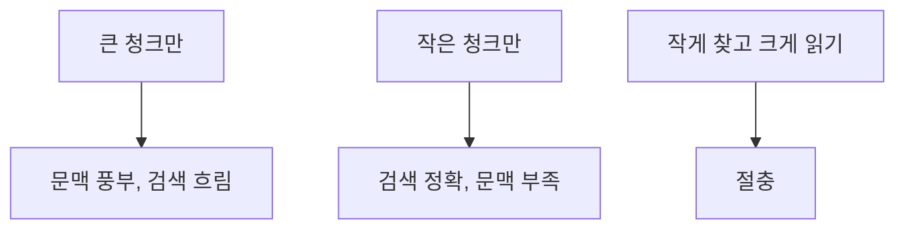

# 청크 확장과 부모 문서 검색

> **작은 조각으로 정확히 찾고, 모델에는 더 큰 주변 문맥을 돌려주는** RAG 기법. 검색 정밀도와 답변 문맥을 한쪽 희생 없이 얻으려는 시도다.

## 쉽게 말하면
책에서 단어 하나를 찾으려 색인(작은 단위)을 쓰고, 찾은 뒤에는 그 문장만이 아니라 해당 단락이나 쪽 전체를 읽는 것이다.

## 자세히
(검색 요약 기준. 공식 LangChain·LlamaIndex 문서는 열람하지 못했다.)
- 아이디어: **색인 단위와 문맥 단위를 분리**한다. 작은 조각으로 임베딩·검색해 정밀도를 확보하고, LLM에는 더 큰 부모 조각을 준다. 큰 청크는 문맥을 보존하지만 임베딩이 흐려져 검색 정밀도를 해친다는 트레이드오프가 배경이다.
- **문장 창(sentence window)**: 먼저 한 문장을 검색하고 그 주변으로 창을 확장해 더 큰 조각을 만든다(LlamaIndex 스타일의 small-to-big). 서사 글·대화록·기사처럼 생각이 문장 단위로 흐르는 텍스트에 맞는다는 의견이 있다.
- **부모 문서 검색**: 작은 조각을 찾은 뒤 부모 id를 조회해 더 큰 문서(원문 전체 또는 큰 청크)를 반환. 명세·법률·위키 문서에 적합하다는 의견. 한계: 부모 크기가 고정이라 주변 범위를 즉석에서 바꿀 수 없다.
- 비용: LLM 토큰 사용량이 작은 청크 RAG보다 부모/자식 크기 비율만큼 늘어난다.
- 증거는 엇갈린다: 한 벤치마크 논문 표에서는 문장 창 방식이 gpt-3.5-turbo-1106 기준 5.60점, -23.8%(성능 하락)로 보고됐고, 문장을 개별 임베딩할 때의 모호성이 한 원인으로 언급됐다. 효과는 작업에 따라 다르므로 직접 측정하라.

## 그림으로 보기

## 예시
- 계약서에서 "해지 조항" 문장으로 검색하고 해당 조 전체를 모델에 전달.
- 교육: 같은 질문에 작은 청크, 큰 청크, 부모 확장 결과를 비교하는 실습.

## 헷갈리는 것과 비교
| 개념 | 차이 |
|---|---|
| 문장 창 | 검색된 문장 주변을 일정 폭으로 확장 |
| 부모 문서 검색 | 미리 정한 부모 단위를 반환 |
| [하이브리드 검색](#hybrid-search) | 검색 방식(키워드+벡터)을 섞는 것, 문맥 확장과 별개 |

## 더 읽을거리
- [The Chronicles of RAG (arXiv 2401.07883)](https://arxiv.org/pdf/2401.07883) — 청크·검색기 분석(검색 결과 확인).
- [Parent-Document Retrieval 해설](https://zeroentropy.dev/concepts/parent-document-retrieval/) — 개념 설명(검색 결과 확인).
