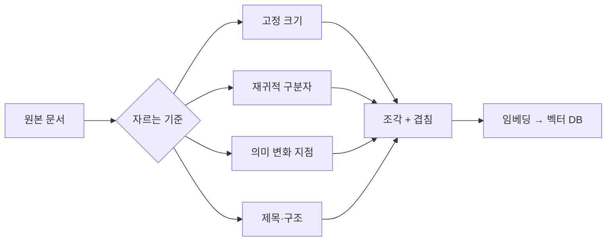
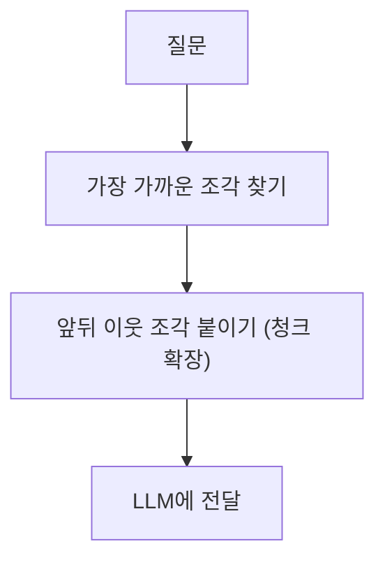

# 청킹(문서 쪼개기)

> 긴 문서를 검색·임베딩하기 좋은 조각(chunk)으로 나누는 단계. 어디서 얼마나 자르느냐가 [RAG](#rag) 검색 품질을 크게 좌우한다.

## 쉽게 말하면
두꺼운 교재를 시험 직전에 찾아보기 쉽게 포스트잇 단위로 나누는 일이다. 너무 잘게 자르면 한 조각만 봐서는 무슨 얘기인지 모르고, 너무 크게 자르면 한 조각에 여러 주제가 섞여 원하는 부분을 못 찾는다. 적당한 크기와 자르는 위치를 찾는 것이 청킹이다.

## 자세히
Pinecone 청킹 가이드(확인 2026-11-02) 기준 주요 전략:
- **고정 크기**: 토큰 수를 정해 균등하게 자른다. 가장 단순해서 "대부분 여기서 시작하라"고 권한다.
- **재귀적**: 문단 → 줄 → 공백 순으로 구분자를 시도하며 목표 크기에 맞춘다. 구조는 존중하지만 의미는 모른다.
- **의미 기반(semantic)**: 인접 문장을 임베딩해 주제가 바뀌는 곳에서 자른다. 계산 비용이 들고 아직 실험적이다.
- **구조 기반**: 제목·HTML 태그·마크다운 섹션처럼 문서 형식을 경계로 쓴다. 형식별 파서가 필요하다.
- **겹침(overlap)**: 조각 사이에 일부를 겹쳐 경계에서 문맥이 끊기는 것을 줄인다.
- **청크 확장**: 검색 후 앞뒤 이웃 조각을 함께 가져와 문맥을 보충한다.
- 크기 감각: 세밀한 사실 검색은 128~256토큰, 문맥이 필요하면 512~1024토큰부터 시험한다. 정답은 데이터·임베딩 모델·질문 유형에 달려 있으므로 여러 크기를 직접 평가해야 한다([평가](#ai-evaluation)).
- 작은 조각은 정확히 맞지만 문맥이 없고, 큰 조각은 문맥은 있지만 의미가 희석되고 "중간 정보 소실" 문제가 커진다.

## 그림으로 보기

## 예시
- 사내 규정 PDF: 장·조 제목이 뚜렷하므로 구조 기반으로 자르고, 조항 하나가 길면 512토큰 안팎으로 재귀 분할한다.
- 실험 방법: 같은 질문 30개로 256 / 512 / 1024토큰 청킹을 비교해 정답 조각이 상위 5개에 들어오는 비율을 센다.

## 헷갈리는 것과 비교
| 개념 | 차이 |
| --- | --- |
| 청킹 | 문서를 검색 단위로 나눔 |
| [임베딩](#text-embedding) | 조각을 의미 벡터로 바꿈 |
| [벡터 DB](#vector-db) | 벡터를 저장하고 가까운 것을 찾음 |
| 컨텍스트 윈도우 | 모델이 한 번에 읽는 한도. 청킹은 이 한도에 맞춰 필요한 부분만 넣게 해 줌 |

## 더 읽을거리
- [Chunking Strategies for LLM Applications (Pinecone)](https://www.pinecone.io/learn/chunking-strategies/) — 전략별 장단점과 크기 가이드.
