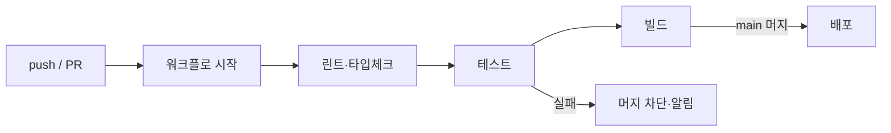

# CI/CD

> CI(지속적 통합)는 코드를 올릴 때마다 빌드·테스트를 자동으로 돌리는 것, CD(지속적 배포/전달)는 통과한 결과를 자동으로 배포 단계까지 보내는 것이다.

## 쉽게 말하면
공장 조립 라인의 자동 검수 장치다. 부품(코드 변경)이 들어올 때마다 기계가 규격 검사를 하고, 합격품만 출고 라인으로 보낸다. 사람이 매번 검사표를 들고 서 있지 않아도 된다.

## 자세히
GitHub Actions 문서의 용어로 정리하면:
- **Workflow**: 하나 이상의 job으로 이뤄진 자동화 과정. 이벤트·수동 실행·일정으로 시작한다. 파일은 저장소의 `.github/workflows/`에 YAML로 둔다.
- **Event**: push, PR 열림 같은 트리거. **Job**: 같은 러너에서 도는 step 묶음(기본 병렬). **Step**: 셸 명령이나 action 하나(순서대로). **Runner**: job이 실행되는 서버(GitHub 호스팅 Linux·Windows·macOS 또는 자체 서버). **Action**: 재사용 가능한 부품.
- **CI에 넣는 것**: 설치 → 린트 → 타입체크 → 테스트 → 빌드. 하나라도 실패하면 PR 머지를 막는다(브랜치 보호 규칙과 연결).
- **CD**: 머지되면 프리뷰·프로덕션에 배포([배포 기초](#deployment-basics)). 호스팅이 Git 연결로 자동 배포하는 경우 별도 CD 설정이 필요 없기도 하다.
- **AI 시대의 의미**: AI가 코드를 많이 만들수록 사람이 일일이 못 보므로, CI가 [결정적 피드백](#deterministic-feedback)을 모든 변경에 일관되게 걸어 주는 안전망이 된다. 비밀키는 저장소 시크릿에 두고 로그에 찍지 않는다.

## 그림으로 보기


## 예시
```yaml
name: CI
on: [push, pull_request]
jobs:
  test:
    runs-on: ubuntu-latest
    steps:
      - uses: actions/checkout@v4
      - run: npm ci
      - run: npm test
```
프롬프트: "이 프로젝트에 PR마다 린트와 테스트를 돌리는 GitHub Actions 워크플로를 만들어 줘. 시크릿은 쓰지 마."

## 헷갈리는 것과 비교
| 개념 | 차이 |
| --- | --- |
| CI | 통합 전 자동 검사 |
| Continuous Delivery vs Deployment | 전자는 배포 준비까지 자동·승인 후 배포, 후자는 완전 자동 배포 |
| [훅](#hooks-guardrails) | 에이전트 세션 안의 로컬 가드. CI는 저장소 단위 공용 가드 |
| Cron/예약 실행 | 이벤트 대신 시간으로 시작하는 워크플로도 가능 |

## 더 읽을거리
- [GitHub Docs: Understanding GitHub Actions](https://docs.github.com/en/actions/get-started/understand-github-actions) — workflow·job·step·runner
