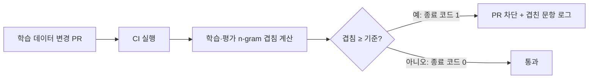
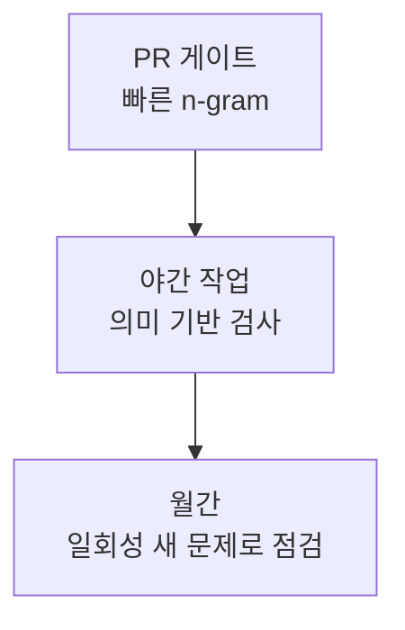

# CI 겹침 게이트

> CI 겹침 게이트는 학습 데이터나 평가셋이 바뀌는 변경(PR)마다 학습-평가 겹침을 자동으로 다시 계산하고, 기준을 넘으면 변경을 막는 검사 단계다. 한 번 점검하고 끝이 아니라 데이터가 늘 때마다 누수를 계속 감시한다.

## 쉽게 말하면
공항 보안검색대를 생각하면 된다. 승객(변경)이 지나갈 때마다 자동으로 검사하고, 금지 물품(평가 문제와 겹치는 학습 데이터)이 나오면 통과를 막는다. 사람이 가끔 가방을 열어 보는 것보다 매번 기계가 보는 편이 새는 일이 적다.

## 자세히
- **구성(해석)**: ① 학습 데이터 변경이 있는 PR에서 CI가 실행 ② 학습 텍스트와 평가 텍스트의 n-gram을 비교([n-gram 겹침 검사](#ngram-overlap-test)) ③ 평가 문제별 겹침 비율이 기준 이상이면 비정상 종료 코드로 PR 차단 ④ 어떤 평가 문항이 어느 학습 문서와 겹쳤는지 로그로 남긴다.
- **직접 만들어 확인한 최소 게이트(파이썬, 8-gram 해시 집합, 기준 0.5)**: 평가 문항 2개와 학습 문서 2개로 시험했다. 학습 문서에 평가 문항 1이 그대로(앞에 "Practice:"만 붙어) 들어 있으면 그 문항의 겹침 비율은 1.00이었고 출력은 "contaminated 1 of 2", 종료 코드 1(실패)이었다. 겹치는 문서를 빼자 "contaminated 0 of 2", 종료 코드 0(통과)이었다. CI는 종료 코드로 성공·실패를 판단하므로 이 값이 그대로 게이트가 된다. 이 코드는 소규모 시험이며 대규모 학습 데이터에는 해시 집합 대신 색인이 필요할 수 있다.
- **한계(해석)**: n-gram만으로는 의역을 못 잡는다([의역 샘플 오염](#rephrased-sample-contamination)). 의미 기반 검사(임베딩·LLM 판정, [LLM decontaminator](#llm-decontaminator))는 비용이 커서 야간 작업으로 돌리고, PR 게이트는 빠른 n-gram 검사로 둔다. 기준값이 너무 낮으면 오탐으로 개발이 막히고 너무 높으면 구멍이 생긴다.
- **운영 팁(해석)**: 평가셋 자체가 바뀌는 변경도 게이트 대상이다. 예외(허용 목록)에는 사유와 승인자를 남긴다. 평가셋 접근 통제와 함께 쓴다([평가셋 격리](#eval-set-quarantine)).

## 그림으로 보기

## 예시
- GitHub Actions 단계에서 `python gate.py data/train.jsonl data/eval.jsonl 0.5`를 실행하고 실패하면 병합을 막는다(스크립트 형태는 위 실험 참고).
- 교육 활용: 학습 문서에 평가 문항을 일부러 섞어 PR이 막히는지 확인하는 실습.

## 헷갈리는 것과 비교
| 개념 | 차이 |
| --- | --- |
| CI 겹침 게이트 | 변경마다 자동 탐지·차단 |
| [평가셋 격리](#eval-set-quarantine) | 접근 자체를 막음(예방) |
| [카나리 문자열](#canary-string) | 외부 유출 표식 |
| [n-gram 겹침 검사](#ngram-overlap-test) | 게이트가 쓰는 검사 방법 |

## 더 읽을거리
- [Deduplicating Training Data Makes Language Models Better (arXiv 2107.06499)](https://arxiv.org/abs/2107.06499) — 학습·검증 겹침이 평가에 미치는 영향
