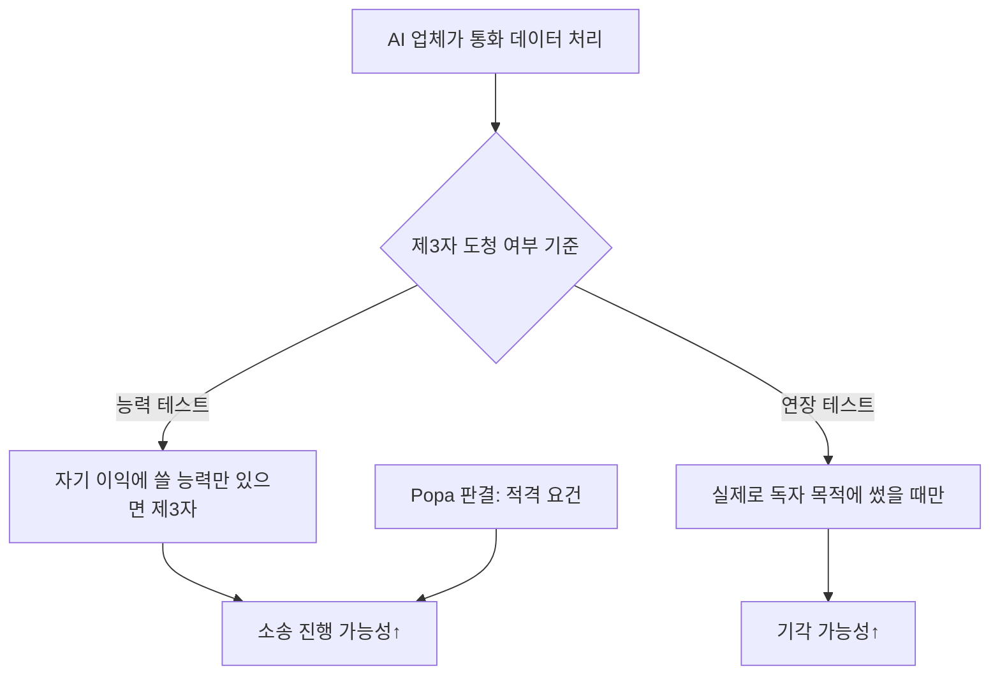

# CIPA 소송

> 캘리포니아 침해 방지법(CIPA)을 근거로, 고객 통화·채팅을 처리하는 AI 업체와 이를 쓰는 기업을 상대로 제기되는 집단소송. 핵심 쟁점은 AI 업체가 "제3의 도청자"인가이다. (법률 자문 아님)

## 쉽게 말하면
통화 중에 모르는 사람이 옆에서 듣고 분석하면 도청이다. AI 콜센터 도구가 통화 내용을 자기 서버로 받아 분석한다면 "그 업체는 대화의 제3자인가, 기업의 연장(녹음기)인가"를 두고 법원이 갈린다.

## 자세히
출처: 로펌 해설 요약(판결 원문 직접 확인 안 함).
- **Ambriz v. Google(N.D. Cal., 2025-02)**: Google Cloud Contact Center AI가 통신사 고객 통화를 도청했다는 집단소송. 법원이 기각 신청을 거부해 진행 허용. 청구 근거는 형법 631(a), 637.5.
- **두 기준의 갈림**: "연장(extension) 테스트"는 업체가 얻은 데이터를 자기 목적에 썼다는 주장이 필요. "능력(capability) 테스트"는 업체가 데이터를 자기 이익에 쓸 기술적 능력만 있어도 제3자로 본다. Ambriz는 능력 테스트를 따랐다(Javier v. Assurance IQ 인용).
- **이후 변화**: 2025-08 제9순회 Popa v. Microsoft가 사적·민감 정보 수집 없는 일상적 추적은 당사자 적격(standing)이 없다고 판단해 원고에게 불리하게 기울었다는 해설이 있다. 능력 테스트가 폐기됐다고 명시한 것은 아니라는 해설도 있어 현재 상태는 불확실하다.
- **관련 조항**: 632.7(이동·무선 전화 녹음) 관련 검색에서는 자료가 나오지 않아 이 글에서 다루지 않는다.
- **실무 의미**: AI 녹음·전사 도구를 도입하는 기업은 업체의 데이터 재사용 권한(학습·분석) 제한을 계약에 넣고, 통화 시작 시 고지·동의를 둔다([전원 동의](#all-party-consent)).

## 그림으로 보기

## 예시
- 콜센터 AI 업체와 계약할 때 "고객 통화 데이터를 자사 모델 학습에 사용하지 않는다" 조항을 넣으면 연장 테스트에서 방어에 유리하다는 논리(해설 기반, 보장 아님).

## 헷갈리는 것과 비교
| 개념 | 차이 |
|---|---|
| CIPA | 캘리포니아 주법, 집단소송 빈발 |
| 연방 도청법 | 일방 동의 기준 |
| [전원 동의](#all-party-consent) | 녹음 동의 규칙 자체 |

## 더 읽을거리
- [Federal judge allows Google customer service AI class action to proceed (ZwillGen)](https://www.zwillgen.com/privacy/federal-judge-allows-google-customer-service-ai-class-action-to-proceed/) — Ambriz 결정 해설(검색 결과로만 확인)
- [The Collapse of Capability Theory](https://sjipl.mainelaw.maine.edu/2025/12/18/the-collapse-of-capability-theory-ambriz-popa-and-the-future-of-article-iii-standing-in-ai-privacy-cases/) — Popa 이후 논의(검색 결과로만 확인)
