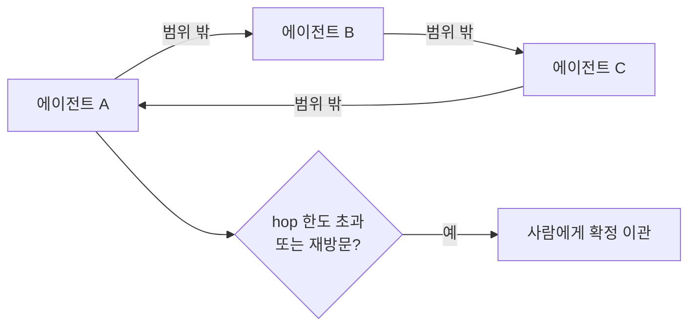

# 순환 이관 (Circular Handoff)

> 에이전트(또는 부서)끼리 **서로 담당이 아니라며 문의를 계속 돌려보내 아무도 해결하지 못하는 실패**. 고객은 같은 말을 되풀이하며 맴돌게 된다. 홉(hop) 횟수 제한과 방문 기록으로 감지하고 사람에게 확정 이관한다.

## 쉽게 말하면
민원 창구에서 "그건 3층에서 합니다", 3층에서는 "1층으로 가세요"를 반복하는 상황이다. 어느 창구도 틀린 말은 안 했지만 민원인은 영원히 해결을 못 한다.

## 자세히
출처: 직접 확인한 외부 출처는 없다. 이 노드는 앞서 정리한 [반복 설명률](#repeat-explanation-rate), [이관 경계 검증](#handoff-boundary-validation)의 원리를 바탕으로 한 **설계 제안**이다(confidence 낮음).
- **발생 원인(해석)**: 라우팅 규칙이 서로를 가리킴, 범위 정의의 빈틈("어느 에이전트도 소유하지 않는 문의"), 이관 사유가 사라지지 않고 되풀이됨, 에이전트가 불확실할 때 기본값으로 다른 쪽에 넘김.
- **감지 신호(제안)**: ①같은 대화에서 이관 횟수(hop count)가 N회(예: 3) 초과 ②같은 에이전트에 두 번 방문(방문 집합 기록) ③사이클 내 총 대기 시간이 임계 초과 ④고객의 반복 발화·불만 ⑤이관 사유가 변하지 않음.
- **방지책(제안)**: 이관 메시지에 `hop_count`와 `visited_agents`를 포함하고, 한도 초과나 재방문 시 **자동으로 사람 확정 이관**(더 돌리지 않음). 소유 없는 문의를 위한 기본 담당(fallback owner)을 지정.
- **원인 개선**: 순환이 감지된 건을 모아 라우팅 규칙·범위 정의의 빈틈을 고치고([이관 사유 분류](#escalation-reason-taxonomy)), 이관 사유 코드의 "범위 밖"이 한 곳에 몰리는지 본다.
- **측정(제안)**: 순환 이관 비율, 평균 hop 수, 순환 건의 총 해결 시간과 [반복 설명률](#repeat-explanation-rate).
- **한계**: hop 한도가 너무 낮으면 정당한 다단계 이관도 끊긴다. 예외 규칙이 필요하다.

## 그림으로 보기


## 예시
```python
def route(msg, target):
    msg["hop_count"] += 1
    if msg["hop_count"] > 3 or target in msg["visited"]:
        return "human_owner"        # 더 돌리지 않고 사람 확정 이관
    msg["visited"].append(target)
    return target
```
교육 활용: 자사 부서 간 이관 흐름을 그려 보고 "소유자 없는 문의"가 있는지 찾는 실습.

## 헷갈리는 것과 비교
| 개념 | 차이 |
|---|---|
| 순환 이관 | 담당을 돌려 해결 못 함 |
| 정상 다단계 이관 | 단계마다 진전이 있음 |
| [이관 경계 검증](#handoff-boundary-validation) | 메시지 형식 검사 |
| [권한 범위 명시](#authorization-scope) | 받는 쪽이 할 수 있는 일을 적음 |

## 더 읽을거리
- [이관 경계 검증](#handoff-boundary-validation) — 이관 메시지에 필수 필드(hop_count 등)를 강제하는 방법
