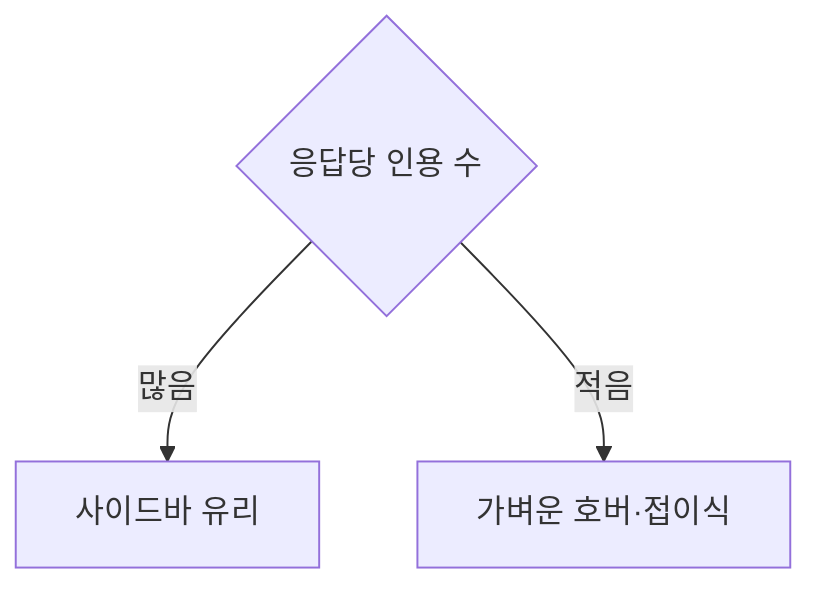

# 인용 밀도

> AI 답변 하나에 **인용이 몇 개 들어 있는지**. 같은 인용 UI라도 밀도에 따라 사용자의 부담과 비판적 사고에 미치는 효과가 달라진다.

## 쉽게 말하면
각주가 한두 개인 글과 한 문장마다 달린 글은 읽는 방식이 다르다. 각주가 많으면 옆에 정리해 둔 쪽이 편하고, 적으면 굳이 옆 칸이 필요 없다.

## 자세히
(He·Liu arXiv 2601.14611 HTML 본문 앞부분을 직접 읽었다. 사전 인쇄본.)
- **측정 방식(논문)**: 밀도를 이산 조건으로 나누지 않고 **응답당 인용 수를 연속 예측 변수**로 두어 인터페이스 조건과의 상호작용을 검정했다.
- **호버 카드**: 밀도가 높을수록 작업 부담(β=0.05)이 늘고 증거 평가(β=0.08)는 좋아졌다.
- **정렬 사이드바**: 밀도가 높을수록 종합하기(β=0.07)·출처 관련 사고(β=0.02) 점수가 올랐다. 밀도가 낮으면 부정적 효과(종합하기 β=−1.53).
- **시사**: 인용 UI는 밀도에 맞춰 바꾸는 적응형이 필요하다고 저자는 제안한다.

## 그림으로 보기

## 예시
- 답변의 인용 수를 세어 5개 이상이면 사이드바, 미만이면 호버 카드로 전환(제안, 논문이 시험한 것은 아님).

## 헷갈리는 것과 비교
| 개념 | 차이 |
|---|---|
| 인용 밀도 | 응답 안의 인용 개수 |
| [인용 재현·정밀](#citation-recall-precision) | 인용의 뒷받침 품질 |

## 더 읽을거리
- [He & Liu (arXiv 2601.14611)](https://arxiv.org/html/2601.14611v1) — 직접 읽음(앞부분).
