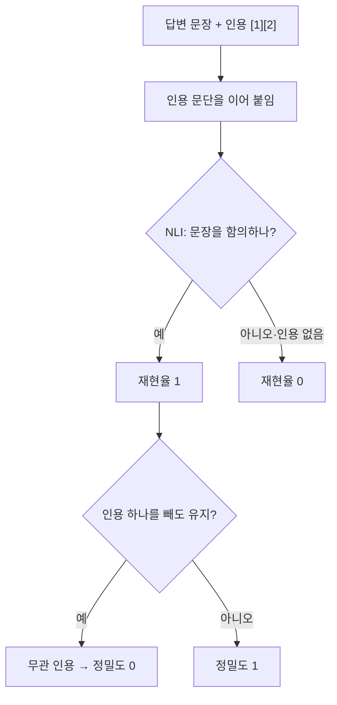

# 인용 재현율·정밀도

> 답변의 각 문장이 **인용한 자료로 충분히 뒷받침되는지(재현율)**, 그리고 달린 인용 하나하나가 **필요한 것인지(정밀도)**를 재는 두 지표다.

## 쉽게 말하면
보고서 문장마다 각주가 있고, 그 각주들을 합쳐 읽으면 문장이 정말 나오는지가 재현율이다. 각주 중 쓸데없는 것이 섞였는지가 정밀도다.

## 자세히
(ALCE 논문 §3.3과 Figure 3을 직접 읽었다.)
- **인용 재현율**: 문장마다 0 또는 1. 문장에 **인용이 있고** 인용된 모든 문단을 이어 붙인 것이 문장을 **NLI 모델로 함의**하면 1. 응답 안의 모든 문장에 대해 평균. AIS(attributable to identified sources) 프레임워크에 따라 "인용 자료만으로 그 문장이 참이다"를 뜻한다.
- **인용 정밀도**: 인용마다 0 또는 1. **하나만으로는 문장을 뒷받침하지 못하고, 그것을 빼도 나머지 인용들의 뒷받침에 영향이 없으면 "무관한(irrelevant)" 인용**으로 본다. 재현율이 0이면 정밀도도 0. 최소 인용 집합을 요구하지는 않는다 — 사람도 신뢰를 위해 중복 인용을 하고 의료 조언처럼 중요한 주장에는 여러 인용이 도움이 되기 때문.
- **우선순위(논문)**: 잘 뒷받침된 진실한 답을 보장하므로 재현율을 우선하되, 정밀도는 불필요한 출처를 사람이 검토하는 수고를 줄여 사용자 만족에 중요하다.
- **그림 3 예**: 세 문장 중 2개만 뒷받침 → 재현율 2/3 = 66%, 인용 6개 중 4개가 관련 → 정밀도 4/6 = 66%.
- **한계**: NLI 판정 오류가 점수에 섞인다. 논문은 사람 평가와의 높은 상관을 보였다고 주장하나(수치는 본문 §6, 이 글에서 확인하지 못함).

## 그림으로 보기

## 예시
- 답변 3문장, 인용 6개: 문장 1·3이 인용으로 뒷받침, 문장 2는 아님 → 재현율 66%. 인용 6개 중 2개가 무관 → 정밀도 66%(논문의 그림 값과 같은 형태).

## 헷갈리는 것과 비교
| 지표 | 묻는 것 |
|---|---|
| 인용 재현율 | 문장이 인용으로 충분히 뒷받침되나 |
| 인용 정밀도 | 인용이 필요한가(무관 인용 없나) |
| 정확성(EM·claim recall) | 답 자체가 맞나 |
| [NLI 함의 검사](#nli-entailment-check) | 둘을 계산하는 판정 방법 |

## 더 읽을거리
- [Gao et al. (2023)](https://arxiv.org/abs/2305.14627) — §3.3, Figure 3(직접 읽음).
- [ALCE GitHub](https://github.com/princeton-nlp/ALCE) — 코드·데이터(논문이 안내, 열람은 안 함).
