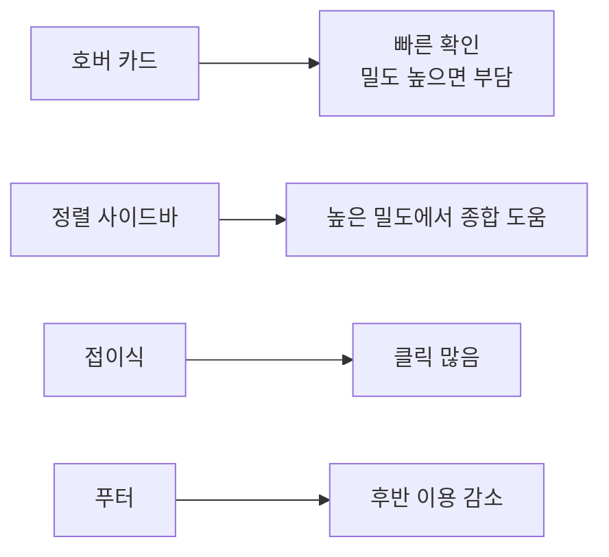
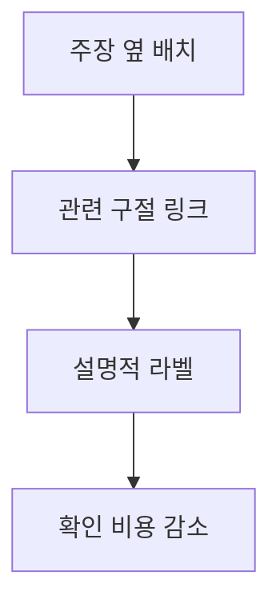

# 인용 UI 패턴

> AI 답변의 출처를 화면에 보여 주는 방식(접이식 목록, 호버 카드, 하단 목록, 정렬된 사이드바 등). 방식에 따라 사용자의 확인 행동과 부담이 달라지며 "최선의 하나"는 없다.

## 쉽게 말하면
책의 각주 방식과 같다. 쪽 아래에 바로 달 수도, 책 끝에 모을 수도, 옆 여백에 붙일 수도 있다. 각각 읽는 흐름과 확인하는 수고가 다르다.

## 자세히
- **네 가지 방식(arXiv 2601.14611, 열람, N=372, Prolific, Perplexity 기반 대화형 AI로 논증 에세이 작성)**
  - 접이식(Collapsible): "Used Sources" 토글 뒤에 숨기고 본문엔 클릭 가능한 배지.
  - 호버 카드(Hover Card): 배지에 마우스를 올리면 출처 카드.
  - 푸터(Footer): 응답 끝에 출처 카드를 참고문헌처럼 나열.
  - 정렬 사이드바(Aligned Sidebar): 본문 인용과 정렬된 고정 사이드바.
- **행동 결과**: 접이식이 배지 클릭·읽기 세션이 가장 많았고, 사이드바·푸터는 카드 호버가 많았다. 호버 사용자는 인용에서 글쓰기로 가장 매끄럽게 이어졌다. 푸터는 넷째 메시지 이후 사용이 줄었다.
- **인식 결과**: 투명성·신뢰·확신에 대한 유의한 인터페이스 효과는 없었다. 호버는 인용 밀도가 높아질수록 작업 부담이 커졌다. 사이드바는 인용이 많을수록 종합·출처 관련 비판적 사고 점수가 올랐고 적을 때는 낮았다. 호버는 증거 강도 평가가 개선됐다.
- **결론(저자)**: 단일 최선은 없고 적응형 인터페이스와 장기 연구가 필요. 단일 사전 인쇄본이라 추가 검증 전에는 일반화하지 않는다.
- **NN/g 권고(열람)**: 사람들은 인용 링크를 거의 누르지 않고 눈에 띄는 인용은 확인 없이도 신뢰를 높인다. 그래서 확인 안내 문구, 본문과 구별되는 스타일, 주장 옆 배치, 관련 구절로 링크, 설명적 라벨(출판물·글 제목)을 권한다. 가짜 인용은 UI로 해결 못 하는 모델 문제라고 명시한다.
- 검색 요약에는 별개의 2025년 394명 실험도 있었다(미열람). 인터페이스 효과가 경험·인식 지표엔 제한적이고 지식·관심·동의 변화엔 유의했다는 보고.

## 그림으로 보기

## 예시
- 사내 문서 챗봇: 각 주장 끝에 [사규 3.2 휴가] 칩, 호버하면 해당 구절 미리보기, 끝에 "모든 출처 보기".
- 교육 실습: 같은 답변을 네 방식 목업으로 만들어 동료가 출처를 확인하는 데 걸린 시간 비교.

## 헷갈리는 것과 비교
| 개념 | 차이 |
|---|---|
| 인용 UI | 출처를 어떻게 보이나 |
| [주장 단위 출처 연결](#claim-level-attribution) | 무엇을 연결하나 |
| [근거성 지표](#groundedness-metric) | 연결이 맞는지 점수화 |
| [설명 가능성 감사](#explainability-audit) | 설명 전반의 적합성 |

## 더 읽을거리
- [Seeing to Think? (arXiv 2601.14611)](https://arxiv.org/html/2601.14611v1) — 네 가지 출처 표시 비교(앞부분 열람)
- [NN/g: Explainable AI](https://nngroup.com/articles/explainable-ai/) — 인용 표시 권고
