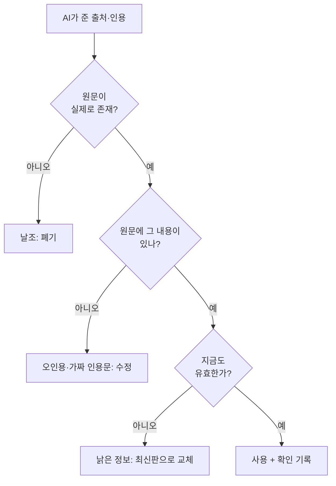
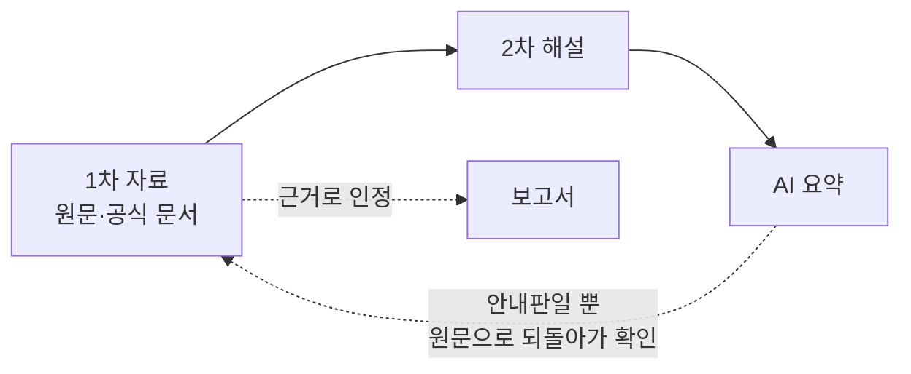

# 인용·링크 검증

> AI가 알려 준 출처(논문, 판례, 기사, URL, 인용문)가 실제로 존재하는지, 그 출처에 그 내용이 정말 있는지를 사람이 직접 열어 확인하는 습관과 절차.

## 쉽게 말하면
후배가 보고서에 "각주 12번 참고"라고 썼다면, 선배는 각주 12번을 실제로 펼쳐 본다. AI가 쓴 각주는 더 철저히 봐야 한다. 이 후배는 책 제목과 쪽수를 그럴듯하게 지어낼 수 있기 때문이다. 문장이 매끄러울수록 확인을 건너뛰기 쉽다.

## 자세히
**AI 출처 오류의 세 가지 얼굴**(Charlotin의 법원 사례 데이터베이스 분류)
- **날조(fabricated)**: 존재하지 않는 판례·논문·URL을 만들어 냄. 1,877건 태그.
- **오인용(misrepresented)**: 실제 있는 자료지만 그 내용이 말한 바와 다름. 971건.
- **가짜 인용문(false quote)**: 출처에 없는 문장을 따옴표로 인용. 607건.
- **낡은 정보**: 폐지된 법이나 뒤집힌 판결을 현행처럼 제시. 38건.

**실제 규모(Damien Charlotin 데이터베이스, 2026-11-14 갱신)**: 2023년 2분기 이후 법원·재판소 결정 중 AI 환각 내용에 의존한 것으로 판단되거나 시사된 사례 2,293건(미국 1,554, 캐나다 245, 호주 112, 영국 91). 사용자별로는 변호사 없이 직접 소송한 당사자 1,315건, 변호사 913건, 판사 34건, 전문가 18건, 검사 5건. 크라우드소싱 데이터베이스이므로 전수 통계가 아니며, 분모(AI로 쓴 전체 서류 수)를 모르기 때문에 "발생률"이 아니다.

**검증 절차**
1. **존재 확인**: 제목·저자·사건번호·URL로 직접 검색한다. 링크는 클릭해서 열린다고 끝이 아니라 내용이 주장과 맞는지 읽는다.
2. **내용 확인**: 인용문은 원문에서 Ctrl+F로 찾아 문구가 일치하는지 본다. 숫자·날짜는 원문 표와 대조한다.
3. **현행성 확인**: 법·규정·가격은 날짜를 보고 최신판을 확인한다([지식 컷오프](#knowledge-cutoff) 문제).
4. **출처 등급**: 1차 자료(원문·공식 문서) > 2차 해설 > AI 요약. AI 요약은 근거가 아니라 안내판이다.
5. **기록**: 확인한 날짜와 열람한 URL을 남긴다.

**AI에게 시키는 법**: 웹 검색·[RAG](#rag)로 실제 문서를 가져오게 하고 "원문에서 해당 문장을 그대로 인용하고 위치를 적어라"고 요구하면 오류가 줄지만 없어지지는 않는다. 그 인용 역시 원문과 대조한다.

## 그림으로 보기

## 예시
- 보고서에 AI가 제시한 논문 "Kim et al., 2023, Journal of ..."를 구글 스콜라와 DOI 조회로 찾아 존재 여부와 초록의 내용을 확인한다.
- 계약서 검토 요청 후 AI가 인용한 법 조문 번호를 법제처 사이트에서 직접 열어 문구를 대조한다.
- 교육 활용: 수강생에게 AI가 만든 참고문헌 목록 10개를 주고 진짜/가짜를 가려 내는 실습을 한다.

## 헷갈리는 것과 비교
| 개념 | 차이 |
|---|---|
| 인용 검증 | 사람이 사후에 출처를 확인하는 절차 |
| [RAG](#rag) | 출처를 가져와 쓰게 하는 설계. 그래도 검증은 필요 |
| [환각](#hallucination) | 문제의 원인 현상. 인용 검증은 그 대응 습관 |
| [보정](#calibration) | 모델의 확신 정확도. 확신 있어 보여도 인용은 틀릴 수 있음 |

## 더 읽을거리
- [AI Hallucination Cases (Damien Charlotin)](https://www.damiencharlotin.com/hallucinations/) — 법원 판단 사례와 유형별 집계
