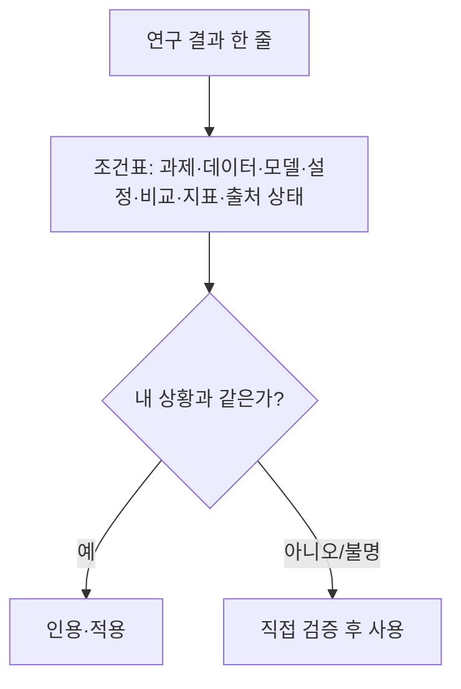
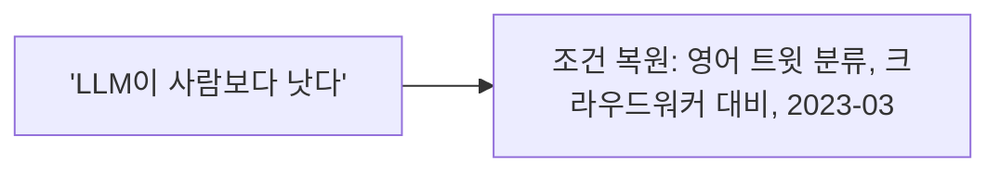

# 연구 인용 시 범위 명시

> AI 연구 결과를 인용·전달할 때는 **과제, 데이터, 모델(버전), 평가 방식, 시점**을 결과와 함께 밝힌다. "LLM이 사람보다 낫다" 같은 한 줄 요약은 조건이 빠지면 거짓이 된다.

## 쉽게 말하면
"이 약은 효과가 있다"가 아니라 "성인 환자 300명, 8주, 위약 대비 고혈압 수치가 낮아졌다"라고 말해야 다른 사람이 자기 상황에 맞는지 판단할 수 있다. AI 연구 인용도 같은 조건표가 필요하다.

## 자세히
- **조건표(최소 항목)**
  | 항목 | 예 |
  |---|---|
  | 과제 | 트윗 5개 분류 과제, 생의학 개체 인식 |
  | 데이터 | 영어 트윗 2,382개, NCBI Disease 개발 세트 |
  | 모델·버전·시점 | ChatGPT(2023-03), GPT-5, Claude 3.5 Sonnet |
  | 설정 | 제로샷/퓨샷, 프롬프트·규칙서 유무 |
  | 비교 대상 | 크라우드워커, 최고 미세조정 모델 |
  | 지표·구간 | 엄격 F1, 정확도 95% 구간 |
  | 출처 상태 | 초록만 확인 / 본문 확인 / 재현 안 함 |
- **범위를 안 밝힐 때의 실제 오류 예**
  - Gilardi 외(arXiv 2303.15056, 초록 확인): 트윗 2,382개에서 제로샷 ChatGPT가 5개 과제 중 4개에서 크라우드워커보다 정확, 주석당 $0.003 미만. → "LLM이 사람보다 정확"이 아니라 "**영어 트윗 분류에서 크라우드워커보다**"이다. 같은 분야의 Ziems 외(arXiv 2305.03514)는 25개 벤치마크에서 분류는 최고 미세조정 모델을 못 이겼다고 한다([제로샷 vs 미세조정](#zero-shot-vs-finetuned-annotation)).
  - 모델 행동은 시점에 따라 변한다: GPT-4 소수 판별 정확도 2023-03 84% → 2023-06 51%([재검증](#model-version-revalidation)).
- **연구 자체의 신뢰성 점검(Kapoor & Narayanan 2022, arXiv 2207.07048, 초록 확인)**: ML을 도입한 **17개 분야, 329개 논문**에서 데이터 누수(leakage) 오류를 확인했고 일부는 "크게 낙관적인 결론"을 낳았다. 누수 유형 분류 8가지와 이를 막는 **모델 정보 시트(model info sheet)** 보고 표준을 제안한다. 내전 예측 사례에서는 "복잡한 ML이 로지스틱 회귀보다 낫다"고 주장한 논문들이 모두 누수 때문에 재현되지 않았고, 오류를 고치면 복잡한 모델이 수십 년 된 로지스틱 회귀보다 실질적으로 낫지 않았다. 논문을 읽는 것만으로는 오류를 발견할 수 없었고 정보 시트가 있었다면 모두 탐지 가능했다고 한다. → 인용 대상 논문의 분할 방식·전처리 위치 보고 여부를 본다([분할 방식 명시](#report-split-method)).
- **인용 습관(권장)**
  1. 숫자를 인용할 땐 괄호로 조건을 붙인다: "(영어 트윗, ChatGPT 2023-03, 크라우드워커 대비)".
  2. **초록만 읽었는지 본문까지 읽었는지** 표기한다.
  3. 저자 주장과 내가 확인한 사실을 구분("주장:").
  4. 일반화는 "이 조건에서"로 한정하고 내 도메인에서 직접 검증이 필요한 부분을 명시([일반화 한계](#llm-annotation-domain-generalization)).
  5. 시점(날짜)을 적는다.
- **교육 활용**: 수강생이 뉴스·논문 요약을 읽고 조건표 7칸을 채워 보는 연습(조건이 비어 있으면 주장을 보류).

## 그림으로 보기

## 예시
- 나쁜 인용: "ChatGPT는 사람보다 라벨링이 정확하다(Gilardi 2023)."
- 좋은 인용: "영어 트윗 2,382개 5개 분류 과제에서 제로샷 ChatGPT(2023-03)가 크라우드워커보다 4개 과제에서 정확했다(Gilardi 외 2023, 초록 확인). 한국어·사내 용어는 미검증."

## 헷갈리는 것과 비교
| 개념 | 설명 |
|---|---|
| 인용 | 출처 표기 |
| 범위 명시 | 결과의 적용 조건 표기 |
| 재현 | 같은 조건에서 다시 해 보기 |
| [한국어 도메인 검증](#korean-domain-llm-annotation) | 내 조건 검증 |

## 더 읽을거리
- [Leakage and the Reproducibility Crisis in ML-based Science (arXiv 2207.07048)](https://arxiv.org/abs/2207.07048) — 17개 분야 329개 논문의 누수와 정보 시트(초록 열어 확인).
- [Gilardi 외 (arXiv 2303.15056)](https://arxiv.org/abs/2303.15056) — 조건이 명확한 사례(초록 열어 확인).
