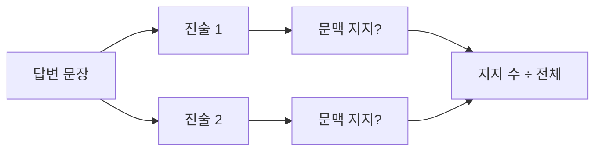

# 진술 분해(claim decomposition)

> 긴 답변을 **하나씩 검증할 수 있는 짧은 진술(claim)로 쪼개는** 단계다. 충실도 평가는 이렇게 쪼갠 진술마다 근거가 있는지 확인한다.

## 쉽게 말하면
"아인슈타인은 1879년 3월 20일 독일에서 태어났다"를 통째로 맞다 틀리다 하면 애매하다. "독일에서 태어났다"와 "1879년 3월 20일에 태어났다"로 나누면 하나는 맞고 하나는 틀린 것을 정확히 짚는다.

## 자세히
(RAGAS 문서의 faithfulness 지표 페이지를 직접 읽었다. 진술을 나누는 구체적 프롬프트 문구는 페이지에서 확인하지 못했다.)
- **절차(RAGAS)**: ① 응답을 개별 진술로 **분해** ② 각 진술을 검색 문맥에 비춰 지지/미지지로 판정 ③ **지지된 진술 수 ÷ 전체 진술 수**로 점수(0~1).
- **예(RAGAS)**: "Einstein was born in Germany on 20th March 1879" → "Einstein was born in Germany", "Einstein was born on 20th March 1879". 문맥의 생일은 14 March 1879이므로 날짜 진술은 미지지 → **1/2 = 0.5**.
- **왜 쪼개나(해석)**: 한 문장에 맞는 말과 틀린 말이 섞이면 통째 판정이 부정확하다. 쪼개면 부분 점수가 가능하고 틀린 부분을 지목할 수 있다.
- **ALCE와의 차이**: ALCE는 문장 단위로 인용 재현율을 계산하고([인용 재현·정밀](#citation-recall-precision)), ELI5 정확성에는 LLM이 만든 하위 주장 3개를 쓴다([NLI 함의 검사](#nli-entailment-check)).
- **한계(해석)**: 분해를 LLM이 하므로 분해 품질이 점수에 영향을 준다. 같은 답변도 분해가 다르면 점수가 달라질 수 있다.

## 그림으로 보기

## 예시
- 상담 답변 "환불은 7일 이내 가능하며 배송비는 무료입니다"를 두 진술로 쪼개 각각 약관 문단과 대조한다(제안).

## 헷갈리는 것과 비교
| 개념 | 차이 |
|---|---|
| 진술 분해 | 답을 검증 단위로 쪼개기 |
| [충실도(groundedness)](#groundedness-metric) | 분해 후 계산하는 점수 |
| 요약 | 내용을 줄이기(검증과 무관) |

## 더 읽을거리
- [RAGAS — Faithfulness](https://docs.ragas.io/en/stable/concepts/metrics/available_metrics/faithfulness/index.md) — 직접 읽음.
