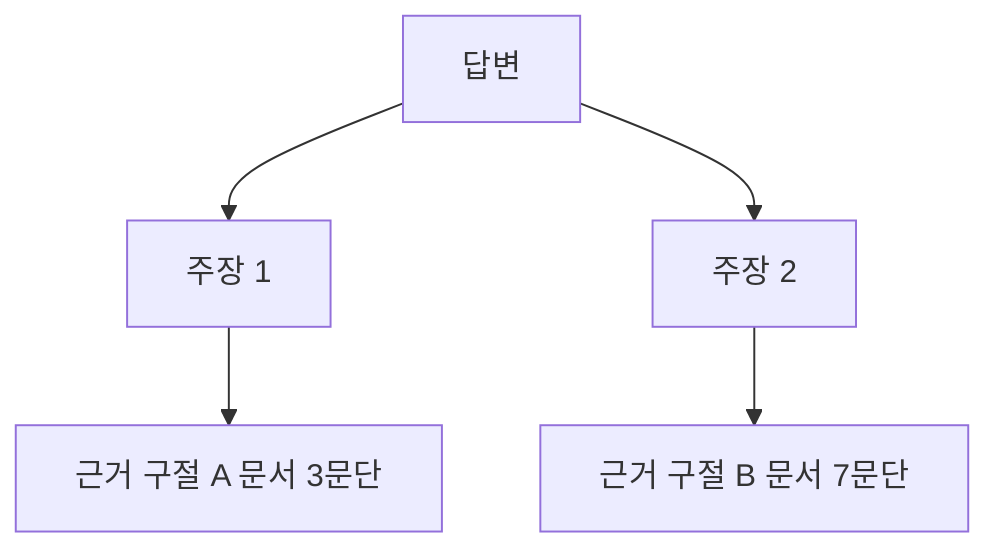
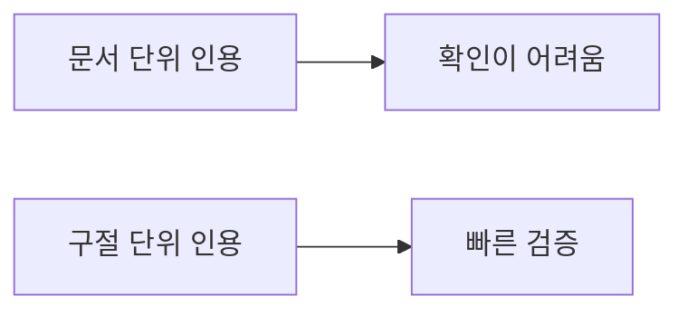

# 주장 단위 출처 연결

> 답변 속 문장이나 문서 번호 수준이 아니라, 하나하나의 "주장"에 그것을 뒷받침하는 구체적 근거 구절을 연결하는 방식. 사용자가 확인하기 쉽고 근거성 점수를 매기기도 좋다.

## 쉽게 말하면
논문 각주에 "참고문헌 3번"이라고만 쓰는 것과 "참고문헌 3번 45쪽 둘째 문단"까지 쓰는 것의 차이다. 뒤쪽이 검증하기 훨씬 빠르다.

## 자세히
- **문서 단위 인용의 한계**: 문서 ID만 인용하면 사용자가 특정 주장을 확인하기 어렵다. FRONT 논문(arXiv 2408.04568, 초록 열람)은 이 점과, 문맥 내 학습에 의존한 인용의 품질이 약하다는 점을 문제로 든다.
- **FRONT의 접근**: 답을 구체적인 근거 인용구(supporting quote)에 접지(ground)하도록 학습시키는 훈련 틀. 보고에 따르면 LLaMA-2-7B로 ALCE에서 모든 비교 기준선을 앞서 인용 품질이 데이터셋 평균 14.21% 개선, ChatGPT도 넘었다(저자 보고).
- **ALCE 벤치마크(Gao 등, arXiv 2305.14627, 초록 열람)**: LLM 인용을 자동 평가하는 첫 벤치마크로 소개된다. 유창성·정확성·인용 품질을 측정하고 자동 점수가 사람 판단과 강한 상관이 있다고 보고한다. 가장 좋은 모델도 ELI5에서 약 절반은 인용 근거가 완전하지 않았다.
- **인용 재현·정밀 개념(검색 요약, 본문 미확인)**: ALCE 계열 평가는 인용된 자료가 문장을 함의하는지(recall), 각 인용이 꼭 필요한지(precision)를 NLI 모델로 판정한다고 정리됐다. 초록은 두 용어를 명시하지 않았다.
- **문장 단위 vs 주장 단위 비교 연구**는 이번 검색에서 찾지 못했다. 아래 구분은 설계 관점의 해석이다. 한 문장에 주장이 둘 이상 섞이면 문장 단위 인용은 어느 주장을 지지하는지 흐리다.

## 그림으로 보기

## 예시
- "휴가는 연 15일이며 이월은 5일까지" → 주장 둘, 각각 인사규정 3.2항, 3.4항 구절에 연결.
- 교육 실습: AI 답변 한 단락의 주장마다 근거 구절을 원문에서 찾아 번호로 연결하는 표 만들기.

## 헷갈리는 것과 비교
| 개념 | 차이 |
|---|---|
| 주장 단위 연결 | 주장마다 근거 구절 |
| 문서 단위 인용 | 어느 문서인지만 |
| [근거성 지표](#groundedness-metric) | 연결된 근거로 지지 비율 계산 |
| [인용 UI 패턴](#citation-ui) | 연결을 사용자에게 보이는 방식 |

## 더 읽을거리
- [Learning Fine-Grained Grounded Citations (arXiv 2408.04568)](https://arxiv.org/abs/2408.04568) — FRONT(초록 열람)
- [ALCE (arXiv 2305.14627)](https://arxiv.org/abs/2305.14627) — 인용 평가 벤치마크(초록 열람)
