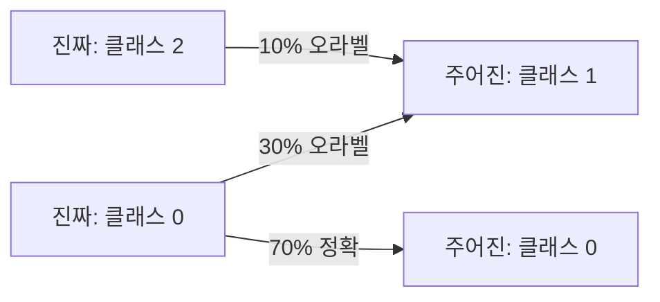
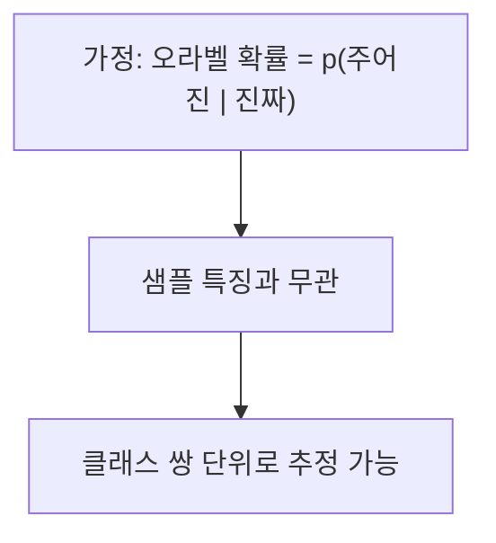

# 클래스 조건부 노이즈

> 라벨이 틀릴 확률이 **그 샘플의 진짜 클래스에만 의존한다**고 보는 가정이다(예: 진짜 "고양이"가 "호랑이"로 잘못 라벨될 확률은 있어도, 사진이 흐린지 같은 개별 사정은 보지 않는다). Confident learning의 기본 가정이다.

## 쉽게 말하면
우체국 분류원이 "등기 우편은 종종 일반 우편으로 잘못 분류한다"는 습관이 있다고 하자. 틀리는 정도는 우편의 종류(클래스)에 달려 있고, 봉투가 얼룩졌는지는 상관없다고 단순화하는 것이다.

## 자세히
- **정의**: 잘못된 라벨이 붙을 확률을 `p(주어진 라벨 | 진짜 라벨)`로 쓴다. 이 확률이 샘플 특징(x)과 무관하고 클래스 쌍에만 의존한다고 가정한다.
- **논문(Northcutt et al., Confident Learning, arXiv 1911.00068 초록 확인)**: 이 가정 아래 주어진(노이즈) 라벨과 알 수 없는 진짜 라벨의 결합분포를 추정하며, 일반화된 방법이 일관적(consistent)이라고 주장하고 라벨 오류가 정확히 발견되는 충분조건을 제시한다. ImageNet에서 "missile" 이미지 645장이 상위 클래스 "projectile"로 라벨된 것으로 추정했다.
- **cleanlab 문서**: py, 노이즈 행렬, 역 노이즈 행렬, confident joint, joint 다섯 양이 클래스 조건부 라벨 노이즈를 "완전히 특징짓는다"고 설명한다.
- **직접 실험(cleanlab 2.9.0, 3클래스 합성 2,000개)**: 진짜 0→1을 30%, 진짜 2→1을 10%로 뒤집어 실제 노이즈율 0.128. 5-폴드 교차예측 확률로 구한 confident joint(행=주어진 라벨, 열=진짜 라벨)에서 `[1][0]=101`(주어진 1·진짜 0), `[1][2]=63`이 두드러져 **0→1과 2→1 비대칭 패턴**이 드러났다. `find_label_issues`는 195개를 의심했고 정밀도 0.75, 재현율 0.57이었다. 한 번의 합성 실험이며 실제 데이터에서는 달라진다.
- **가정이 깨지는 경우**: 흐린 사진·모호한 문장처럼 **특정 샘플이 어려워서** 틀리는 노이즈(특징 의존 노이즈), 라벨러마다 다른 오류, 체계적 편향은 클래스 조건부만으로 설명되지 않는다. 이때 추정이 어긋날 수 있다(일반 지식).
- **의미**: 클래스 쌍마다 노이즈가 다르다는 점을 반영해 "클래스 불균형·혼동 쌍"을 따로 보게 해 준다.

## 그림으로 보기

## 예시
- 감정 분류에서 "중립"이 "긍정"으로 자주 잘못 라벨되는 패턴 → 클래스 쌍(중립→긍정)의 노이즈만 높게 추정.
- 교육: 라벨링 가이드를 "혼동 쌍" 중심으로 개선하는 근거.

## 헷갈리는 것과 비교
| 개념 | 차이 |
|---|---|
| 클래스 조건부 노이즈 | 오류가 진짜 클래스에만 의존 |
| 균일(대칭) 노이즈 | 모든 클래스로 같은 확률 |
| 특징 의존 노이즈 | 샘플별 난이도에 따라 오류 |
| [노이즈 전이 행렬](#noise-transition-matrix) | 이 가정 아래의 확률 표 |

## 더 읽을거리
- [Confident Learning (arXiv 1911.00068)](https://arxiv.org/abs/1911.00068) — 가정과 결합분포 추정(초록 확인).
- [cleanlab 튜토리얼](https://docs.cleanlab.ai/stable/tutorials/indepth_overview.html) — 다섯 통계량과 `find_label_issues`.
