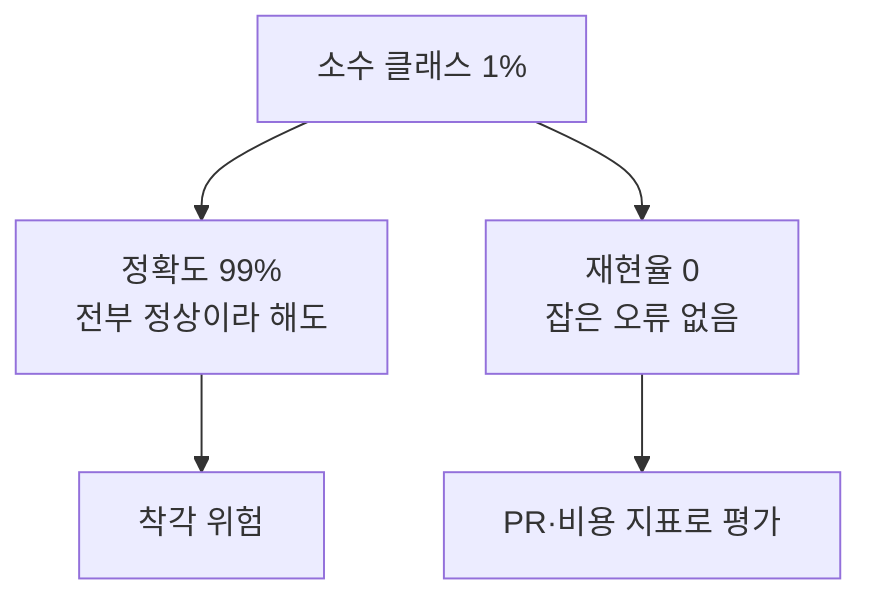
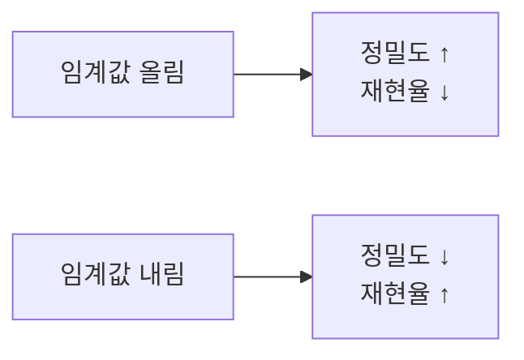

# 클래스 불균형과 임계값

> 오류 같은 소수 클래스가 전체의 1%처럼 드물면, 기본 임계값 0.5는 거의 모든 건을 "정상"으로 판정하고도 정확도 99%가 나와 쓸모없는 모델을 좋아 보이게 한다. 불균형 데이터에서는 정확도 대신 정밀도·재현율을 보고 임계값을 비용에 맞게 옮긴다.

## 쉽게 말하면
1,000통 중 스팸이 10통인 편지함에서 "전부 정상"이라고 답하는 직원은 정확도 99%지만 스팸을 한 통도 못 잡는다. 정확도가 높다는 사실만으로는 일을 하는지 알 수 없다.

## 자세히
- **정확도의 함정(Google ML 단기 과정, 열람)**: 이메일 1,000통 중 스팸 10통(1%)인데 항상 "스팸 아님"을 내는 모델은 TP=0, TN=990, FP=0, FN=10으로 정확도 99%지만 재현율은 0이고 정밀도는 정의되지 않는다(0/0). 정확도는 클래스가 균형일 때만 대략적인 지표라고 한다.
- **임계값의 영향(같은 과정)**: 임계값을 올리면 FP가 줄고 FN이 늘어 정밀도는 대체로 오르고 재현율은 내린다. 내리면 반대다. 과정의 예시 수치는 낮은 임계값에서 정밀도·재현율 0.80/0.80, 높은 임계값에서 1.00/0.50이다.
- **불균형이 학습에 미치는 영향(Google ML 단기 과정, 불균형 데이터셋 문서, 열람)**: 가벼운 불균형은 보통 괜찮지만 심하면 소수 클래스 예시가 너무 적어 제대로 학습하기 어렵다. 다수 200·소수 2(약 99%/1%)이고 배치 크기 20이면 대부분의 배치에 소수 예시가 없다. 해법으로 다수 클래스 다운샘플링(25배면 99/1이 약 80/20)과, 그로 인한 예측 편향을 바로잡는 다수 클래스 손실 업웨이팅(같은 25배)을 쓴다. 최적 배수는 실험으로 찾는다고 문서는 말한다.
- **재조정과 임계값의 관계(Elkan, IJCAI 2001, 본문 열람)**: 표준 학습기는 암묵적으로 임계값 0.5로 결정한다. 비용 때문에 목표 임계값 p*가 0.5와 다르다면 훈련 세트의 부정 예시 수에 p*(1−p0)/((1−p*)p0)를 곱해(p0는 학습기의 임계값) 같은 효과를 낼 수 있다고 정리한다(논문의 정리 1. PDF 수식 추출이 깨져 형태는 직접 유도해 확인). p0=0.5이면 곱하는 값은 p*/(1−p*)이다. 예를 들어 p*=0.1이면 부정 예시를 1/9로 줄이는 것과 같다.
- **간단한 대안(해석)**: 모델을 그대로 두고 점수 기준선만 옮기는 것이 더 쉽다([결정 임계값 튜닝](#decision-threshold-tuning)). 다운샘플링을 했다면 확률이 부풀어 있으므로 업웨이팅이나 보정으로 되돌려야 비용 계산에 쓸 수 있다.
- **지표 선택**: 정확도 대신 정밀도·재현율·PR 곡선, 또는 비용 기반 점수([사용자 정의 스코어러](#custom-scorer))를 쓴다.

## 그림으로 보기

## 예시
- 사기 탐지: 사기가 0.1% 미만인 데이터에서 임계값을 0.5가 아니라 비용 비율로 정한 낮은 값으로 옮기고, 재현율·정밀도를 함께 보고한다.
- 교육 활용: "항상 정상이라고 답하는 모델의 정확도"를 계산해 보며 정확도 함정을 체험하는 퀴즈.

## 헷갈리는 것과 비교
| 개념 | 차이 |
| --- | --- |
| [결정 임계값 튜닝](#decision-threshold-tuning) | 기준선을 찾는 절차. 이 글은 불균형일 때 0.5가 부적절한 이유 |
| 다운샘플링 | 학습 데이터를 조정. 확률이 부풀므로 보정 필요 |
| [오탐 vs 미탐 비용](#false-positive-vs-false-negative-cost) | 목표 임계값 p*를 정하는 비용 비율 |

## 더 읽을거리
- [Google ML 단기 과정: Accuracy, precision, and recall](https://developers.google.com/machine-learning/crash-course/classification/accuracy-precision-recall) — 정확도 함정과 임계값 효과
- [Google ML 단기 과정: Imbalanced datasets](https://developers.google.com/machine-learning/crash-course/overfitting/imbalanced-datasets) — 다운샘플링과 업웨이팅
- [Elkan: The Foundations of Cost-Sensitive Learning](https://cseweb.ucsd.edu/~elkan/rescale.pdf) — 재조정과 임계값의 관계
