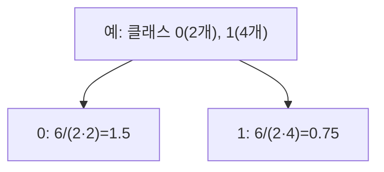

# class_weight=balanced

> scikit-learn에서 `class_weight='balanced'`는 클래스 빈도에 반비례하는 가중치를 자동으로 줘서, 데이터를 복제하지 않고 소수 클래스의 오류를 더 크게 벌한다.

## 쉽게 말하면
소수 클래스 문제는 점수를 더 높게 쳐 주는 가산점을 주는 것이다. 문제 수는 그대로인데 희귀한 유형을 틀리면 더 크게 감점한다.

## 자세히
(scikit-learn 문서 `compute_class_weight`를 하위 에이전트가 읽은 노트 기준.)
- **공식**: 클래스 가중치 = `n_samples / (n_classes * np.bincount(y))`. 예: y=[1,1,1,1,0,0] → 클래스 0은 1.5, 클래스 1은 0.75.
- **적용**: LogisticRegression, RandomForestClassifier 등은 이 가중치를 `fit`에 넘긴 `sample_weight`와 곱한다. RandomForest에는 `'balanced_subsample'`(각 트리의 부트스트랩 표본에서 가중치를 계산)도 있다. 지원하는 모든 추정기 목록은 이번에 확인하지 않았다.
- **효과(제안)**: 소수 클래스 재현율이 오르고 정밀도가 떨어지는 경향이 일반적이다([재현율-정밀도 거래](#recall-precision-tradeoff-resampling)). 확률 보정이 깨질 수 있으므로 임계값·보정을 다시 점검한다.
- **장점**: 데이터 복제가 없어 누수 위험이 낮고 빠르다. 한계: 가중치를 지원하지 않는 모델에는 쓸 수 없다.

## 그림으로 보기



## 예시
```python
from sklearn.linear_model import LogisticRegression
clf = LogisticRegression(class_weight="balanced").fit(X_train, y_train)
```
- 교육 활용: 불균형 데이터에서 accuracy가 속이는 사례와 함께 가중치 효과 비교.

## 헷갈리는 것과 비교
| 개념 | 차이 |
|---|---|
| class_weight | 손실 가중, 데이터 불변 |
| 오버샘플링 | 소수 클래스 표본을 복제·합성 |
| [분할 후 리샘플링](#resample-after-split) | 복제 시 누수 주의 |

## 더 읽을거리
- [compute_class_weight 문서](https://scikit-learn.org/stable/modules/generated/sklearn.utils.class_weight.compute_class_weight.html) — 공식과 예.
