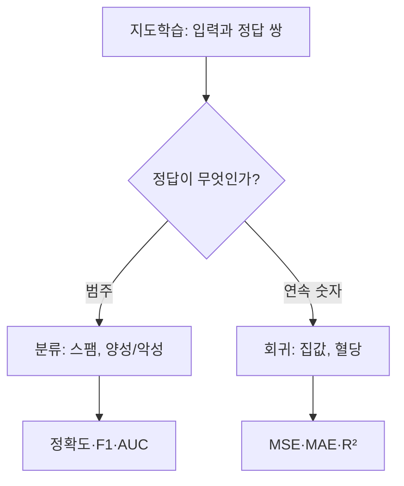
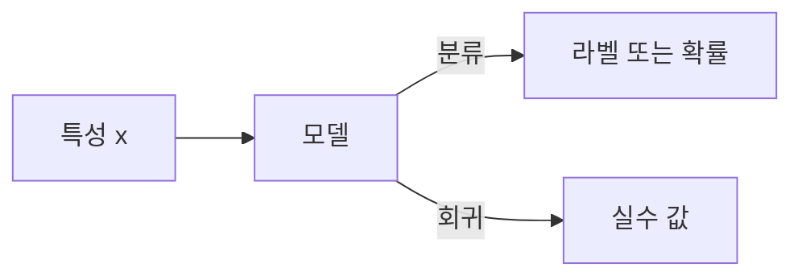

# 분류와 회귀

> 분류(Classification)는 입력을 정해진 범주 중 하나로 나누는 문제이고, 회귀(Regression)는 연속적인 숫자 값을 예측하는 문제다. 지도학습의 두 대표 유형이며, 출력이 범주냐 숫자냐로 구분한다.

## 쉽게 말하면
병원에서 "이 사진의 종양은 양성인가 악성인가"를 고르는 것은 분류, "이 환자의 내년 혈당 수치는 얼마인가"를 맞히는 것은 회귀다. 객관식 시험과 주관식(숫자 쓰기) 시험의 차이와 비슷하다.

## 자세히
- **분류**: 출력이 유한한 클래스. 스팸/정상(이진), 붓꽃 품종(다중 클래스). 모델은 클래스 라벨이나 클래스별 확률을 낸다. 대표 알고리즘: 로지스틱 회귀, SVM, k-NN, 의사결정나무, 랜덤 포레스트, 그래디언트 부스팅.
- **회귀**: 출력이 실수. 집값, 연비(mpg). Google ML 단기 강좌는 선형 회귀를 `y' = b + w₁x₁`(편향 + 가중치×특성)으로 쓰고, 학습이 편향과 가중치를 계산해 최적 모델을 만든다고 설명한다. 같은 계열 알고리즘이 회귀 버전으로도 있다(Ridge, Lasso, SVR 등).
- **평가 지표**(일반적으로 쓰는 것): 분류 — 정확도, 정밀도, 재현율, F1, ROC AUC. 회귀 — MSE, MAE, R².
- 출력 종류가 정해지면 쓸 수 있는 모델과 지표가 정해진다. 불균형 데이터에서 정확도만 보면 속기 쉽다(99%가 정상이면 전부 "정상"이라 해도 99%).
- 참고: LLM의 다음 토큰 예측은 어휘 전체에 대한 분류 문제로 볼 수 있다.

## 그림으로 보기



## 예시
```python
from sklearn.linear_model import LogisticRegression, LinearRegression
clf = LogisticRegression().fit(X_train, y_label)   # 분류
reg = LinearRegression().fit(X_train, y_number)    # 회귀
```
- 업무: 고객 이탈 여부 예측(분류), 다음 달 매출 예측(회귀).

## 헷갈리는 것과 비교
| 개념 | 차이 |
| --- | --- |
| 로지스틱 회귀 | 이름은 회귀지만 분류 모델 |
| [자기지도학습](#self-supervised) | 정답 라벨 없이 데이터 일부를 가려 맞힘 |
| [지도·비지도 학습](#supervised-unsupervised) | 상위 주제. 분류·회귀는 지도학습의 하위 유형 |

## 더 읽을거리
- [Google ML Crash Course: Linear regression](https://developers.google.com/machine-learning/crash-course/linear-regression) — 회귀의 정의와 모델식
- [scikit-learn: Supervised learning](https://scikit-learn.org/stable/supervised_learning.html) — 분류·회귀 알고리즘 목록 (분류 지표 설명은 일반 지식으로 보충)
