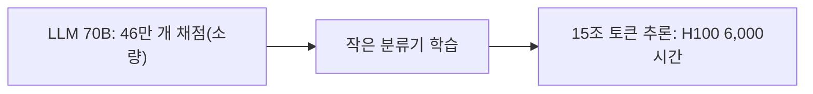
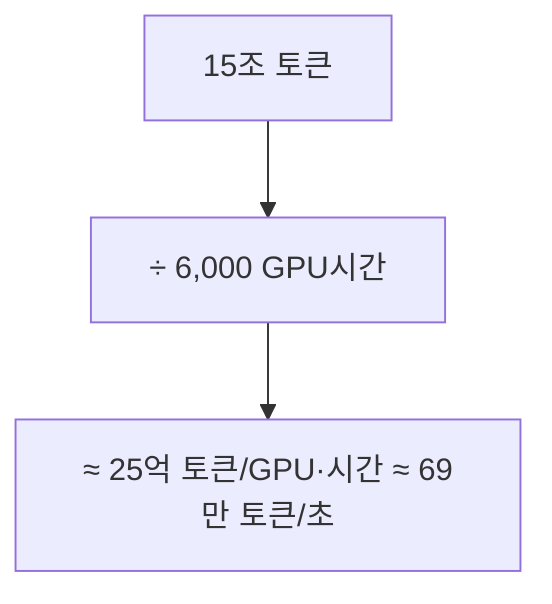

# 대규모 분류기 추론 비용

> 웹 데이터를 분류기로 거를 때 드는 비용은 **학습이 아니라 수조 토큰에 모델을 돌리는 추론**이 지배한다. FineWeb-Edu 분류기는 15조 토큰 전체에 H100 GPU 6,000시간이 들었다.

## 쉽게 말하면
시험 채점 기준표를 만드는 건 하루면 되지만, 수천만 장의 답안지를 전부 채점하려면 채점자를 오래 써야 한다. 한 장당 비용이 작아도 곱하기가 크다.

## 자세히
(FineWeb 논문, arXiv 2406.17557 PDF 본문을 직접 읽고 계산)
- 보고된 값: 교육 분류기를 **FineWeb 15조 토큰**에 적용하는 데 **H100 GPU 6,000시간**.
- 직접 계산: 15조 ÷ 6,000시간 = **시간당 약 25억 토큰**, 초당 약 **69만 토큰**/GPU(이 값은 보고된 두 숫자로 나눈 평균 처리량이며 문서 길이·배치·최적화에 따라 달라진다).
- 비교: 같은 논문에서 전체 FineWeb 소거 실험 전체에 쓴 연산은 H100 **80,000 GPU 시간**으로 서술된다. 분류기 적용 비용은 그 약 7.5% 수준이다(단순 비율).
- 비용을 줄이는 설계: ① 분류기를 **작게**(동결 임베딩+선형 헤드, [동결 임베딩 회귀](#frozen-embedding-regression)) ② 문서의 **앞부분만** 입력(토큰 수 제한) ③ 대규모 규칙 필터·중복 제거를 **먼저** 해서 입력량 축소 ④ 배치·양자화 등 추론 최적화. LLM(70B)로 전체를 직접 채점했다면 훨씬 비쌌을 것이므로 LLM은 46만 개 표본만 채점해 분류기를 학습시켰다([가산식 프롬프트](#additive-scoring-prompt)).
- 실무 감각(제안): 추론 비용 ≈ (토큰 수 ÷ 처리량) × GPU 단가. 자기 데이터 규모와 모델 처리량을 소규모로 재서 외삽한다. 외삽은 [외삽 낙관 편향](#extrapolation-optimism)처럼 틀릴 수 있어 여유를 둔다.
- 한계: GPU 시간의 금액 환산은 임대 단가에 따라 달라 이 글에서는 계산하지 않았다.

## 그림으로 보기

## 예시
- 내 코퍼스 2,000억 토큰을 같은 처리량으로 돌린다면 약 80 GPU시간(2,000억 ÷ 25억; 처리량이 같다는 가정).
- 교육: "학습 비용" 외에 "적용 비용"을 따로 추정해야 하는 이유.

## 헷갈리는 것과 비교
| 개념 | 차이 |
|---|---|
| 학습 비용 | 분류기를 만드는 일회성 비용 |
| 추론 비용 | 모든 문서에 적용하는 반복 비용(이 노드) |
| 합성 주석 비용 | LLM으로 표본을 채점하는 비용 |

## 더 읽을거리
- [The FineWeb Datasets (arXiv 2406.17557)](https://arxiv.org/abs/2406.17557) — 15조 토큰·6,000 H100시간·80,000 H100시간 서술(PDF 본문 읽음).
