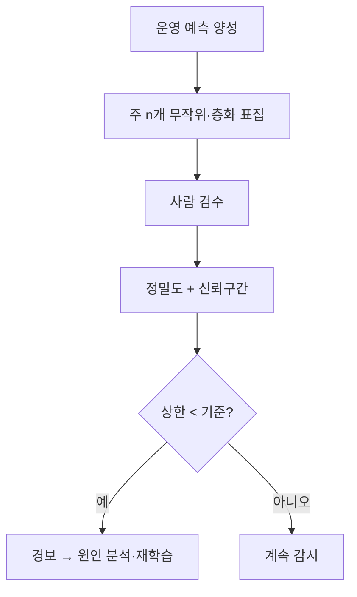

# 운영 분류기 감시 표본 추출

> 서비스 중인 분류기의 정밀도·재현율이 떨어지지 않는지 **주기적으로 일부를 표본 추출해 사람이 라벨링**하고 추적하는 방법이다. 표본이 작으면 하락을 놓치거나 헛경보가 나므로 표본 크기를 설계해야 한다.

## 쉽게 말하면
공장의 불량 검사기를 매일 전수 점검할 수는 없으니, 검사기가 "불량"이라고 한 제품 중 일부를 꺼내 사람이 다시 확인해 맞힌 비율(정밀도)을 기록한다. 확인 개수가 너무 적으면 비율이 운에 흔들린다.

## 자세히
(직접 시뮬레이션: 기준 정밀도 0.30, 주당 n개의 "예측 양성"을 사람이 검수, 실제 정밀도가 떨어지는 상황, 3,000회 반복, 경보 규칙 = 95% Wilson 신뢰구간 **상한이 기준 0.30 미만**일 때)
- **한 주 표본으로 하락을 탐지할 확률**
  | 실제 정밀도 | n=50 | n=100 | n=200 | n=400 | n=800 |
  |---|---|---|---|---|---|
  | 0.25(−0.05) | 0.10 | 0.21 | 0.36 | 0.61 | 0.88 |
  | 0.20(−0.10) | 0.31 | 0.64 | 0.91 | 1.00 | 1.00 |
  | 0.15(−0.15) | 0.67 | 0.96 | 1.00 | 1.00 | 1.00 |
  하락 폭이 작을수록(−0.05) 많은 표본이 필요하다. −0.10 하락은 주 200개로 91%, −0.05는 800개여야 88%.
- **헛경보율(정밀도 변화 없음, 0.30)**: n=50 2.0%, 100 2.2%, 200 2.6%, 400 2.5%, 800 1.8%. 신뢰구간 상한 규칙은 주당 약 2%의 헛경보를 낸다.
- **여러 주 합치기**: −0.10 하락(0.20)을 주 50개씩 4주 합쳐 200개로 보면 탐지 확률이 0.90이다. 표본이 작으면 빠른 판단 대신 **누적**으로 보완.
- **표본 설계(제안)**
  1. **무엇을 표본할지**: 정밀도는 "예측 양성"에서 표집하면 효율적이다. 재현율은 **예측 음성**에서 누락 양성을 찾아야 하므로 별도 표본(과표집 필요)([평가용 과표집](#oversampling-for-evaluation)).
  2. **무작위 + 층화**: 점수 구간·유형·채널별로 표집해 어디서 떨어지는지 추적.
  3. **주기와 크기**: 탐지하고 싶은 최소 하락 폭과 허용 지연으로 역산(위 표).
  4. **라벨링 품질**: 감시용 라벨도 [이중 라벨링·판정](#sampled-double-annotation)과 일치도 점검 대상.
  5. **기준선 고정**: 출시 시점의 정밀도를 신뢰구간과 함께 기록([시험 세트 비율 불일치](#test-prior-mismatch)에 주의).
  6. 하락 경보 시 원인 분류: 입력 분포 변화([데이터 드리프트](#data-drift)), 개념 변화, 라벨 기준 변화([라벨러 기준 드리프트](#labeler-drift)).
- 이 수치는 이항 분포 가정(표본이 독립)이며 실제 서비스에서는 시간에 따른 상관·계절성이 더해진다.

## 그림으로 보기

## 예시
- 스팸 신고 분류기: 매주 예측 양성 200건을 검수해 정밀도 추이를 대시보드에 표시, 4주 이동 합산도 같이 본다.
- 교육: 품질 관리의 표본 검사 설계(검출력·헛경보)를 AI 운영에 적용.

## 헷갈리는 것과 비교
| 개념 | 차이 |
|---|---|
| 운영 감시 표본 | 서비스 중 라벨 표본으로 성능 추적 |
| 사전 시험 세트 평가 | 출시 전 1회 |
| [라벨링 보정 표본](#calibration-frequency) | 라벨러 품질 감시 |
| 입력 분포 감시 | 라벨 없이 분포 변화만 봄(보조) |

## 더 읽을거리
- [Saito & Rehmsmeier 2015, PLOS ONE](https://journals.plos.org/plosone/article?id=10.1371/journal.pone.0118432) — 정밀도가 양성 비율에 의존하는 불균형 평가.
- [scikit-learn 모델 평가 가이드](https://scikit-learn.org/stable/modules/model_evaluation.html) — 정밀도·재현율 정의.
