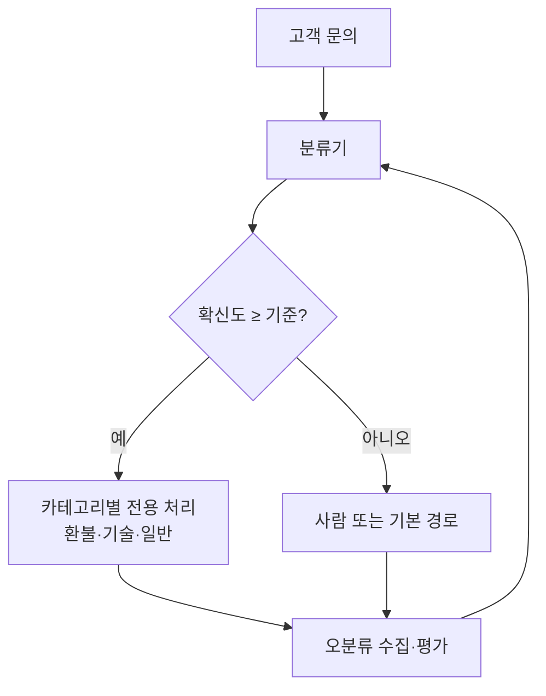

# 분류기 설계

> 라우팅 워크플로의 핵심 부품: 들어온 요청을 **어느 처리 경로로 보낼지 분류하는 판정기**. 카테고리를 겹치지 않게 정의하고, **"기타" 경로와 확신도 기준**을 두며, **레이블이 붙은 예시로 정확도를 재서** 고친다.

## 쉽게 말하면
병원 접수 창구에서 "내과·외과·상담"으로 환자를 나누는 직원과 같다. 증상이 애매하면 마음대로 보내지 않고 "다시 확인할게요"로 사람에게 넘겨야 오배정이 줄어든다.

## 자세히
(Anthropic "Building effective agents"의 라우팅 정의 + 직접 실행)
- **라우팅**: 입력을 분류해 전문화된 후속 프롬프트·모델로 보내는 패턴. 환불·기술·일반 문의를 다른 프로세스로 보내거나, 쉬운 질문은 작은 모델, 어려운 질문은 큰 모델로 보내는 예가 있다. 분류기는 LLM일 수도, 전통적 분류 모델일 수도 있다.
- **직접 실행**(scikit-learn 1.9.1, 한국어 짧은 문의 18개로 학습, 문자 n-gram TF-IDF + 로지스틱 회귀, 3개 카테고리 환불/기술/일반, 새 문의 10개로 시험): 정확도 **0.90**(9/10). 틀린 건 카테고리에 없는 "오늘 날씨 어때요"(정답 일반, 예측 기술, 확신 0.46).
- **확신도 임계값으로 사람에게 넘기기**:

| 임계값 | 자동 처리 건수 | 자동 처리분 정확도 |
|---|---|---|
| 0.0(전부 자동) | 10/10 | 0.90 |
| 0.5 | 6/10 | **1.00** |
| 0.6 | 5/10 | 1.00 |

  낮은 확신(0.44~0.46)의 건은 사람·기본 경로로 보내면 자동 처리분의 정확도가 올라간다. 대신 자동화 비율이 줄어드는 **교환 관계**가 있다. 표본이 10건이라 수치는 구조 이해용이다.
- **설계 체크리스트**:
  1. **카테고리는 상호 배타적·포괄적**으로, 정의와 경계 사례를 문서화("환불했는데 앱도 먹통" 같은 복합 문의 처리 규칙).
  2. **"기타/모르겠음" 경로**를 둔다(범위 밖 질문을 억지로 분류하지 않기).
  3. **확신도 기준**으로 사람 검토나 상위 모델로 승격.
  4. **레이블 데이터로 평가**(혼동 행렬, 카테고리별 재현율·정밀도). 잘못 보냈을 때 비용이 큰 카테고리(예: 환불→일반)를 따로 본다.
  5. LLM 분류기라면 카테고리 설명·예시를 프롬프트에 넣고, 출력은 **고정된 라벨(JSON)** 로 제한([JSON](#json-format)).
  6. 운영에서 **오분류 샘플을 수집**해 예시·규칙을 갱신.
- 한계: 작은 데이터·합성 문장 기준의 시연이다. 실제 서비스는 더 많은 데이터와 지속적인 모니터링이 필요하다.

## 그림으로 보기


## 예시
```python
proba = clf.predict_proba(vec.transform([text]))[0]
label, conf = clf.classes_[proba.argmax()], proba.max()
route = label if conf >= 0.5 else "human_review"
```
- LLM 분류 프롬프트: "다음 문의를 [환불, 기술, 일반, 기타] 중 하나로 분류하고 JSON `{label, confidence}`만 출력해. 확신이 낮으면 기타로."

## 헷갈리는 것과 비교
| 개념 | 차이 |
|---|---|
| 분류기(라우터 부품) | 경로를 정하는 판정 |
| [프롬프트 체이닝](#prompt-chaining) | 고정 순서 처리 |
| [체이닝 실습](#prompt-chain-example) | 단계 사이 게이트 설계 |
| [라우팅 패턴](#routing-pattern) | 분류 후 분기하는 전체 구조 |

## 더 읽을거리
- [Anthropic: Building effective agents](https://www.anthropic.com/engineering/building-effective-agents) — 라우팅 워크플로의 정의와 예.
- [scikit-learn: LogisticRegression](https://scikit-learn.org/stable/modules/generated/sklearn.linear_model.LogisticRegression.html) — predict_proba 사용.
