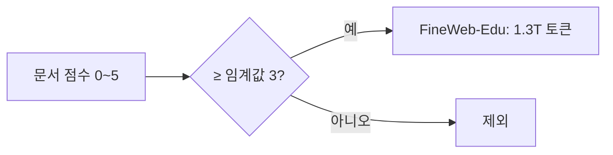
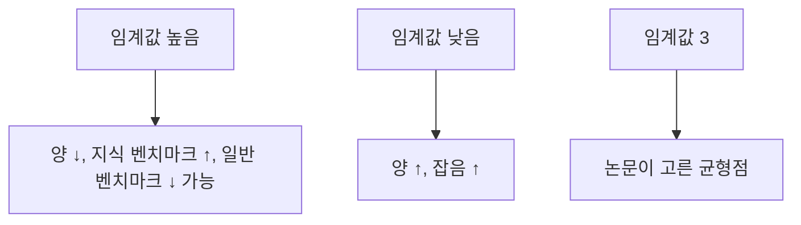

# 분류기 임계값 균형

> 품질 분류기로 데이터를 거를 때 **"몇 점 이상만 남길까"**는 데이터 양과 특화 성능 사이의 균형 문제다. FineWeb-Edu는 교육 점수 **3 이상**을 골랐고, 지식·추론 벤치마크와 다른 벤치마크의 균형이 가장 좋다고 보고했다.

## 쉽게 말하면
입학 컷 점수를 정하는 일이다. 컷을 높이면 우수한 학생만 남지만 학생 수가 줄고 한쪽 과목에만 강한 반이 된다. 낮추면 인원은 많지만 평균 수준이 내려간다.

## 자세히
(FineWeb 논문, arXiv 2406.17557 PDF 본문과 부록 F.2를 직접 읽음)
- 분류기는 문서에 0~5점(정수로 반올림)을 주고, **고정 임계값**을 넘는 문서만 교육용으로 분류한다. 임계값을 여러 개 시험해 최종적으로 **최소 3점**을 선택했다.
- 선택 근거(논문): 3점이 **지식·추론 집약 벤치마크(MMLU, ARC 등)의 성능과 HellaSwag 같은 다른 벤치마크 성능 사이에서 가장 좋은 균형**을 보였다. 1.71B 모델을 280억 토큰으로 학습한 임계값 비교(Fig. 17)에서 평균 성능이 가장 좋았다.
- 임계값 3에서 분류기의 검증 F1은 **82%**(Llama 3 주석을 정답으로 본 값). 결과 데이터 FineWeb-Edu는 **1.3조 토큰**이다.
- 큰 규모 확인: 1.71B 모델을 3,500억 토큰으로 학습하면 FineWeb 대비 MMLU가 33%→37%(상대 약 12%), ARC가 46%→57%(상대 약 24%)로 올랐다. 학습 초기에는 Matrix 데이터셋 최종 성능을 약 10배 적은 토큰으로 따라잡았다.
- 해석 주의: 교육 점수로 거르면 특정 지식 벤치마크에는 이득이지만 다른 능력(예: 상식 완성형 HellaSwag)에는 덜 유리할 수 있다. 그래서 임계값을 데이터 양과 목표 능력에 맞춰 정해야 한다(제안: 후보 임계값마다 작은 모델로 비교).
- 트레이드오프 요약: 임계값↑ → 데이터 양↓, 교육·지식 편향↑, 다양성↓ 가능성. 임계값↓ → 데이터 양↑, 잡음↑.

## 그림으로 보기

## 예시
- 사내 분류기로 문서 품질을 0~5로 채점한 뒤, 임계값 2·3·4로 소형 모델을 학습해 비교하고 목적 지표에 맞는 값을 선택.
- 교육: 컷 점수 설정을 정밀도·재현율 논의와 연결.

## 헷갈리는 것과 비교
| 개념 | 차이 |
|---|---|
| 임계값 3 | 이 연구에서 균형이 좋았던 값(데이터·목표별로 다름) |
| F1 82% | 분류기가 LLM 주석을 따라한 정도 |
| [교육적 품질 분류기](#educational-quality-classifier) | 임계값을 적용하는 모델 |

## 더 읽을거리
- [The FineWeb Datasets (arXiv 2406.17557)](https://arxiv.org/abs/2406.17557) — 임계값 선택과 결과(PDF 본문 읽음).
