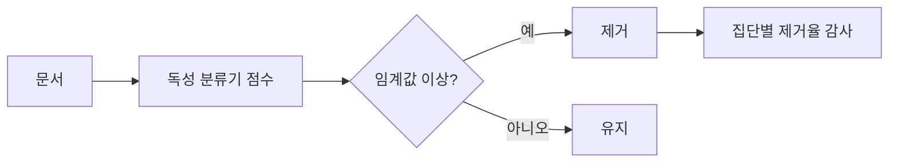
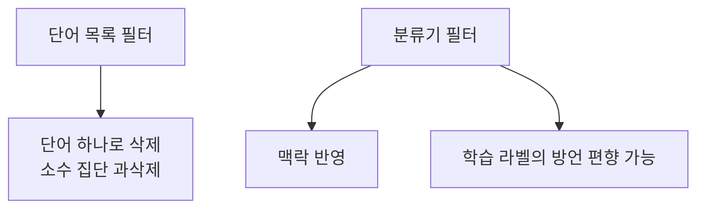

# 분류기 기반 독성 필터

> 금지어 목록 대신 **글 전체의 맥락을 보고 독성(공격·혐오) 점수를 매기는 분류기**로 학습 데이터를 거르는 방식. 목록 필터의 오탐은 줄 수 있지만, 분류기도 소수 방언·집단에 대한 편향을 그대로 가질 수 있다.

## 쉽게 말하면
"나쁜 단어가 한 번이라도 나오면 퇴장"(목록)에서 "대화 전체를 듣고 판단하는 심판"(분류기)으로 바뀐 것이다. 심판이 맥락을 보니 더 정확해 보이지만, 심판이 어떤 말투를 더 의심하도록 배웠다면 같은 불공정이 다른 모양으로 남는다.

## 자세히
- **목록 필터의 문제**: 금지어가 하나라도 있으면 문서를 지우는 방식은 소수 방언·성소수자 관련 글을 많이 지운다([방언별 필터링 편향](#dialect-filtering-bias)). Gopher 논문은 이 때문에 단어 목록 대신 Google SafeSearch를 썼다고 밝힌다(arXiv 2112.11446, 직접 읽음).
- **분류기의 편향 증거 1(Sap 외 2019, ACL, 초록 직접 읽음)**: 여러 혐오 표현 데이터셋에서 아프리카계 미국 영어(AAE) 표지가 독성 평점과 예상 밖으로 상관되고, 이런 데이터로 학습한 모델이 그 편향을 흡수·증폭한다. AAE 트윗과 스스로 아프리카계 미국인이라 밝힌 이용자의 트윗이 다른 트윗보다 **최대 2배 공격적으로 분류**될 수 있다. 트윗의 방언을 주석자에게 알려 주면(방언·인종 프라이밍) 공격적이라고 표시하는 비율이 유의하게 줄었다.
- **분류기의 편향 증거 2(Welbl 외, "Challenges in Detoxifying Language Models", EMNLP Findings 2021, 초록 직접 읽음)**: 독성 완화 기법이 RealToxicityPrompts의 자동 독성 점수는 개선하지만, 소수 집단에 관한 글과 그 방언에 대한 **커버리지(모델이 그런 글을 다루는 능력)를 줄인다**. 독성을 많이 줄인 뒤에는 자동 점수가 높아도 사람 평가자가 동의하지 않는 경우가 잦았다.
- **정리**: 분류기는 목록보다 정교하지만 ① 라벨(사람 주석)의 편향이 들어가고 ② 방언·집단별 오탐률이 다를 수 있으며 ③ 자동 점수만으로 안전을 보증하기 어렵다. 점수 임계값에 따라 소수 집단 글의 제거율이 달라진다(제안).
- **점검법(제안)**: 필터 전후로 방언·주제·집단별 제거율을 비교([필터 전후 집단 비율 감사](#pre-post-filter-audit)), 제거된 표본 눈검사([제외 데이터 보고](#excluded-data-report)), 임계값 후보별 비교, 사람 평가와의 일치 확인.

## 그림으로 보기

## 예시
| 연구 | 발견 |
|---|---|
| Sap 외 2019 | AAE 트윗이 최대 2배 공격적으로 분류될 수 있음 |
| Welbl 외 2021 | 독성 완화가 소수 집단 글 커버리지를 줄임 |
- 업무 장면: 사내 상담 로그에서 비속어 분류기로 거를 때, 사투리·청소년 말투가 더 많이 걸리는지 필터 전후 비율을 비교한다.

## 헷갈리는 것과 비교
| 개념 | 차이 |
|---|---|
| 분류기 독성 필터 | 맥락 기반 점수로 판정 |
| [금지어 목록 필터](#bad-words-list-filter) | 단어 존재만으로 판정 |
| [문맥 인식 유해성 분류기](#context-aware-toxicity-filter) | 같은 방향의 더 구체적 설계 노드 |
| [제외 문서 감사](#excluded-document-audit) | 걸러진 표본을 직접 검토 |

## 더 읽을거리
- [The Risk of Racial Bias in Hate Speech Detection (ACL 2019)](https://aclanthology.org/P19-1163/) — AAE 편향(초록 직접 읽음).
- [Challenges in Detoxifying Language Models (arXiv 2109.07445)](https://arxiv.org/abs/2109.07445) — 독성 완화의 부작용(초록 직접 읽음).
- [Gopher 논문 (arXiv 2112.11446)](https://arxiv.org/abs/2112.11446) — SafeSearch 선택 이유(PDF 직접 읽음).
