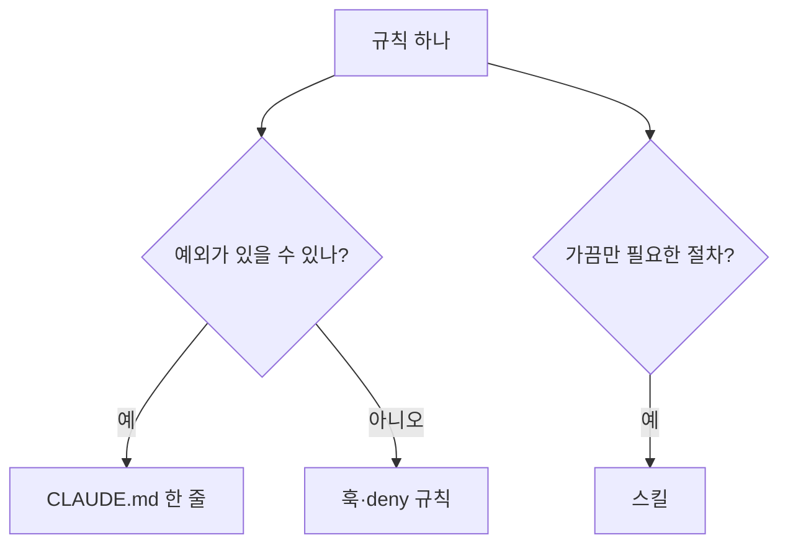
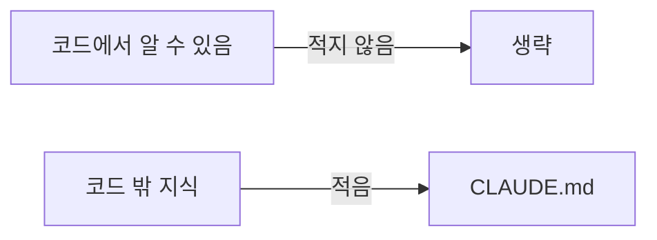

# CLAUDE.md 쓰는 법

> Claude Code가 매 세션 시작 때 읽는 프로젝트 지침 파일. "코드를 읽어서는 알 수 없는 것"만 짧게 적는 것이 핵심이다.

## 쉽게 말하면
새 직원에게 주는 한 장짜리 인수인계 메모다. 건물 구조도는 직원이 직접 둘러보면 알지만, "결재는 이 순서로", "이 서랍은 건드리지 마"는 말해 줘야 안다. 메모가 열 장이 되면 정작 중요한 한 줄이 묻힌다.

## 자세히
Claude Code 모범 사례(2026-11 확인) 기준:
- **짧게 유지**: CLAUDE.md는 모든 세션·모든 작업에 로드되므로 한 줄마다 Claude의 주의를 조금씩 쓴다. 코드에서 알아낼 수 있는 건 적지 않는다(아키텍처·파일 구조 설명 등은 Claude가 저장소를 읽으면 안다).
- **적을 것**: ① 작업 검증 방법(테스트·타입체크·린트 명령, 파일 하나만 돌리는 법) ② 코드가 오해를 부르는 곳(새 코드가 따라 하면 안 되는 옛 패턴) ③ 저장소에 없는 결정(배포 방식, 팀이 정한 에러 헬퍼, 마이그레이션 리뷰 대상) ④ 두 번 이상 고쳐 준 것.
- **개인 취향**은 `CLAUDE.local.md`에 두고 `.gitignore`에 넣는다.
- **권고 vs 강제**: CLAUDE.md는 모델이 읽고 대체로 따르는 지침이다. "절대 `.env`를 읽지 마"처럼 예외 없는 규칙은 훅이나 deny 규칙으로 옮긴다([훅과 가드레일](#hooks-guardrails)). 강조어(IMPORTANT)를 덧붙여도 안 지켜지면 파일이 너무 길거나 훅에 맞는 규칙이라는 신호다.
- **스킬과 분담**: 가끔만 필요한 절차는 스킬로 빼면 이름·설명만 상시 로드되고 본문은 필요할 때만 읽혀 컨텍스트가 덜 든다.
- `/doctor`가 코드에서 이미 알 수 있는 내용을 줄이라고 제안한다.
- 파일명 관례: Claude Code는 `CLAUDE.md`, 여러 도구가 공통으로 보는 관례는 [AGENTS.md](#agents-md).

## 그림으로 보기



## 예시
```markdown
# 프로젝트 메모
- 검증: `npm test`, 한 파일만: `npm test -- path/to/file`, 타입체크: `npm run typecheck`
- `legacy/api.ts` 패턴은 새 코드에서 쓰지 말 것 (fetch 래퍼는 `lib/http.ts`)
- 배포는 main 머지 시 자동. DB 변경은 마이그레이션 리뷰 필수
```

## 헷갈리는 것과 비교
| 개념 | 차이 |
| --- | --- |
| CLAUDE.md | 상시 로드되는 짧은 지침 |
| 스킬 | 필요할 때만 본문이 로드되는 절차 |
| 훅 | 예외 없이 강제 실행 |
| [AGENTS.md와 기록 시스템](#agents-md) | 도구 중립적 지침 관례와 docs 구조 |

## 더 읽을거리
- [Claude Code: Best practices](https://code.claude.com/docs/en/best-practices) — CLAUDE.md를 짧게, 강제 규칙은 훅으로
