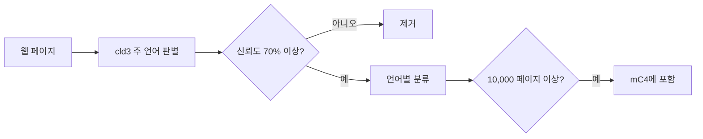
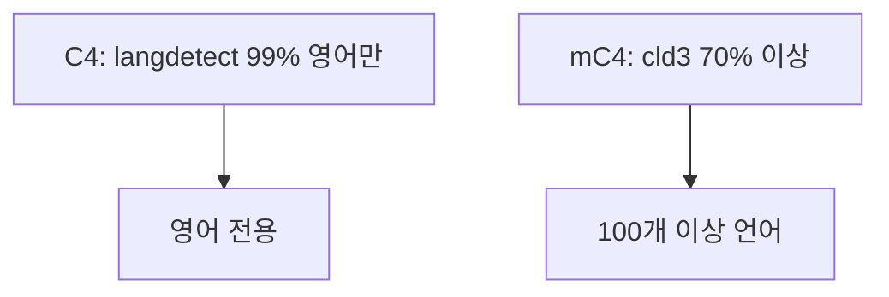

# cld3 언어 판별

> Google의 신경망 기반 언어 식별기(cld3)다. mC4(다국어 C4)는 이 판별기로 페이지의 주 언어를 정하고 신뢰도가 70% 미만이면 버렸다.

## 쉽게 말하면
글을 한 줄 읽고 "이건 한국어일 확률 92%"처럼 국적을 맞히는 판별기다. 확률이 애매하면(예: 70% 미만) 어느 나라 글인지 불확실하다고 보고 제외한다.

## 자세히
(Xue 외, mT5 논문 arXiv 2010.11934 본문과 GitHub 링크를 직접 읽고 확인. 초록에는 cld3 언급이 없고 PDF 본문 3.1절에 있다.)
- **C4 vs mC4**: 영어 전용 C4는 langdetect가 영어일 확률 **99% 이상**을 준 페이지만 남겼다. mC4는 **cld3**로 100개 이상 언어를 식별한다.
- **신뢰도 임계값**: 각 페이지의 주 언어 판별 신뢰도가 **70% 미만이면 제거**. 이후 언어별로 묶어 **페이지 10,000개 이상**인 언어만 코퍼스에 포함 → cld3 기준 107개 "언어"(그중 6개는 같은 언어의 문자 변형, 예: ru와 ru-Latn). 논문 제목은 101개 언어.
- **원료**: 드문 언어를 확보하려고 Common Crawl의 **월간 스크랩 71개 전부**를 썼다(C4는 2019년 4월 스크랩 하나).
- **주의(제안)**: 판별기 임계값을 높이면 정확도는 오르나 코드 스위칭(한국어+영어 혼용)·짧은 글·저자원 언어가 더 잘려 나간다.

## 그림으로 보기

## 예시
- 한국어 크롤에서 영어·한국어 혼합 글이 낮은 신뢰도로 걸러지는지 샘플 확인.
- 교육 활용: "언어 판별도 확률이고 임계값 선택이 누구를 지우는가"를 논의.

## 헷갈리는 것과 비교
| 개념 | 차이 |
|---|---|
| cld3 | Google 신경망 언어 판별 |
| [fastText 언어 식별](#fasttext-language-id) | CCNet이 쓴 176개 언어 분류기, 임계값 0.5 |
| langdetect | C4가 쓴 영어 판별(99% 기준) |

## 더 읽을거리
- [mT5 (arXiv 2010.11934)](https://arxiv.org/abs/2010.11934) — 3.1절 mC4 구성 방식(PDF 본문).
- [google/cld3 (GitHub)](https://github.com/google/cld3) — 논문이 링크한 저장소.
