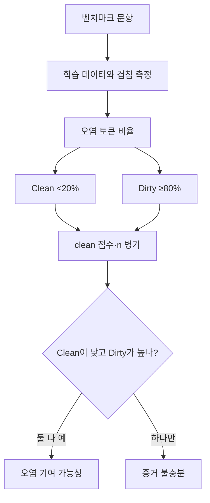
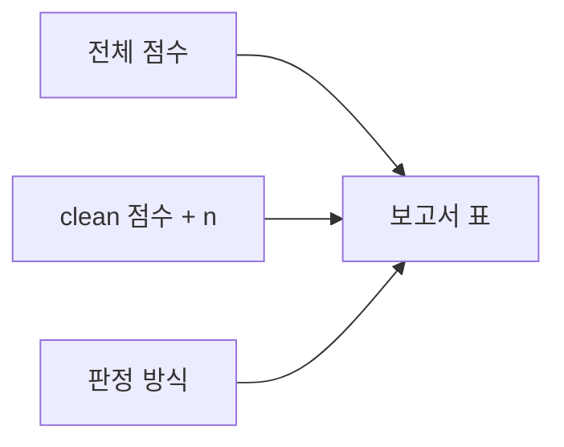

# 오염 제외 점수 보고

> 벤치마크 점수를 낼 때 **학습 데이터와 겹친 문항을 뺀 "깨끗한(clean)" 부분의 점수를 전체 점수와 함께 보고**하는 관행. 오염이 점수를 부풀렸는지 독자가 판단할 수 있게 한다.

## 쉽게 말하면
시험 점수를 발표할 때 "족보에 있던 문제를 뺀 점수도 같이 알려 드립니다"라고 하는 것이다. 족보 문제를 빼도 점수가 비슷하면 실력이고, 크게 떨어지면 점수가 부풀려졌을 수 있다.

## 자세히
- **GPT-3 방식(arXiv 2005.14165, 직접 읽음)**: 학습 데이터와 N-gram(최대 13단어)이 겹치는 문항을 "dirty"로 두고, clean 부분집합으로 다시 평가해 원점수와 비교했다. clean 점수가 1~2% 넘게 낮으면 과적합 의심, 크게 높으면 필터가 쉬운 문항을 먼저 dirty로 표시했을 수 있다. 대부분 벤치마크에서 변화는 미미했고 PIQA·Winograd는 일부 오염 증거로 결과에 별표를 붙였다([n-그램 겹침 오염 측정](#ngram-overlap-contamination)).
- **Llama 2 방식(arXiv 2307.09288 부록 A.6, PDF 직접 읽음)**:
  - 이전 방식(13-gram, PaLM의 "8-gram의 70%")은 문항의 몇 %가 오염됐는지 알 수 없다고 보고, **토큰 단위**로 본다. 평가 샘플과 학습 데이터 양쪽에서 **10토큰보다 긴 n-gram**에 들어 있는 토큰을 오염으로 보고, 샘플의 **오염 토큰 비율**을 계산한다. 실제 평가에 쓰는 완전한 프롬프트를 토크나이즈해 매칭하며, 최대 4토큰의 skipgram 예산을 허용한다.
  - 오염이 점수에 기여했다면 가장 깨끗한 문항은 보완 집합보다 점수가 낮고 가장 더러운 문항은 높아야 한다는 가정 아래 네 부분집합을 정의한다: **Clean**(<20%), **Not clean**(≥20%), **Not dirty**(<80%), **Dirty**(≥80%). 둘 중 하나만 성립하면 오염의 충분한 증거로 보지 않는다.
  - 탐지는 접미사 배열로 약 7시간, 추정 1,500코어(PySpark)가 들었다.
  - 표(PDF 추출 결과, 열 정렬이 흐트러졌을 수 있음)에서 HellaSwag 70B는 Clean 7,391개 평균 80.0, Not clean 2,651개 89.5, 같은 크기 무작위 표본 평균 82.5 대비 Z값이 Clean −5.73, Not clean +9.56으로 읽힌다. 즉 이 벤치마크에서는 오염이 점수에 기여했다는 두 방향의 신호가 모두 보인다. 다른 벤치마크 결과는 이번에 정리하지 않았다.
- **보고 형식(제안)**: 벤치마크명 | 전체 점수 | clean 점수(n) | dirty 점수(n) | 오염 판정 방식(N, 토큰/단어 단위) | 한계. clean 점수와 개수를 병기하고 판정 방식을 밝힌다.
- **한계**: clean/dirty 부분집합은 모집단을 대표하지 않을 수 있고(난이도 차이), 재진술 오염은 못 잡는다([정확 일치 오염 측정](#exact-match-contamination)). 그래서 두 방향 검사나 무작위 같은 크기 표본과의 비교(Z값)를 쓴다.

## 그림으로 보기

## 예시
| 보고 항목(예시 형식) | 내용 |
|---|---|
| 전체 점수 | 82.5(HellaSwag 70B 무작위 표본 평균) |
| Clean 점수 | 80.0 (n=7,391, <20% 오염) |
| Not clean 점수 | 89.5 (n=2,651) |
- 업무 장면: 사내 평가 세트 점수를 보고할 때 학습 로그와 겹치는 문항 비율과 clean 점수를 함께 쓰고, 오염 판정 기준(8단어 겹침 등)을 각주로 단다.

## 헷갈리는 것과 비교
| 개념 | 차이 |
|---|---|
| 오염 제외 점수 보고 | clean 점수를 병기하는 보고 방식 |
| [n-그램 겹침 오염 측정](#ngram-overlap-contamination) | 겹침을 재는 방법 |
| [코퍼스 속 벤치마크 오염](#benchmark-contamination-in-corpus) | 문제 자체 |
| [신뢰성과 타당성](#reliability-vs-validity) | 점수가 의미 있는 값인가의 일반 문제 |

## 더 읽을거리
- [Llama 2 (arXiv 2307.09288)](https://arxiv.org/abs/2307.09288) — 부록 A.6 토큰 단위 오염 분석(PDF 직접 읽음).
- [GPT-3 (arXiv 2005.14165)](https://arxiv.org/abs/2005.14165) — clean 부분집합 재평가(PDF 직접 읽음).
