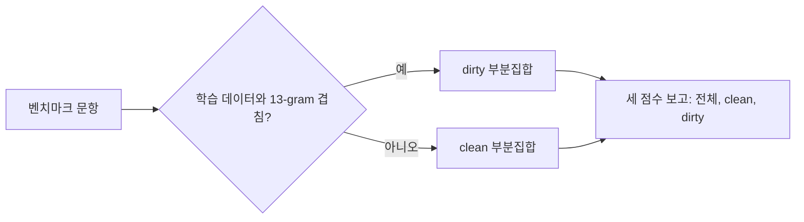
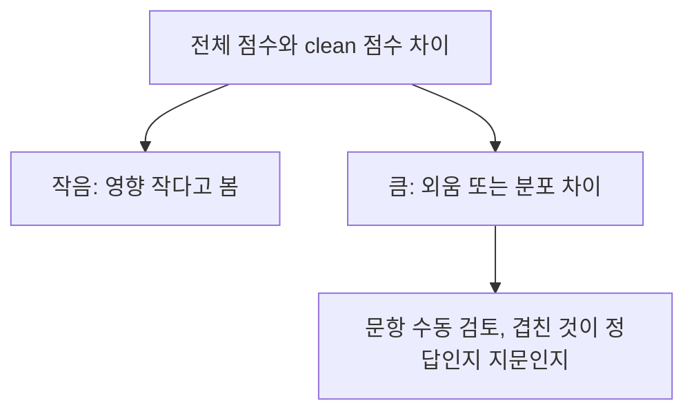

# 겹침 제외 점수 따로 보고

> 벤치마크 점수를 낼 때 **전체 점수와, 학습 데이터와 겹친 문항을 뺀 clean 부분집합 점수를 함께** 싣는 관행이다. 두 점수 차이가 작으면 오염 영향이 작다고 보고, 크면 의심한다.

## 쉽게 말하면
시험 후에 "전체 평균 80점, 그런데 연습 문제집에 있던 문제를 뺀 평균은 76점"이라고 같이 알려 주는 것이다. 4점 차이가 외운 몫일 수 있다. 다만 그 4점이 정말 외운 것인지, 남은 문제가 원래 더 어려워서인지는 따로 따져야 한다.

## 자세히
- **GPT-3 논문(Brown 외 2020, 4절·부록 C, ar5iv 확인)**: 평가 문항 하나라도 학습 문서와 **13-gram이 겹치면 dirty**, 안 겹치면 clean. 짧은 문항은 전체 길이로 비교하고, 창 크기 N은 문항 길이 하위 5% 기준으로 최소 8·최대 13.
- 벤치마크의 약 4분의 1이 50% 넘게 dirty였지만 clean 부분집합 점수는 대체로 거의 변하지 않았고, 오염 정도와 점수 차 사이의 뚜렷한 상관은 없었다고 보고한다.
- **구체 사례**(논문 수치):

| 벤치마크 | 겹침 비율 | 전체 → clean | 비고 |
|---|---|---|---|
| PIQA | 29% | 82.3 → 79.3 (−3점) | 작은 모델도 비슷하게 떨어져 통계 편향으로 의심, 별표 표시 |
| Winograd | 45%(본문) | 88.6 → 86.2 | 표의 개수(273 중 164)는 약 60%라 본문과 불일치 |
| DROP | 처음 90% 초과 | 36.5 → 29.5 | 지문만 겹침, 남은 6%는 분포가 다름 |
| LAMBADA | 상당 | 0.5% 이내 | 실제 오염이 있어도 점수 차 작음 |

- **해석(제안)**: clean 점수가 떨어졌다고 곧 "외운 것"은 아니다. DROP처럼 **지문만 겹치고 정답은 안 겹친** 경우가 있고, clean 부분집합이 더 어려운 분포일 수 있다. 그래서 겹침 비율·정의(13-gram)·두 점수를 같이 적는다.
- **직접 계산 예(여섯 문항)**: dirty 3문항 중 2개 정답, clean 3문항 중 1개 정답이면 전체 0.50, clean 0.33, dirty 0.67, 오염 비율 50%. 이처럼 세 값을 모두 보면 차이가 분명하다.
- 자세한 한계: n-gram 방식은 의역 오염을 놓치므로 clean이라고 해서 깨끗하다는 보장은 없다([학습-평가 오염 탐지](#train-test-contamination-lsh)).

## 그림으로 보기

## 예시
- 신규 모델 카드에 "MMLU 전체 xx, 겹침 제외 xx, 겹침 비율 x%"를 표로 기재.
- 교육: 동료 모델의 두 점수를 받아 차이의 원인을 토론하는 활동.

## 헷갈리는 것과 비교
| 개념 | 차이 |
|---|---|
| [학습-시험 겹침](#train-test-overlap) | 문제 자체 |
| 겹침 제외 보고 | 문제에 대한 투명한 보고 방식 |
| [오염 탐지](#train-test-contamination-lsh) | 어떤 문항이 겹치는지 찾는 기술 |

## 더 읽을거리
- [Language Models are Few-Shot Learners (GPT-3) — ar5iv](https://ar5iv.labs.arxiv.org/html/2005.14165) — 4절·부록 C의 clean/dirty 분석(열어 확인).
- [오염 탐지 서베이](https://arxiv.org/html/2404.00699v1) — n-gram 기법별 정의와 한계(열어 확인).
