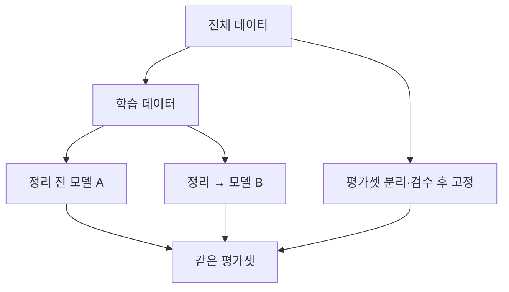
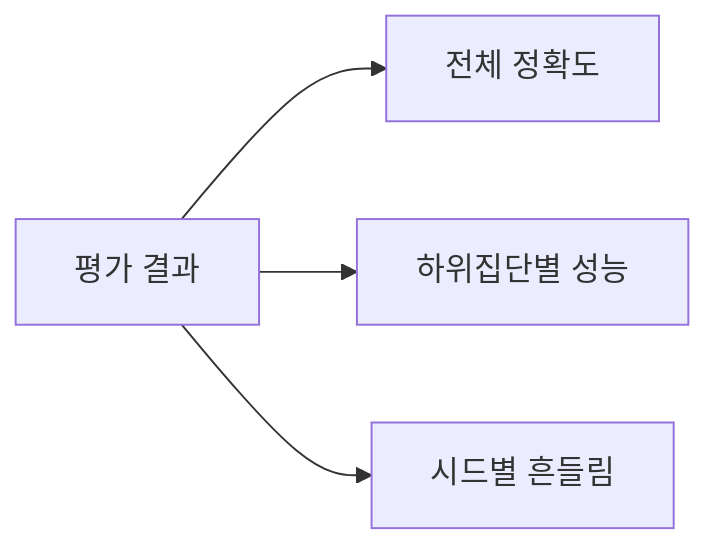

# 정리 전후 비교 평가

> 정리 전후 비교 평가는 데이터를 정리하기 전과 후의 모델을, 정리 작업에 쓰지 않은 같은 깨끗한 평가셋에서 비교해 정리가 실제로 도움이 됐는지 확인하는 절차다.

## 쉽게 말하면
다이어트 효과를 볼 때 같은 저울로 전과 후를 재야 한다. 전에는 고장 난 저울, 후에는 새 저울로 재면 숫자가 달라져도 살이 빠졌는지 알 수 없다.

## 자세히
- **평가셋도 노이즈가 있다(cleanlab 문서)**: 노이즈 있는 테스트셋은 측정 정확도를 왜곡하므로 테스트셋 라벨도 정리하라고 한다. 문서의 장난감 예제는 참 라벨을 아는 상황에서 정확도가 83%→86%로 올랐지만, 실제 프로젝트는 참 라벨이 없어 신뢰할 만한 테스트셋을 따로 검수해 만들어야 개선 여부를 알 수 있다.
- **절차(해석)**: ① 평가셋을 먼저 따로 떼어 두고 학습·탐지에 쓰지 않는다 ② 평가셋 라벨을 이중 검수([이중 검수](#double-annotation-review))로 확정해 "고정"한다 ③ 정리 전 모델 A와 정리 후 모델 B를 같은 조건(시드·하이퍼파라미터)으로 학습 ④ 평가셋에서 전체 정확도와 클래스·하위집단별 성능을 비교 ⑤ 시드를 여러 개로 반복해 차이가 흔들림 범위를 넘는지 본다.
- **함정(해석)**: 정리에 쓴 데이터와 평가 데이터가 겹치면 낙관적인 결과가 나온다. 정리 전 노이즈 평가셋으로 잰 개선폭은 정리 후 평가셋 개선폭과 다를 수 있다. 평균만 보면 [하드 샘플 제거 부작용](#hard-sample-removal)을 놓친다.
- **성공 기준 미리 정하기(해석)**: "정확도 +1%p 이상, 어떤 하위집단도 −1%p 이하로 떨어지지 않음"처럼 작업 전에 적는다. 숫자는 예시다.

## 그림으로 보기

## 예시
- 표: 모델 A 정확도 0.83, 모델 B 0.86(문서 장난감 예제 수치). 실제 업무에선 시드 5개 평균과 표준편차를 함께 적는다.
- 교육 활용: 평가셋을 정리하기 전과 후에 같은 모델의 점수가 얼마나 달라지는지 보여 주고 "측정 도구도 검증해야 한다"를 가르친다.

## 헷갈리는 것과 비교
| 개념 | 차이 |
| --- | --- |
| 정리 전후 비교 | 같은 평가셋으로 효과 확인 |
| [정리→재학습 라운드](#relabel-retrain-rounds) | 정리와 재학습의 반복 |
| [검수 정지 규칙](#review-stopping-rule) | 언제 멈출지 |
| [삭제 대신 보류](#quarantine-instead-of-delete) | 정리 방식의 안전장치 |

## 더 읽을거리
- [cleanlab in-depth tutorial](https://docs.cleanlab.ai/stable/tutorials/indepth_overview.html) — 테스트셋 정리 필요성과 정확도 개선 예
