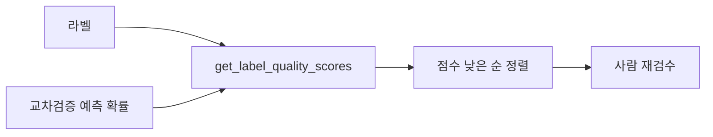
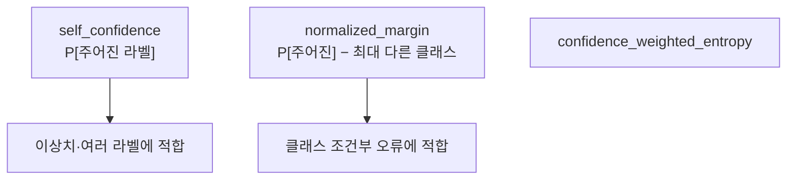

# 라벨 품질 점수

> 샘플마다 **"붙어 있는 라벨이 맞을 가능성"을 0~1로 매긴 점수**다(cleanlab `get_label_quality_scores`). 1에 가까우면 라벨이 맞을 가능성이 높고 0에 가까울수록 오류일 가능성이 크다. 점수를 오름차순 정렬하면 검수 우선순위가 된다.

## 쉽게 말하면
채점자가 답안지마다 "이 정답 표시가 믿을 만한 정도"를 점수로 매기는 것이다. 점수가 낮은 답안지부터 다시 확인하면 오답 표시를 빨리 찾을 수 있다.

## 자세히
- **입력(cleanlab 문서)**: `labels`(0~K-1 정수), `pred_probs`(N×K 예측 확률). 정확한 점수를 위해 **교차검증 같은 표본 외(out-of-sample) 확률**을 권장한다.
- **방법 3가지**: `self_confidence`(기본) = 주어진 라벨의 예측 확률 P[k]. `normalized_margin` = P[k] − 다른 클래스의 최대 확률(다른 라벨이 분명히 더 맞는 클래스 조건부 오류에 좋음). `confidence_weighted_entropy` = P의 엔트로피를 자기 신뢰로 나눈 값(0~1로 변환). 문서는 이상치처럼 어느 클래스에도 안 맞거나 여러 라벨에 걸친 샘플에는 `self_confidence`가 낫다고 한다. `adjust_pred_probs=True`는 클래스별 신뢰 임계값을 빼 클래스 불균형을 보정한다.
- **정렬은 직접**: 함수가 정렬하지 않는다. `np.argsort(scores)`가 "오류 가능성이 높은 순"이고 `find_top_issues(scores, top=10)` 도우미가 있다.
- **직접 실험(cleanlab 2.9.0, 3클래스 합성 2,000개, 라벨 12% 무작위 오염 → 오류 247개)**: 점수 낮은 순 상위 100개 중 진짜 오류 비율(precision@100) — `self_confidence` **0.97**, `normalized_margin` 0.96, `confidence_weighted_entropy` 0.93. 상위 300개에서는 0.67, 0.68, 0.61. 오류 샘플의 평균 점수 0.16(self_confidence) 대 정상 샘플 0.67. 무작위로 100개를 뽑으면 오류가 약 12%(약 12개)인데 점수 순서로 보면 약 97개로 **검수 효율이 약 8배**였다. 단일 합성 실험이며 실제 데이터는 노이즈·모델에 따라 달라진다.
- **한계**: 점수는 확률이 아니라 순위용이다. 모델이 약하거나 클래스가 어려우면 정상 샘플도 낮은 점수를 받는다. 데이터에 따라 임계값을 정해야 한다.

## 그림으로 보기



## 예시
```python
from cleanlab.rank import get_label_quality_scores
scores = get_label_quality_scores(labels, pred_probs, method="self_confidence")
review_order = scores.argsort()   # 가장 의심스러운 샘플부터
```
- 고객 문의 2만 건 라벨 점검: 점수 하위 300건만 먼저 사람이 확인.

## 헷갈리는 것과 비교
| 개념 | 차이 |
|---|---|
| 라벨 품질 점수 | 샘플별 순위용 연속값 |
| `find_label_issues` | 오류 후보를 이진으로 고르는 필터 |
| 모델 신뢰도 | 예측 확률(라벨과 무관) |
| [노이즈 전이 행렬](#noise-transition-matrix) | 클래스 쌍 수준의 통계 |

## 더 읽을거리
- [cleanlab.rank 문서](https://docs.cleanlab.ai/stable/cleanlab/rank.html) — 점수 정의와 방법 3종.
- [Confident Learning (arXiv 1911.00068)](https://arxiv.org/abs/1911.00068) — 이론 배경(초록 확인).
