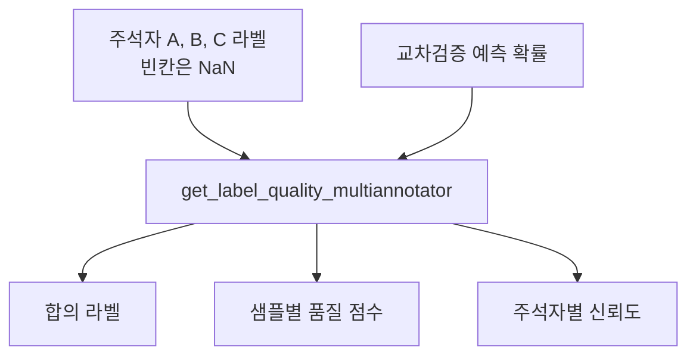
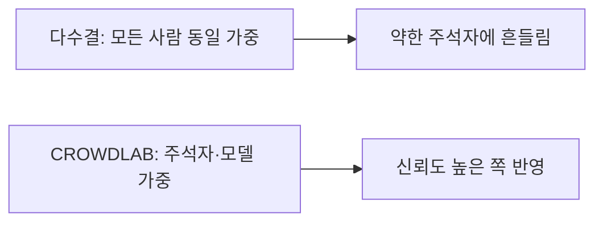

# 다중 주석자 합의

> 한 샘플에 **여러 사람이 단 라벨을 하나의 합의 라벨로 합치고**, 샘플별 품질 점수와 주석자별 신뢰도를 함께 계산하는 방법이다(cleanlab `get_label_quality_multiannotator`). 단순 다수결보다 주석자 실력과 모델 예측을 함께 고려한다.

## 쉽게 말하면
여러 채점관이 같은 답안에 점수를 줄 때, 의견이 갈리면 "평소 정확한 채점관의 의견에 더 무게를 주고, AI 조교 의견도 참고"해 최종 점수를 정하는 것이다. 채점관마다 신뢰 성적표도 함께 나온다.

## 자세히
(cleanlab 문서 `cleanlab.multiannotator` 기준)
- **입력**: `labels_multiannotator`(N×M 표, 주석자가 안 단 칸은 NaN)와 `pred_probs`(교차검증으로 얻은 N×K 예측 확률). 모든 샘플은 **라벨이 최소 1개** 있어야 한다.
- **합의 방법**: `majority_vote`(다수결, 동률은 `pred_probs`로 결정), `best_quality`(품질 점수가 가장 높은 라벨). 문서의 본문과 시그니처가 기본값을 다르게 적고 있으니 명시하는 편이 안전하다.
- **품질 방법**: `crowdlab`(기본, 주석자 라벨과 모델 예측을 가중 앙상블), `agreement`(합의 라벨과 일치하는 주석자 비율).
- **출력**: `label_quality`(주석 개수, 합의 라벨, 주석자 일치도, 합의 품질 점수), 주석자별 `annotator_stats`(라벨한 수, 합의와의 일치도, 가장 자주 틀리는 `worst_class`, `annotator_quality`), 옵션으로 가중치. 점수는 0~1, 낮을수록 신뢰가 낮다.
- **직접 실험(cleanlab 2.9.0, 3클래스 합성 1,000개, 주석자 A·B·C의 정확도 0.9·0.8·0.55, 각자 70%만 라벨, 라벨 없는 32개 제외 968개)**
  - 합의 정확도: cleanlab **0.961**, 단순 다수결 **0.798**(pandas `mode` 기준, 동률은 가장 작은 라벨을 고르는 순진한 기준선이라 cleanlab의 다수결 동률 처리와는 다르다).
  - 주석자 수별: 1명만 단 샘플(182개) cleanlab 0.951 vs 다수결 0.753, 3명 샘플(339개) 0.968 vs 0.885.
  - 추정한 `annotator_quality`: C **0.54**(실제 0.55), B 0.72, A 0.78. 낮은 순 정렬이라 가장 신뢰가 낮은 C가 맨 위에 나왔다.
  - 해석: 모델이 쉬운 데이터에서 정확해 모델 예측이 큰 몫을 한 결과이며, 모델이 약하거나 주석자 수가 적으면 이득이 줄 수 있다(일반 추론). 합성 한 번의 결과다.
- **쓰임**: 크라우드소싱 라벨 합치기, 주석자 교육·교체 결정, 라벨이 갈리는 샘플을 전문가에게 보내기.
- **주의**: 주석자가 같은 편향(체계적으로 같은 방향으로 틀림)을 가지면 합의도 틀린다. 모델 예측이 학습 데이터에 영향을 받으므로 순환을 피하도록 표본 외 확률을 쓴다.

## 그림으로 보기



## 예시
```python
from cleanlab.multiannotator import get_label_quality_multiannotator
res = get_label_quality_multiannotator(labels_df, pred_probs)   # labels_df: N×M, NaN 허용
res["label_quality"]["consensus_label"]; res["annotator_stats"]   # 합의 라벨, 주석자 성적표
```
- 크라우드 워커 20명이 단 라벨에서 신뢰도 낮은 워커 3명을 식별해 교육.

## 헷갈리는 것과 비교
| 개념 | 차이 |
|---|---|
| 다수결 | 단순·빠름, 주석자 실력 무시 |
| CROWDLAB | 주석자와 모델을 함께 가중 |
| [라벨 품질 점수](#cleanlab-label-quality-score) | 라벨이 한 사람일 때의 샘플 점수 |
| 평가자 간 일치도(IAA) | 주석자끼리의 일치 정도(통계량) |

## 더 읽을거리
- [cleanlab.multiannotator 문서](https://docs.cleanlab.ai/stable/cleanlab/multiannotator.html) — 입력·방법·출력 정의.
