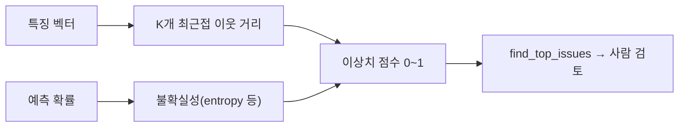
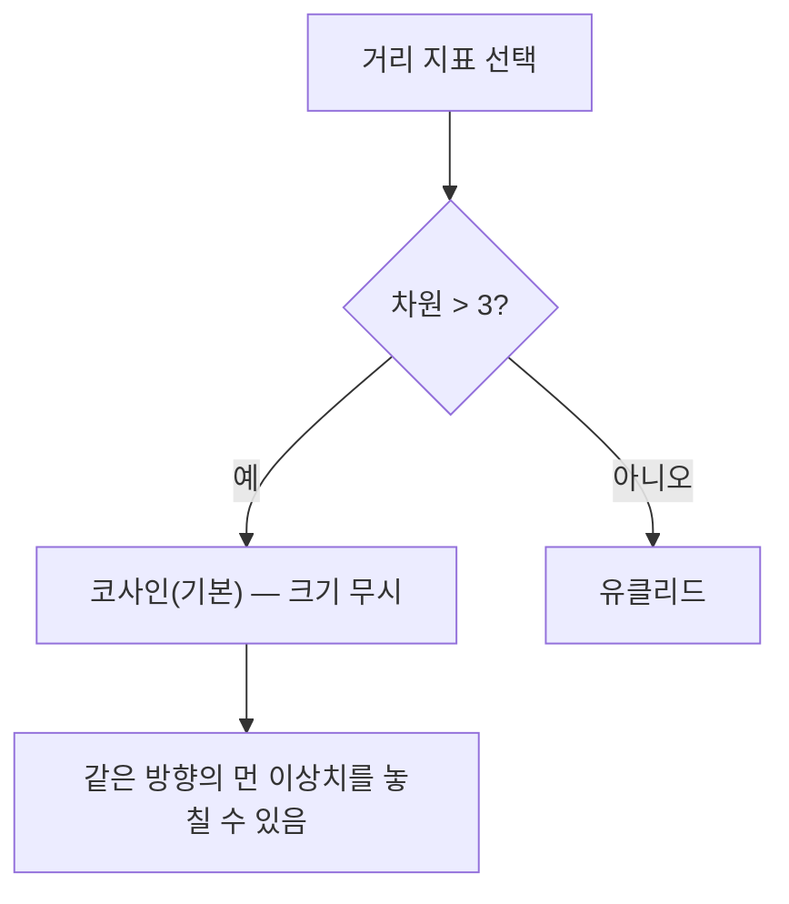

# cleanlab 이상치 탐지

> cleanlab의 `OutOfDistribution`은 **각 샘플이 나머지 데이터에 비해 얼마나 "전형적"인지 0~1 점수**로 매긴다. 0에 가까울수록 이상치(out-of-distribution)다. 특징 벡터(최근접 이웃 거리)나 분류기 예측 확률(불확실성)로 계산한다.

## 쉽게 말하면
교실에서 모든 학생과의 평균 거리를 재서, 혼자 멀리 떨어져 앉은 학생을 찾는 것이다. 그 학생이 진짜 이상한 건지 단지 자리가 외진 건지는 사람이 보고 판단한다.

## 자세히
(cleanlab 문서의 `cleanlab.outlier.OutOfDistribution` 기준)
- **점수 범위**: [0, 1]. 0에 가까우면 "데이터 분포에서 덜 전형적인" 이상치.
- **특징으로 계산**: 샘플과 K개 최근접 이웃 사이의 평균 거리 기반. 입력은 숫자 벡터여야 하며 이미지·텍스트·범주형은 **임베딩 벡터**를 넣는다. 기본 `k=10`, 거리 지표는 특징 차원이 3보다 크면 **코사인**, 아니면 유클리드. `t`(기본 1)는 `exp(-x*t)` 변환으로, 점수가 1 근처에 몰리면 키운다(순위는 안 바뀜).
- **예측 확률로 계산**: 분류기 확률의 불확실성. `method`는 `"entropy"`(기본), `"least_confidence"`(= max(P), MSP), `"gen"`(Generalized Entropy, CVPR 2023). 클래스 불균형 보정(`adjust_pred_probs`, 기본 True)을 쓰면 라벨이 필요하다.
- **API**: `OutOfDistribution(params=...)`에서 `fit_score(features=...)`로 한 번에 점수를 얻고, `fit`/`score`로 새 데이터를 평가한다. 가장 심한 이상치는 `cleanlab.rank.find_top_issues`로 추린다. 알고리즘은 arXiv 2207.03061.
- **직접 실험(cleanlab 2.9.0, 5차원 3클러스터 1,000개 + 이상치 주입)**: 흩어진 이상치 20개 — 기본(코사인) **AUROC 0.996**, 유클리드 1.000. 이상치 5개 — 기본 0.998, 유클리드 1.000. 그런데 **서로 가까이 모인 이상치 20개(N(15,1))는 기본 설정에서 AUROC 0.244**(이상치 평균 점수 0.575 > 정상 0.333, 거꾸로)였고 유클리드 거리로 바꾸자 0.988(이상치 0.146 대 정상 0.362)이 됐다. 코사인은 크기(거리)를 무시하고 방향만 보므로, 정상 군집과 같은 방향에 멀리 놓인 이상치를 놓친다. 한 번의 합성 실험이며 추정 원인(코사인이 크기를 무시함)은 지표를 바꿔 결과가 뒤집힌 것으로 확인했다.
- **교훈**: 거리 지표와 `k`를 데이터에 맞게 확인한다. 이상치가 `k`개 이상 뭉쳐 있으면 서로를 이웃으로 삼아 덜 이상해 보일 수 있다(일반 지식).
- 이상치 점수는 "삭제 대상"이 아니라 "검토 대상"이다. 드문 정상 샘플도 낮은 점수를 받는다.

## 그림으로 보기



## 예시
```python
from cleanlab.outlier import OutOfDistribution
from sklearn.neighbors import NearestNeighbors
ood = OutOfDistribution(params={"knn": NearestNeighbors(n_neighbors=10, metric="euclidean")})
scores = ood.fit_score(features=embeddings)   # 낮을수록 이상치
```
- 이미지 임베딩으로 학습 데이터에 섞인 엉뚱한 사진을 찾아 라벨링 전에 제외.

## 헷갈리는 것과 비교
| 개념 | 차이 |
|---|---|
| 이상치 점수 | 샘플이 분포에서 얼마나 벗어났나 |
| [라벨 품질 점수](#cleanlab-label-quality-score) | 라벨이 맞을 가능성 |
| 데이터 드리프트 | 데이터셋 전체 분포 변화 |
| OOD 탐지 | 학습 분포 밖 입력 감지(서비스 중) |

## 더 읽을거리
- [cleanlab.outlier 문서](https://docs.cleanlab.ai/stable/cleanlab/outlier.html) — 점수 정의, 파라미터, API.
- [알고리즘 논문 arXiv 2207.03061](https://arxiv.org/abs/2207.03061) — 문서가 인용한 알고리즘 설명(미열람, 문서 인용만 확인).
