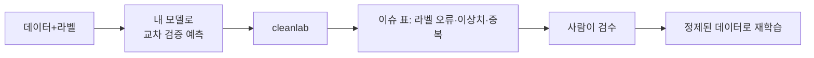
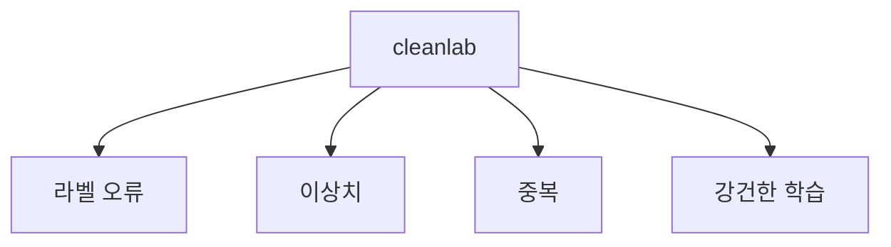

# cleanlab

> 머신러닝 데이터의 라벨 오류·이상치·중복 같은 문제를 기존 모델의 예측으로 찾아 주는 오픈소스 파이썬 라이브러리다. [Confident Learning](#confident-learning)의 구현으로 출발했고 라이선스는 Apache-2.0이다.

## 쉽게 말하면
데이터 건강검진 키트다. 내가 이미 쓰는 모델을 꽂기만 하면 "이 라벨 수상함, 이 샘플은 이상치, 이 둘은 거의 같은 데이터"라고 표시된 목록을 준다.

## 자세히
(GitHub 저장소 README를 직접 열어 확인. 설치 명령 자체는 페이지에 안 나옴 — 공식 문서 docs.cleanlab.ai 참조라고만 안내.)
- 기능: 라벨 오류, 이상치, 중복 등 데이터 이슈 탐지 + 노이즈 라벨에서 더 튼튼한 모델 학습.
- 지원: 텍스트·이미지·표·오디오 등 "어떤 데이터든", PyTorch·OpenAI·XGBoost 등 "어떤 모델이든". 전용 지원 과제: 분류, 다중 라벨 분류, 토큰 분류, 회귀, 세분화, 객체 탐지, 다중 주석자 데이터, 이상치 탐지.
- 요구: Python 3.10+, Linux·macOS·Windows. 설치는 uv·pip·conda.
- 대표 사용(README):
```python
cl = cleanlab.classification.CleanLearning(sklearn.YourFavoriteClassifier())
label_issues = cl.find_label_issues(data, labels)
```
- 결과는 샘플별 "이슈 여부·점수" 표다. 높은 순으로 사람이 확인한다. 자동 삭제는 권하지 않는다(제안: 오탐이 있고 라벨 오류가 진짜 어려운 샘플일 수도 있음).
- 근거 이론은 [Confident Learning](#confident-learning), 필요한 입력은 [표본 외 예측 확률](#out-of-sample-pred-probs).

## 그림으로 보기



## 예시
```bash
pip install cleanlab
```
```python
from cleanlab.classification import CleanLearning
from sklearn.linear_model import LogisticRegression
cl = CleanLearning(LogisticRegression(max_iter=1000))
issues = cl.find_label_issues(X, y)   # 라벨 이슈 표
```
- 사내 문의 분류 데이터에 돌려 의심 상위 100건을 담당자가 확인한다.

## 헷갈리는 것과 비교
| 개념 | 차이 |
|---|---|
| cleanlab | 데이터 이슈 탐지 라이브러리 |
| [Confident Learning](#confident-learning) | 그 밑바탕 방법론 |
| [라벨 오류 탐지](#label-error-detection) | 목적 |
| 데이터 검증 도구(TFDV 등) | 스키마·분포 이상 확인. 라벨 오류는 직접 못 찾음 |

## 더 읽을거리
- [cleanlab GitHub](https://github.com/cleanlab/cleanlab) — 기능·지원 과제·라이선스(열어 확인).
- [Confident Learning 논문](https://arxiv.org/abs/1911.00068) — 이론 배경(열어 확인).
