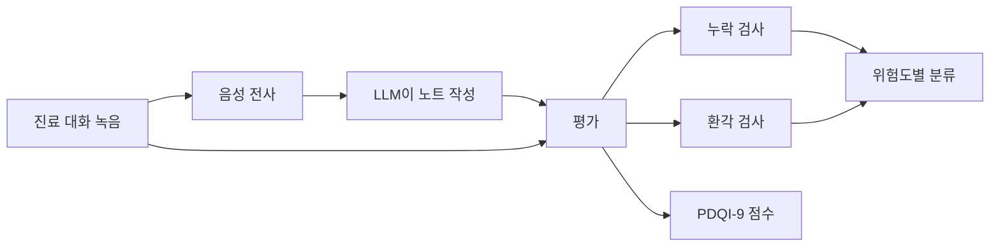

# 임상 노트 정확도 평가

> AI 스크라이브(진료 녹음 → 진료 기록 자동 작성)가 쓴 노트에서 누락·환각·오류를 어떻게 재고 점수 매기는지의 방법.

## 쉽게 말하면
회의록 담당 비서가 진료실에서 의사와 환자의 대화를 듣고 차트를 대신 쓴다. 평가는 "비서가 받아쓴 내용이 대화와 맞는가(오류), 빠뜨린 것은 없는가(누락), 말하지 않은 것을 지어냈는가(환각)"를 사람 전문가가 채점표로 점검하는 일이다.

## 자세히
- **PDQI-9**(Physician Documentation Quality Instrument): 노트 품질을 9개 항목(정확성·유용성·간결성·일관성 등)으로 점수화하는 검증된 도구. 연구마다 변형판·점수 범위가 달라 숫자를 직접 비교하기 어렵다.
- **오류 유형**: 누락(빠짐), 환각(대화에 없는 내용 생성), 전사 오류(음성 인식 단계 실수), 잘못 귀속(누가 말했는지 혼동).
- **연구 결과(서로 엇갈림)**:
  - 5개 전문과 연구: 환각이 AI 노트 31% vs 의사 작성 노트 20%(p=0.01). 그래도 검토자는 AI 노트를 선호한 경우가 많았다(수치 일부 확인 못 함).
  - 11개 벤더를 표준 시나리오 5개로 평가: AI 노트가 사람 노트보다 점수가 일관되게 낮았다.
  - 시뮬레이션 5개 플랫폼: 평균 PDQI-9 36±4, 오류가 노트로 넘어가는 비율 약 20%(가상 환자 대화).
  - 다른 연구: 손으로 쓴 노트는 누락이 더 많고 더 심각했고, AI 오류 일부는 전사 단계 문제였다.
- 결론: 어느 쪽이 낫다고 단정하기 어렵고, **우리 병원·진료과·언어에서 직접 재야** 한다.
- 평가 방법: 대화 원문과 노트를 대조한 문장 단위 사실 확인, 사람 검토 표본, [LLM auto-rater](#llm-auto-rater)로 대량 1차 채점 후 사람이 보정.

## 그림으로 보기

## 예시
- 시범 도입: 의사 10명, 환자 대화 200건을 대상으로 전사 오류·누락·환각을 센다. 환각 중 약 처방·검사 결과 같은 고위험 항목은 따로 집계해 허용치를 0에 가깝게 둔다.
- 도입 기준 정하기: [목표 정확도의 경제성](#accuracy-economics)처럼 오류 비용이 큰 항목은 의사 서명 전 검토를 의무화.

## 헷갈리는 것과 비교
| 개념 | 차이 |
| --- | --- |
| [환각](#hallucination) | 없는 내용을 지어냄 |
| 누락 | 있어야 할 내용이 빠짐, 사람 노트에서도 흔함 |
| 전사 오류 | 음성 인식 단계 실수, 요약 이전에 이미 발생 |
| [Ambient scribe](#ambient-scribe) | 평가 대상인 제품 |

## 더 읽을거리
- [Assessing the quality of AI-generated clinical notes (PMC)](https://www.ncbi.nlm.nih.gov/pmc/articles/PMC12586549/) — PDQI-9 기반 검증 평가(31% vs 20% 환각)
- [Mayo Clinic Proceedings: Digital Health, 시뮬레이션 평가](https://www.mcpdigitalhealth.org/article/S2949-7612(25)00099-9/fulltext) — 5개 플랫폼 비교(검색 결과 요약만 확인)
- [Annals of Internal Medicine: Rapid Evaluation of AI for Ambient Dictation](https://doi.org/10.7326/ANNALS-25-02772) — 1차 진료 노트 품질 비교(요약만 확인)
