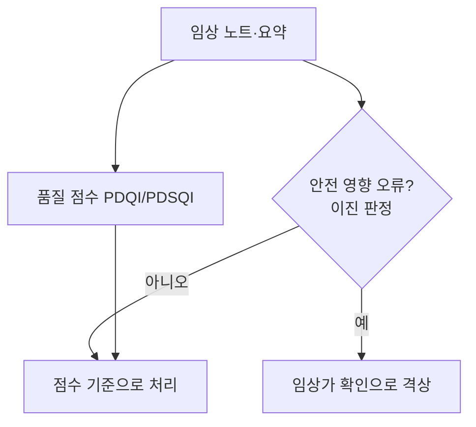

# 임상 노트 안전 검토

> 임상 기록·요약의 품질을 점수(PDQI-9 등)로 재는 것과 별개로, 환자 안전에 영향을 줄 수 있는 중대한 오류를 따로 걸러 내는 검토 절차. 평균 점수가 높아도 치명적 오류 하나가 가려질 수 있기 때문이다.

## 쉽게 말하면
식당 위생 점검에서 "맛·서비스 평균 4.5점"이어도 "냉장 온도 위반" 같은 항목은 점수와 별개로 즉시 시정 대상인 것과 같다. 점수는 전반적 질을, 안전 검토는 치명적 결함을 본다.

## 자세히
출처는 PDQI-9 원 논문(Stetson 등 2012, PMC3347480, 열람)과 LLM 요약용 PDSQI-9 논문(arXiv 2501.08977, 열람)이다. 이 노드의 "별도 안전 검토" 설계는 두 논문에서 끌어낸 해석이며 논문이 제안한 절차가 아니다. 의료 조언이 아니다.
- **PDQI-9(2012)**: 의사 기록의 품질을 아홉 속성(Up-to-Date, Accurate, Thorough, Useful, Organized, Comprehensible, Succinct, Synthesized, Consistent)에 5점 리커트로 평가, 총점 9~45점. 별도의 한 문항 General Impression(Terrible~Excellent)도 있다. 입원·경과·퇴원 기록 아홉 건을 평가했고 내적 일치 알파 0.87~0.94, 평가자 간 ICC 0.83(95% CI 0.72~0.91)이었다. 한계로 표본이 작고(세 차트의 아홉 기록), 평가자가 환자를 모르고 훈련 기간이 없었으며, 복사 붙여넣기 기록을 잘 못 알아챘고, 도구가 독창성을 측정하지 않는다고 적었다.
- **PDSQI-9(LLM 요약용)**: PDQI-9를 LLM 생성 요약에 맞게 고쳤다. Up-to-Date와 Consistent를 빼고 Cited와 Stigmatizing(낙인 표현)을 더했으며 일부 속성은 이진 척도다. 전체 ICC(3,k) = 0.867이고 속성별 ICC는 Comprehensible 0.500부터 Cited 0.947까지였다. 전체 Krippendorff α는 0.575였다.
- **핵심 관찰(PDSQI-9 논문)**: 별도의 중대 오류 점수 범주나 처리는 보고되지 않았다. 환각(조작)은 주로 Accurate, 누락은 주로 Thorough 아래에서 평가된다. 즉 평균 점수 안에서 치명적 오류가 희석될 수 있다.
- **안전 검토 설계(해석)**: ① 점수와 별개로 "환자 안전에 영향을 줄 수 있는 오류 있음/없음" 이진 판정, ② 해당 시 점수와 무관하게 사람 임상가 확인으로 격상, ③ 오류 유형(약물·용량·알레르기 등 누락 또는 조작)을 기록해 모델·프롬프트 개선에 쓴다. 구체 오류 분류와 기준은 이번에 확인한 자료에 없으므로 기관별 임상 안전 담당자와 정해야 한다.
- 위 연구는 한 대학 병원 맥락의 소규모 평가이며 일반화에는 추가 연구가 필요하다.

## 그림으로 보기

## 예시
- LLM이 만든 퇴원 요약에서 알레르기 정보가 빠졌다면 총점이 높아도 안전 검토에서 걸러 임상가가 확인한다(설계 예시).
- 교육 실습: 가상 요약 3개에 PDQI 속성 점수와 "안전 영향 오류" 여부를 각각 표시하고 두 결과가 어긋나는 사례를 찾는다.

## 헷갈리는 것과 비교
| 개념 | 차이 |
|---|---|
| 품질 점수(PDQI-9) | 전반적 기록 품질 |
| 안전 검토 | 중대한 오류를 이진으로 거름 |
| [이관 요약 품질](#handoff-summary-quality) | 비임상 이관 요약의 사실성·완전성 |
| [Krippendorff alpha](#krippendorff-alpha) | 평가자 일치도 지표 |

## 더 읽을거리
- [Stetson 외: PDQI-9 (PMC3347480)](https://pmc.ncbi.nlm.nih.gov/articles/PMC3347480) — 속성·신뢰도(열람)
- [PDSQI-9 (arXiv 2501.08977)](https://arxiv.org/html/2501.08977v2) — LLM 요약용 도구(열람)
