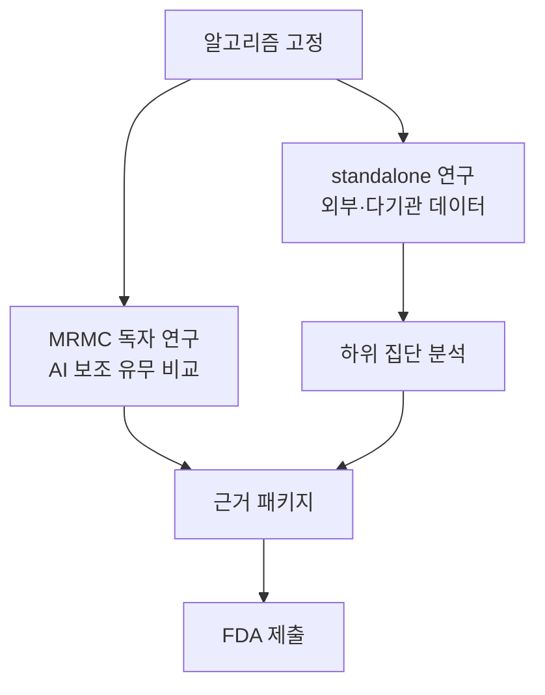

# 임상 근거

> 의료 AI가 허가 심사에서 내야 하는 성능 입증 자료. 알고리즘 단독 성능(standalone)과 의사가 쓸 때 성능이 어떻게 바뀌는지(reader study)가 대표적이다.

## 쉽게 말하면
신약이 "시험관에서 효과"와 "사람에게서 효과" 둘 다 필요하듯, 영상 AI도 "알고리즘이 정답을 얼마나 맞히나"와 "의사가 쓰면 더 잘 보나"를 따로 보인다.

## 자세히
출처: 컨설팅 업체 글과 규제 해설 검색 요약(FDA 지침 본문은 확인 못 함 — fda.gov에서 최신본 확인 필요). 업체 글은 자사 서비스 홍보를 겸한다.
- **standalone 연구**: 의사 없이 알고리즘 vs 정답(ground truth). AUC·민감도·특이도와 하위 집단(인종·성별·나이·스캐너 제조사·병원 등)별 결과를 낸다. 일반화 근거의 핵심.
- **MRMC 독자 연구**: 여러 판독자·여러 증례로 AI 보조 유무를 비교, ΔAUC 또는 고정 특이도에서 민감도 변화를 본다. 판독자 간 편차 때문에 교차(fully crossed) 설계를 기대한다.
- **규모(업체 글, 방사선과 510(k) 표본의 중앙값, LLM 추출 후 일부만 검수됨)**: MRMC 244건(IQR 200~398), standalone 900건(IQR 249~2,008), 비율 약 3.4배. 검증용 수치로 쓰지 말고 개별 확인.
- **설계 요령(요약)**: 학습 데이터와 시간·병원이 분리된 외부 검증 세트, 검증 전에 알고리즘(임계값 포함) 고정, 독립 데이터, 통계 분석 계획 사전 수립, 프로토콜을 FDA 사전 상담(Pre-Sub)에서 조율. MRMC 후 standalone을 계속 모으는 일정 전략, 판독자 휴지기 2~4주가 흔하다. 판독 순서는 FDA 지침이 무작위화를 요구하므로 고정 순서는 사전 협의.
- **CADe 지침(2020) 요약 주장**: standalone만으로 부족할 수 있고, 출력이나 적응증이 predicate와 다르면 독자 연구가 필요.
- 연관: 비교 대상 [predicate](#predicate-device), 업데이트 사전 승인 PCCP.

## 그림으로 보기

## 예시
- 흉부 CT 결절 AI: 독자 연구 판독자 15명 × 증례 250건(가정 수치), 별도 standalone 1,000건 이상에서 스캐너 제조사별 민감도를 보고.
- 외부 검증: 학습 병원 A·B, 검증 병원 C·D·E의 2025년 이후 촬영분.

## 헷갈리는 것과 비교
| 개념 | 차이 |
|---|---|
| standalone | 알고리즘 성능 |
| MRMC | 의사 성능 변화 |
| 임상시험(IDE) | 환자 대상 연구는 별도 규정(21 CFR 812) |
| [TEVV](#tevv) | 조직 차원의 평가 프레임 |

## 더 읽을거리
- [How to Plan MRMC and Standalone Studies (Innolitics)](https://innolitics.com/articles/mrmc-standalone-analysis/) — 연구 설계 사례(업체 글, 수치 주의)
- [FDA 510(k) 안내](https://www.fda.gov/medical-devices/premarket-submissions-selecting-and-preparing-correct-submission/premarket-notification-510k) — 성능 데이터 종류 설명
