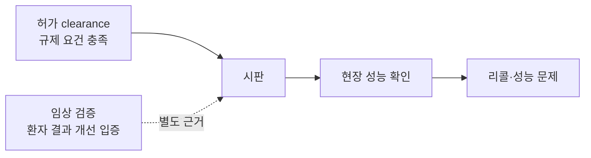

# 허가와 임상 검증의 차이

> FDA 허가(clearance)를 받았다는 것은 규제 기준을 통과했다는 뜻이지, 실제 환자에게 효과가 있다고 임상 시험으로 입증됐다는 뜻이 아니다.

## 쉽게 말하면
운전면허 필기시험에 합격했다고 도로 주행이 안전하다는 보장은 없다. 510(k)는 "기존 기기와 비슷하다"를 보이는 시험이라, 실제 환자에서 결과가 좋아졌는지는 별도로 확인해야 한다.

## 자세히
- 2025년 JAMA Health Forum 연구: 950개 AI 기기를 리콜 기록과 맞춰 보니 60개 기기에서 182건 리콜. 임상 검증 자료가 없는 기기는 리콜 가능성이 **오즈비 2.8배**, 상장사 기기는 5.9배.
- 검증 수준 분류: 없음 / 후향적 데이터셋 / 전향적 시험.
- 다른 연구(691개 AI/ML 기기, 2023년까지): 전향적 근거가 드물고 2021년 이후 허가 다수가 후향적 연구에 의존.
- 원인으로 지목: 510(k)는 대부분의 AI 기기에 전향적 사람 시험을 요구하지 않는다.
- 연구진 제안(FDA 정책 아님): 허가 전 사람 시험 요구, 허가 후 데이터 수집 장려, 5년간 공개 임상 데이터가 없으면 허가 취소.
- 주의: 상관관계이며 인과를 입증한 것은 아니다.

## 그림으로 보기

## 예시
- 병원 AI 구매 체크리스트: "FDA 허가 있음?"에 더해 "전향적 임상 연구 또는 우리 병원 데이터 검증이 있나?"를 질문.
- [임상 노트 정확도 평가](#clinical-note-accuracy)처럼 도입 전 현장 시험을 직접 설계.

## 헷갈리는 것과 비교
| 개념 | 차이 |
| --- | --- |
| 허가(clearance·approval) | 규제 요건 충족 |
| 임상 검증 | 실제 임상 결과로 효과 입증 |
| 후향적 검증 | 과거 데이터로 시험 |
| 전향적 시험 | 실제 환자에게 새로 적용해 관찰 |

## 더 읽을거리
- [JAMA Health Forum: Early Recalls and Clinical Validation Gaps](https://www.ncbi.nlm.nih.gov/pmc/articles/PMC12374217/) — 950개 기기 분석(PMC)
- [Medtech Dive: AI devices with no clinical validation tied to more recalls](https://www.medtechdive.com/news/ai-medical-devices-no-validation-more-recalls-jama/758991/) — 기사 요약
- [AHA: Clinical validation gaps](https://www.aha.org/aha-center-health-innovation-market-scan/2025-09-16-keep-eye-clinical-validation-gaps-ai-enabled-medical-devices) — 병원 관점
