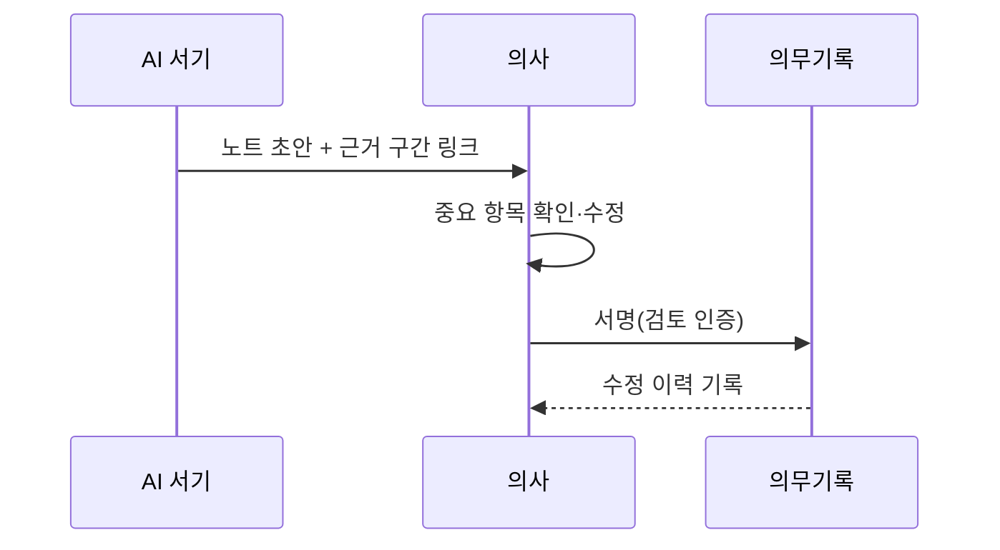

# 의사 검토·서명 절차

> AI가 만든 진료 노트 초안을 의사가 읽고 고친 뒤 서명(승인)해야 기록으로 확정하는 절차. AI 서기 안전의 마지막 방어선이지만, 형식적 클릭이 되면 방어가 되지 않는다.

## 쉽게 말하면
신입이 쓴 보고서를 팀장이 결재하는 구조다. 팀장이 읽지 않고 결재 버튼만 누르면 결재선은 있어도 검증은 없다. 특히 초안이 매끄러울수록 대충 넘기기 쉽다.

## 자세히
출처는 검색 결과 요약이며, 논문 원문(JMIR Med Inform 2026)은 열리지 않아 수치는 2차 요약이다. 확인 수준 낮음.
- **UC Davis 시범 연구(요약)**: AI 서기 노트 7,545건 중 의사가 평가한 표본에서 오류는 대부분 경미~중등도였고, 오류 있는 노트 중 5.3%(19건)가 심각·임박 위험(등급 4~5). 의사가 수정한 AI 단어 비율 중앙값 9.0%, 960건 중 143건(14.9%)은 전혀 수정되지 않음.
- **자동화 편향**: 호주 안전 지침이 의사가 AI 서기 출력을 정확·완전하다고 받아들이기 쉽다고 경고. 해설은 "매끄러운 초안은 빈 페이지보다 덜 검토된다"고 설명한다(의견, 통제 연구 아님).
- **시간 절감 vs 검토 시간**: JAMA 연구(의사 8,581명, 5개 의료 시스템)에서 도입자는 진료 8시간당 문서 작업 약 16분 절감(요약). 토론토 모의 연구는 69.1% 감소지만 절감에 검토·수정 시간이 포함되는지는 불명확. 스웨덴 연구는 자가 보고 4.7분 vs 실측 편집 93초(2차 인용).
- **서명 설계**: 한 번 클릭 "검토함" 인증은 실제 검토의 약한 증거라는 지적이 있다. 요약본의 중요 항목(알레르기·약·진단)에 확인 체크를 따로 두거나, AI가 근거 대화 구간을 연결해 주는 방식이 대안이다(제안 수준, 효과 검증 연구는 찾지 못함).
- **법·책임**: 텍사스 SB 1188이 AI 사용 기록의 검토와 환자 고지를 요구한다는 보도가 있다(원문 미확인). 업체 계약이 책임을 제한하면 부담이 의료기관으로 돌아온다.
- 오류 유형은 [누락과 환각 구분](#omission-vs-hallucination), 과신은 [사용자 과의존](#user-overreliance) 참고.

## 그림으로 보기

## 예시
- 시스템 규칙: 약물·알레르기 섹션은 의사가 항목별 체크해야 서명 활성화. 수정 비율·소요 시간을 로그로 남겨 형식적 서명(무수정·수 초 내 서명)을 감지.
- 도입 평가 지표에 "무수정 서명 비율"을 포함.

## 헷갈리는 것과 비교
| 개념 | 차이 |
|---|---|
| 검토·서명 | 사람의 최종 승인 절차 |
| 자동 품질 평가 | 시스템이 점수 산출 |
| [사람 개입 라우팅](#human-in-the-loop-routing) | 건별로 사람에게 보낼지 결정 |

## 더 읽을거리
- [Medical Economics: Are AI scribes safe?](https://medicaleconomics.com/view/are-ai-scribes-safe-) — 검색 결과로 확인한 해설 기사(본문은 열어 보지 못함)
