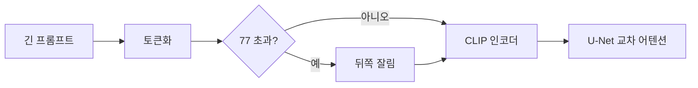
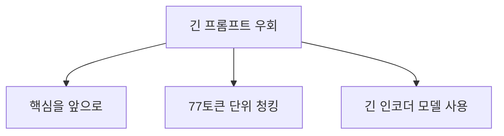

# 77토큰 한계와 긴 프롬프트

> CLIP 텍스트 인코더는 위치 임베딩이 최대 77개라서 프롬프트를 77토큰에서 잘라 내므로, 이미지 생성 모델에서 뒤쪽 문장이 무시될 수 있다.

## 쉽게 말하면
엽서에 쓸 수 있는 글자 수가 정해져 있어서 그 이상은 인쇄되지 않는 것과 같다. 긴 설명을 써도 뒷부분은 엽서에 안 실린다.

## 자세히
- HF CLIP 문서의 텍스트 설정 기본값에 `max_position_embeddings: 77`이 있다(확인). 이것이 텍스트 길이 상한의 근거다. CLIP은 4억 개 (이미지, 텍스트) 쌍으로 학습하고, 이미지·텍스트 인코더 특징을 같은 차원의 잠재 공간으로 사영해 내적으로 유사도를 낸다.
- Stable Diffusion은 동결된 CLIP 텍스트 인코더의 임베딩을 U-Net 교차 어텐션에 넣는다(HF 블로그). 그래서 같은 한계가 이미지 프롬프트에도 적용된다([텍스트 인코더](#clip-text-encoder)).
- 시작·끝 특수 토큰도 슬롯을 쓰므로 실제 내용은 약 75토큰이다(일반적 설명, 문서에 직접 서술은 없음).
- 우회(일반 관행, 이번에 직접 확인하지 않음): 중요한 단어를 앞에 두기, 긴 프롬프트를 77토큰씩 나눠 각각 인코딩해 이어 붙이는 청킹(Stable Diffusion WebUI·diffusers의 일부 도구가 지원), T5 같은 긴 텍스트 인코더를 병용하는 모델(Flux 등) 선택.
- 트레이닝 데이터 캡션이 대체로 짧다는 점도 긴 프롬프트가 효과적이지 않은 이유로 자주 언급된다(주장).

## 그림으로 보기



## 예시
```python
inputs = tokenizer(long_prompt, padding="max_length", max_length=77, truncation=True, return_tensors="pt")
# truncation=True 이면 77토큰 이후는 버려진다
```
상품 사진 생성에서 색상·소재 같은 핵심 묘사를 문장 앞에 두고, 장식적 수식어는 뒤로 보낸다.

## 헷갈리는 것과 비교
| 개념 | 차이 |
|---|---|
| 77토큰 한계 | CLIP 텍스트 위치 임베딩 상한 |
| LLM 컨텍스트 윈도 | 수천~수백만 토큰, 별개 개념 |
| 청킹 | 77토큰 단위로 나눠 인코딩 |
| [교차 어텐션](#cross-attention-diffusion) | 인코딩된 텍스트가 이미지에 영향 주는 경로 |

## 더 읽을거리
- [HF CLIP 문서](https://huggingface.co/docs/transformers/model_doc/clip) — CLIP 구조와 `max_position_embeddings: 77`.
- [Stable Diffusion with Diffusers](https://huggingface.co/blog/stable_diffusion) — 텍스트 인코더와 U-Net의 관계.
