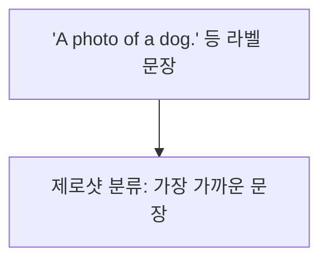

# CLIP 임베딩

> OpenAI의 CLIP(2021)이 이미지와 텍스트를 같은 벡터 공간에 올려 서로 비교할 수 있게 만든 임베딩이다. 4억 쌍의 (이미지, 글)을 대조 학습해 라벨 없이도 이미지를 문장으로 분류한다(제로샷).

## 쉽게 말하면
사진과 그 설명 문장을 한 지도 위에 찍어서, 서로 맞는 쌍은 가깝게, 틀린 쌍은 멀게 배치한 것이다. 그러면 "강아지 사진" 문장 근처의 이미지를 찾을 수 있다.

## 자세히
(Radford 외 arXiv 2103.00020 전문을 하위 에이전트가 읽은 노트 기준.)
- **데이터**: WIT(WebImageText) **4억 (이미지, 텍스트) 쌍**, 50만 개 질의에서 질의당 최대 2만 쌍 수집.
- **학습**: 이미지·텍스트 인코더의 L2 정규화 임베딩 사이 **대칭 대조 손실**. 학습되는 온도 초기값 0.07(최대 100으로 클리핑), 배치 32,768, 32 에폭. 텍스트 인코더는 12층 트랜스포머(6,300만 매개변수).
- **제로샷 결과**: 가장 좋은 모델 ViT-L/14@336px가 ImageNet 제로샷 **76.2%**(Visual N-Grams는 11.5%), top-5 95%. 프롬프트 템플릿 "A photo of a {label}."
- **계산량**: RN50x64는 V100 592개로 18일, 가장 큰 ViT는 V100 256개로 12일.
- **슬라이스 발견에서의 역할(제안)**: 이미지와 텍스트가 같은 공간에 있어 오류 군집에 문장 이름을 붙일 수 있다([오류 인식 혼합 모델](#error-aware-mixture-model)).
- 한계(제안): 웹 데이터의 편향이 임베딩에 반영되며, 세부 분류·계수 같은 과제에서는 약하다는 점이 알려져 있다(원 논문 한계 절은 이번에 읽지 않음).

## 그림으로 보기

## 예시
- 라벨 없는 상품 사진을 "A photo of a sneaker/boot/sandal"로 분류.
- 교육 활용: 이미지 검색을 텍스트 질의로 해 보는 실습.

## 헷갈리는 것과 비교
| 개념 | 차이 |
|---|---|
| CLIP | 이미지-텍스트 공통 임베딩 |
| 이미지 분류기 | 고정된 라벨 집합 |
| [Domino](#domino-slice-discovery) | CLIP 임베딩으로 오류 슬라이스 발견 |

## 더 읽을거리
- [Learning Transferable Visual Models From Natural Language Supervision (arXiv 2103.00020)](https://arxiv.org/abs/2103.00020) — CLIP 논문.
