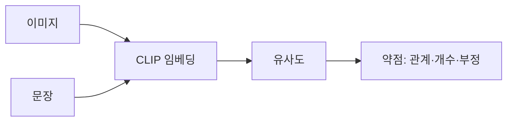
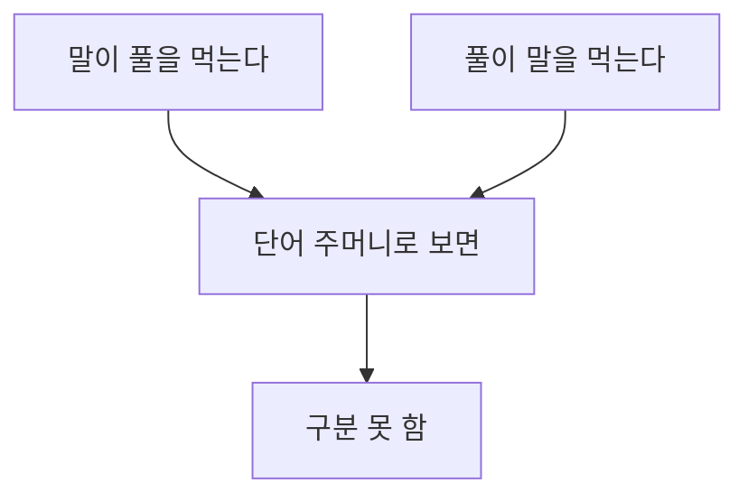

# CLIP의 한계

> CLIP은 이미지와 문장을 같은 공간에 놓는 강력한 모델이지만, **개체와 속성의 결합, 공간 관계, 개수, 부정**처럼 구성적인 이해에서는 약점이 알려져 있다. 문장을 "단어 주머니"처럼 다루는 경향이 대표적이다.

## 쉽게 말하면
사진을 보고 "말이 풀을 먹는다"와 "풀이 말을 먹는다"를 구별하지 못하는 학생과 같다. 필요한 단어가 다 들어 있으면 일단 맞다고 본다.

## 자세히
- 기본 성능(CLIP 논문, 초록 읽음): 인터넷에서 모은 **4억 개 (이미지, 텍스트) 쌍**으로 어떤 캡션이 어떤 이미지에 맞는지 예측하도록 학습. 30개 넘는 벤치마크에서 지도학습 기준선과 경쟁하는 경우가 많고, **ImageNet 제로샷 정확도가 원래 ResNet-50과 같다**.
- **단어 주머니(BoW) 행동**: 검색 요약에 따르면 CLIP이 속성을 해당 개체에 결합하지 못하는 현상이 자주 관찰된다. 2026 ICLR 논문은 이것이 단일 모달이 아닌 **모달 간(cross-modal)** 문제라 주장하며, 텍스트 쪽 선형 변환으로 ARO·SugarCrepe·COCO에서 개선을 보고했다.
- **ARO 벤치마크**: 속성(Visual Genome Attribution), 관계(Visual Genome Relation), 순서(COCO-Order·Flickr30k-Order) 이해를 시험. 저자들은 대조 학습이 비슷한 지름길이 있는 대규모 데이터에서 검색 성능만 최적화하기 때문일 수 있다고 가설을 세운다.
- **공간·수량·부정**: 텍스트 인코더가 부정, 공간·수치 추론, 미묘한 속성 구분에 어려움이 있다는 리뷰와, 상위 대조 모델이 공간 관계·숫자·부정을 텍스트로 잘 인코딩하지 못한다는 연구가 있다. 한 연구는 별 개수 세기가 불안정하고 수량 편향이 있다고 보고.
- 최근 프리프린트(검증 약함): 색은 BoW 신호를 94% 유지하지만 공간 관계는 19%.
- 편향 문제도 알려져 있으나 이번에 읽은 출처에서는 직접 확인하지 못했다.
- 실무: 검색·분류에는 강하지만 정확한 관계·개수·위치 질문에는 다른 모델이나 검증 단계를 덧붙인다.

## 그림으로 보기

## 예시
- "빨간 큐브 위의 파란 구"와 "파란 큐브 위의 빨간 구"를 고르는 시험에서 약함.
- 교육: 이미지 검색 데모로 한계 사례를 직접 찾아 보는 실습.

## 헷갈리는 것과 비교
| 개념 | 차이 |
|---|---|
| CLIP 강점 | 제로샷 분류·이미지-텍스트 검색 |
| CLIP 한계 | 구성적 이해(결합·관계·개수·부정) |
| [VLA](#vla) | 시각-언어 이해를 행동으로 연결하는 모델 |

## 더 읽을거리
- [CLIP 논문](https://arxiv.org/abs/2103.00020) — 4억 쌍, 제로샷 성능(초록 읽음).
- [CLIP Behaves like a Bag-of-Words Model Cross-modally](https://arxiv.org/html/2502.03566v1) — BoW 분석(검색 결과 확인).
