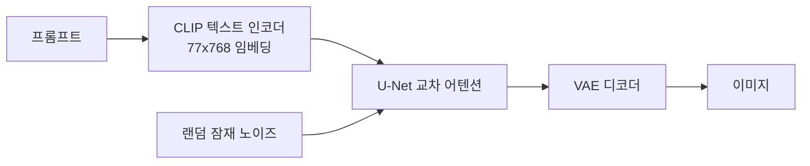

# CLIP 텍스트 인코더

> 글과 이미지를 같은 "의미 공간"의 숫자 벡터로 바꾸도록 함께 훈련된 모델(OpenAI, 2021). Stable Diffusion은 이 중 텍스트 쪽을 떼어 프롬프트를 숫자로 바꾸는 데 쓴다.

## 쉽게 말하면
외국어를 모르는 화가에게 "고양이"라는 말을 그대로 건넬 수는 없다. 통역사가 말을 "그림 감각"으로 번역해 줘야 한다. CLIP 텍스트 인코더가 바로 그 통역사다. 이 통역사는 사진과 설명문 짝을 엄청나게 많이 보며, "이 문장은 이 사진과 가깝다"는 감각을 익혔다.

## 자세히
- **대조 학습**: 인터넷의 이미지-텍스트 약 4억 쌍으로 "어떤 캡션이 어떤 이미지의 짝인가"를 맞히도록 훈련했다(Radford et al., 2021). 이미지 인코더와 텍스트 인코더가 짝이면 벡터를 가깝게, 아니면 멀게 만든다.
- **제로샷**: 분류 라벨 없이도 "a photo of a dog" 같은 문장과 가까운 이미지를 고를 수 있다. 30개 넘는 비전 데이터셋으로 평가했다.
- **Stable Diffusion v1에서의 역할**: 프롬프트를 토큰 최대 77개로 잘라 77×768 크기의 임베딩으로 만든다. 이 임베딩이 [U-Net](#unet-denoiser)의 교차 어텐션에 들어가 이미지 생성을 이끈다. 이 인코더는 SD 훈련 중 추가로 학습하지 않고 고정한다(Hugging Face 블로그).
- 한계: 77토큰 제한, 숫자 세기·글자 쓰기·공간 관계("왼쪽에")에 약하다. 그래서 이후 모델은 인코더를 키우거나(SDXL은 CLIP 두 개 사용) T5 같은 언어 모델을 함께 쓴다.

## 그림으로 보기

## 예시
- 프롬프트가 77토큰을 넘으면 뒤쪽이 잘려 반영되지 않는다 → 중요한 말을 앞에 쓴다.
- 이미지 검색: 사진들을 CLIP 이미지 벡터로 저장하고, 검색어의 텍스트 벡터와 가까운 것을 찾는다([임베딩](#text-embedding) 활용).

## 헷갈리는 것과 비교
| 개념 | 차이 |
|---|---|
| CLIP 텍스트 인코더 | 문장→벡터. 글을 생성하지 않는다 |
| LLM(GPT류) | 다음 토큰을 생성한다 |
| [U-Net](#unet-denoiser) | 벡터의 안내를 받아 노이즈를 걷어 내는 쪽 |

## 더 읽을거리
- [Learning Transferable Visual Models From Natural Language Supervision](https://arxiv.org/abs/2103.00020) — CLIP 원 논문.
- [Stable Diffusion with Diffusers](https://huggingface.co/blog/stable_diffusion) — 텍스트 인코더·U-Net·VAE·스케줄러의 역할.
