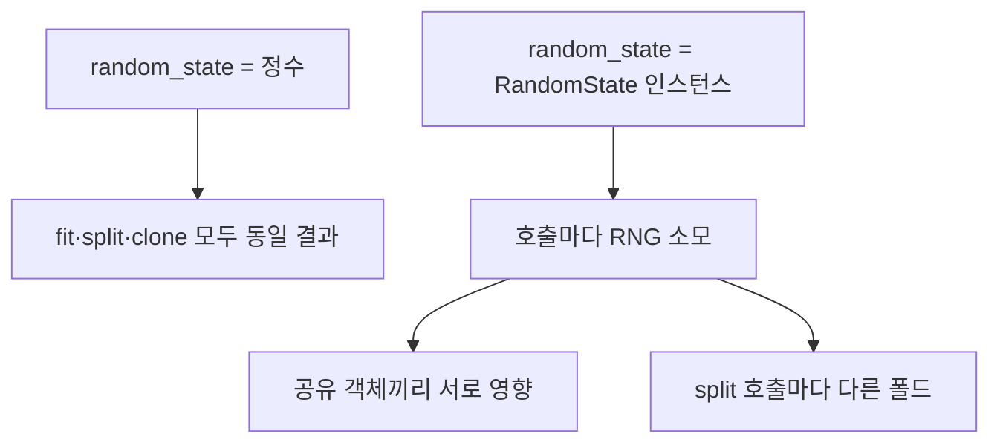
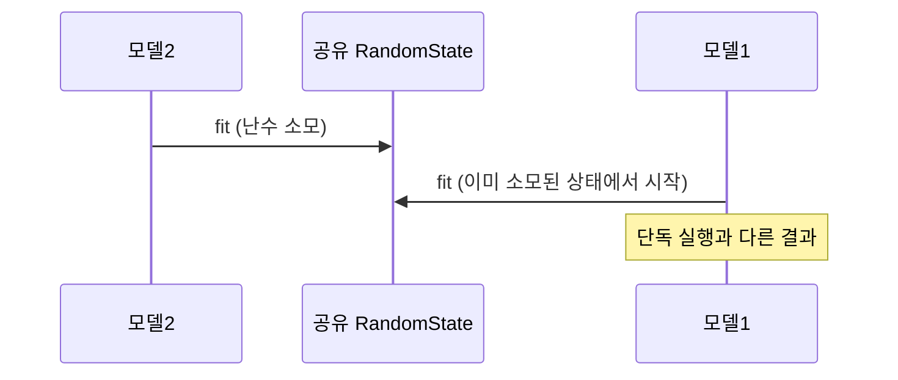

# clone과 난수 공유

> scikit-learn에서 `random_state`에 **정수가 아니라 `RandomState` 인스턴스**를 넘기면 난수 생성기가 객체 사이에서 **공유·소모**되어, 객체를 만들거나 복제(`clone`)하는 순서에 따라 결과가 달라질 수 있다. 재현성을 원하면 정수 시드를 쓰고, 인스턴스는 의도를 알고 쓴다.

## 쉽게 말하면
정수 시드는 "주사위를 처음 위치부터 던지기"라서 누가 던져도 같다. 인스턴스는 "주사위 통을 같이 돌려 쓰기"라서 앞사람이 던진 만큼 상태가 바뀌어 내 결과가 달라진다.

## 자세히
(scikit-learn 1.9.1에서 직접 실행. 개념은 공식 Common pitfalls의 Controlling randomness 절 참고)
- **정수 시드**: `fit`·`split`을 몇 번 불러도 같은 결과, `clone(a)`도 같은 예측. (직접 확인: 정수 시드 포레스트와 그 clone의 `predict_proba` 완전 일치)
- **인스턴스**: 같은 객체로 `fit`을 두 번 하면 **다른 모델**이 나온다(두 번째 fit 때는 RNG 상태가 이미 소모됨). 공식 문서: None이나 `RandomState` 인스턴스는 호출마다 결과가 달라지고, RNG가 호출 사이에 이어진다.
- **clone은 상태를 복사한다**: 직접 확인한 결과 `clone`한 객체의 `random_state`는 **다른 객체**이고, 복제 시점의 상태를 가진다. 사용 전 복제하면 원본과 동일한 모델이 나오고, 원본을 `fit`한 뒤 복제하면 소모된 뒤의 상태를 이어받는다. 공식 문서는 인스턴스를 가진 추정기의 `clone`이 "정확한 복제가 아니라 통계적 복제"라고 설명한다. `GridSearchCV`가 후보마다 추정기를 `clone`하므로 이 성질이 관련된다.
- **두 객체가 같은 인스턴스를 공유할 때(직접 확인)**: `m1`과 `m2`가 같은 `RandomState`를 가지면 `m2.fit`을 먼저 했는지에 따라 `m1`의 결과가 달라졌다. 객체들이 서로의 RNG를 소모한다.
- **CV 분할기**: `KFold(shuffle=True, random_state=RandomState(0))`로 `split`을 두 번 호출하면 **폴드가 서로 달랐다**(직접 확인), 정수 0이면 동일. 공식 문서도 인스턴스를 쓰면 `split` 호출마다 다른 폴드가 나와 모델 간 폴드별 비교가 무효가 될 수 있다고 한다(한 번의 `search.fit` 안에서는 `split`을 한 번만 호출해 괜찮다).
- **GridSearchCV 실험**: 추정기 시드가 정수든 인스턴스든 이 작은 문제에서는 같은 최적값을 골랐다(둘 다 `max_depth=4`, 점수 0.9667). 작은 데이터에서는 차이가 안 드러나지만 재현성이 걸린 실험에서는 정수가 안전하다.
- **권장(공식 문서)**: 재현성은 `random_state=None`을 없애고 하나의 `rng`를 맨 위에 선언해 전달하거나, 정수 시드를 일관되게 쓴다. 견고성은 추정기에는 인스턴스/None으로 폴드별 난수를 달리 해 한 시드의 운을 피하고, CV 분할기에는 정수를 줘 같은 분할로 비교한다. 상충해 보이는 두 권고는 **목적(재현성 vs 견고성)에 따라 다르게 적용**하는 것이다.
- **체크리스트**: ① 분할기는 정수 ② 추정기는 재현성이 목적이면 정수, 변동 확인이 목적이면 여러 시드 ③ 객체 간 인스턴스 공유 금지 ④ 병렬 실행(`n_jobs`)에서 순서 의존이 없는지 확인.

## 그림으로 보기



## 예시
```python
rng = np.random.RandomState(0)
m1 = RandomForestClassifier(random_state=rng)
m2 = RandomForestClassifier(random_state=rng)   # 같은 rng 공유 → m1 결과가 m2 실행 순서에 의존
kf = KFold(5, shuffle=True, random_state=0)      # 분할기는 정수로 고정
```
- 팀 코드에서 노트북 셀 실행 순서에 따라 점수가 바뀐다면 공유 `RandomState`를 의심한다.

## 헷갈리는 것과 비교
| 개념 | 차이 |
|---|---|
| 정수 시드 | 매번 같은 시작점, 재현 쉬움 |
| RandomState 인스턴스 | 소모되는 공유 상태 |
| `clone` | 복제 시점의 난수 상태를 복사한 새 객체 |
| [여러 시드 평균](#seed-sweep-reporting) | 시드를 의도적으로 바꾸는 견고성 방법 |

## 더 읽을거리
- [scikit-learn Common pitfalls — Controlling randomness](https://scikit-learn.org/stable/common_pitfalls.html) — random_state 규칙, 공유 RNG, CV 분할기 권고.
- [KFold API](https://scikit-learn.org/stable/modules/generated/sklearn.model_selection.KFold.html) — `shuffle`·`random_state` 파라미터.
