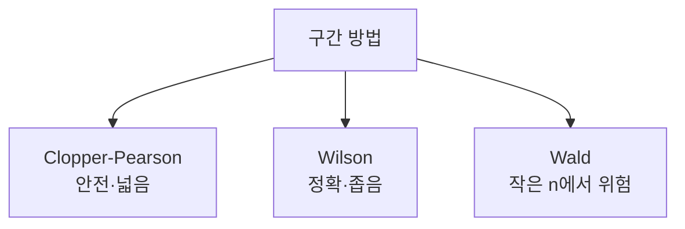

# Clopper-Pearson 구간

> Clopper-Pearson 구간은 이항 분포에서 직접 계산해 신뢰구간의 실제 포함 확률이 명목 수준(예: 95%) 아래로 내려가지 않게 보장하는 "정확한(exact)" 비율 신뢰구간이다. 보장 덕분에 대체로 보수적(넓게 나옴)이다.

## 쉽게 말하면
"오류가 20건 중 1건"이라는 관찰에서 진짜 오류율을 가늠할 때, 여유를 충분히 둬서 "진짜 값이 이 범위 밖일 확률은 5% 이하"라고 자신 있게 말할 수 있게 만든 안전 우선 구간이다. 안전을 위해 구간이 조금 넓다.

## 자세히
- **정의(Wikipedia Binomial proportion confidence interval, 열람)**: n번 중 x번 성공이면 구간은 베타분포의 분위수로 주어진다. 하한은 Beta(α/2; x, n−x+1)의 분위수, 상한은 Beta(1−α/2; x+1, n−x)의 분위수다. x=0이면 (0, 1−(α/2)^(1/n)), x=n이면 ((α/2)^(1/n), 1)이다.
- **"정확하다"의 뜻**: 근사가 아니라 이항 분포에 직접 기반하며, 실제 포함 확률이 명목 1−α보다 작아지지 않는다고 문서가 말한다. 그래서 보통 보수적이다. 95% 구간이 실제로는 95%보다 훨씬 높게 포함될 수 있고 필요 이상으로 넓을 수 있다.
- **Wilson과 비교(같은 문서)**: Wilson 점수 구간이 가장 정확하고 견고한 쪽에 속하고 포함 확률이 명목에 더 가깝다. Clopper-Pearson은 과포함 경향이 있다. 두 구간 모두 대응하는 유의성 검정과 일관된다.
- **Wald(정규 근사)와 비교(같은 문서)**: Wald 구간은 [0,1]을 넘거나 p̂이 0 또는 1일 때 폭이 0이 되어 "확실하다고 잘못 암시"한다. 실제 포함 확률이 큰 표본에서도 명목 아래로 내려갈 수 있다. Clopper-Pearson은 최소 포함 확률을 보장해 이 문제를 피한다.
- **직접 계산한 비교(순수 파이썬, 이항 분포 직접 계산과 이분법, 95%)**

| 관찰(x/n) | Clopper-Pearson | Wilson | Wald |
| --- | --- | --- | --- |
| 0/300 | 0 ~ 1.22% | 0 ~ 1.26% | 0 ~ 0% |
| 1/20 | 0.13% ~ 24.9% | 0.89% ~ 23.6% | 0 ~ 14.6% |
| 5/100 | 1.64% ~ 11.3% | 2.15% ~ 11.2% | 0.73% ~ 9.3% |
| 2/50 | 0.49% ~ 13.7% | 1.10% ~ 13.5% | 0 ~ 9.4% |

  0/300에서 CP 상한 1.22%는 문서의 x=0 공식 1−0.025^(1/300)과 일치한다. 작은 표본(1/20, 2/50)에서 Wald의 상한이 CP·Wilson보다 훨씬 낮아 지나치게 낙관적이다. 앞서 [자동 승인 표본 감사](#audit-sampling-auto-approved)의 "3의 법칙"과 맞춰 보면 0/300의 편측 95% 상한 약 1%(3/300)에 해당하는 양측 구간이 1.22%다.
- **선택(해석)**: 규제 보고처럼 "절대 과소평가하면 안 되는" 맥락이나 극히 작은 표본에는 CP, 일반적인 정확도 보고에는 Wilson이 좋은 기본값이다. 어느 방식이든 사용한 방법을 명시한다.
- **구현(해석)**: 베타 분위수는 `scipy.stats.beta.ppf`로 구한다. 이 실험에서는 scipy 없이 직접 계산했다.

## 그림으로 보기

## 예시
- 안전 검증: 의료 AI가 300건에서 위험 오류 0건이었을 때 "오류율 0%"가 아니라 "95% 신뢰로 1.22% 이하"로 보고한다.
- 교육 활용: 같은 관찰(1/20)을 세 방법으로 구해 폭이 어떻게 다른지 비교하는 실습.

## 헷갈리는 것과 비교
| 개념 | 차이 |
| --- | --- |
| [Wilson 구간](#wilson-interval) | 상위 주제. 포함 확률이 명목에 가깝고 더 좁음 |
| Clopper-Pearson | 최소 포함 확률 보장, 보수적 |
| [Wald 구간의 실패](#wald-interval-failure) | 가장 단순하지만 작은 n·극단 비율에서 실패 |
| [3의 법칙](#rule-of-three) | 관찰 0건일 때의 편측 근사 상한 3/n |

## 더 읽을거리
- [Wikipedia: Binomial proportion confidence interval](https://en.wikipedia.org/wiki/Binomial_proportion_confidence_interval) — CP·Wilson·Wald 정의와 비교
