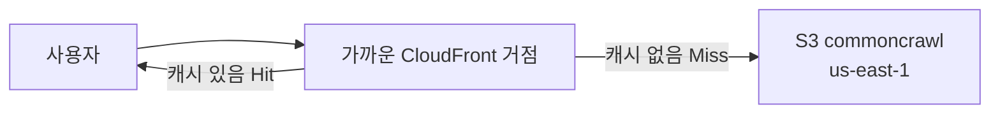
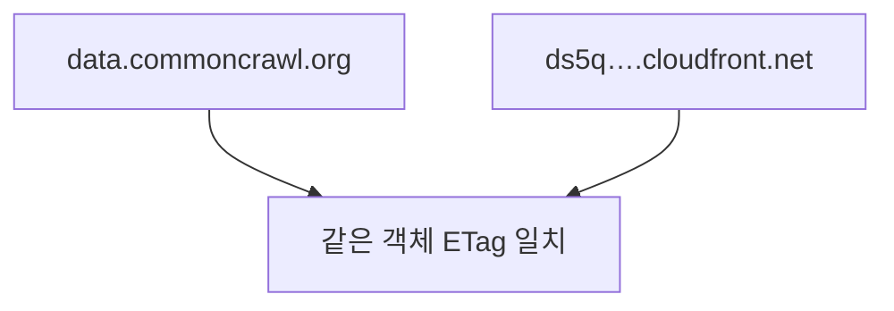

# CloudFront 주소

> Common Crawl 파일은 S3 외에 **CloudFront(AWS의 콘텐츠 전송망)를 거치는 HTTPS 주소**로도 받을 수 있다. `data.commoncrawl.org`와 `ds5q9oxwqwsfj.cloudfront.net`이 같은 파일을 가리킨다.

## 쉽게 말하면
본사 창고(S3)가 멀리 있어도 전국 곳곳의 "동네 배송센터(CloudFront 거점)"가 물건을 대신 내주는 구조다. 어디서 받느냐에 따라 가까운 거점이 응답한다.

## 자세히
(Common Crawl 시작하기 페이지를 읽고 2026-11-28에 두 주소로 직접 HTTP 요청해 확인)
- **안내**: 시작하기 페이지는 `https://data.commoncrawl.org/`를 HTTPS 다운로드 주소로, `https://ds5q9oxwqwsfj.cloudfront.net/[...]`를 **대체 URL 접두사**로 적는다. AWS 계정이 필요 없고 `wget`·`curl`로 받는다.
- **직접 확인**(`crawl-data/CC-MAIN-2024-10/warc.paths.gz`, 헤더 요청):
  - 두 주소 모두 HTTP/2 200, `content-length: 180687`, `accept-ranges: bytes`, `server: AmazonS3`, 응답 헤더에 **`via: … (CloudFront)`**와 `x-amz-cf-pop`(응답한 CloudFront 거점 코드, 요청에서는 IAD 계열)이 있었다.
  - **ETag가 서로 같았다**(`0bc9ca32…`) → 같은 객체다. 즉 `data.commoncrawl.org`도 뒤에서 CloudFront를 거친다.
  - 두 주소 모두 `x-cache: Miss from cloudfront`(첫 요청은 캐시에 없어 원본에서 가져옴).
  - CloudFront 주소로 `Range: bytes=0-99` 요청 → **HTTP 206**, 100바이트. 그래서 [오프셋으로 레코드 받기](#record-fetch-by-offset)를 이 주소에서도 쓸 수 있다.
- **언제 어느 주소를 쓰나(제안)**: 일반 PC·서버는 `data.commoncrawl.org`면 충분하다. 한쪽이 막히거나 느릴 때 다른 주소를 시도한다. 로컬 개발·소량 다운로드에 적합하고, 대량 가공은 데이터와 같은 리전의 S3를 쓰는 편이 낫다([리전 간 전송 요금](#cross-region-transfer-fees)).
- **요금 쪽 사실**: AWS S3 요금 페이지는 S3→CloudFront 전송이 무료라고 밝히지만, 사용자가 CloudFront에서 내려받는 부분의 요금은 Common Crawl이 부담하는 구조인지 등은 문서에서 확인하지 못했다.
- 한계: 거점 코드(`IAD…`)는 이 실습 환경에서 본 값이며 위치마다 다르다. 호스트 이름(`ds5q…`)은 바뀔 수 있어 시작하기 페이지의 최신 값을 확인한다.

## 그림으로 보기

## 예시
| 확인 항목 | 결과 |
|---|---|
| 두 주소 `content-length` | 180687 (같음) |
| ETag | 0bc9ca32… (같음) |
| Range 0-99 | 206, 100바이트 |
- 업무 장면: 교육 실습 중 학교 네트워크에서 한 주소가 차단되면 다른 주소로 바꿔 같은 파일을 받는다.

## 헷갈리는 것과 비교
| 개념 | 차이 |
|---|---|
| CloudFront 주소 | HTTPS로 받는 전송망 경유 주소 |
| `s3://` / [`s3a://`](#s3a-hadoop-protocol) | AWS·하둡이 S3에 직접 접근 |
| AWS CLI `--no-sign-request` | CLI로 익명 접근 |
| [Common Crawl 접근 방법](#cc-s3-access) | 이 주소가 속한 상위 문서 |

## 더 읽을거리
- [Common Crawl 시작하기](https://commoncrawl.org/get-started) — CloudFront 접두사 안내(직접 읽음).
- [Amazon S3 요금](https://aws.amazon.com/s3/pricing/) — S3→CloudFront 전송 무료(직접 읽음).
