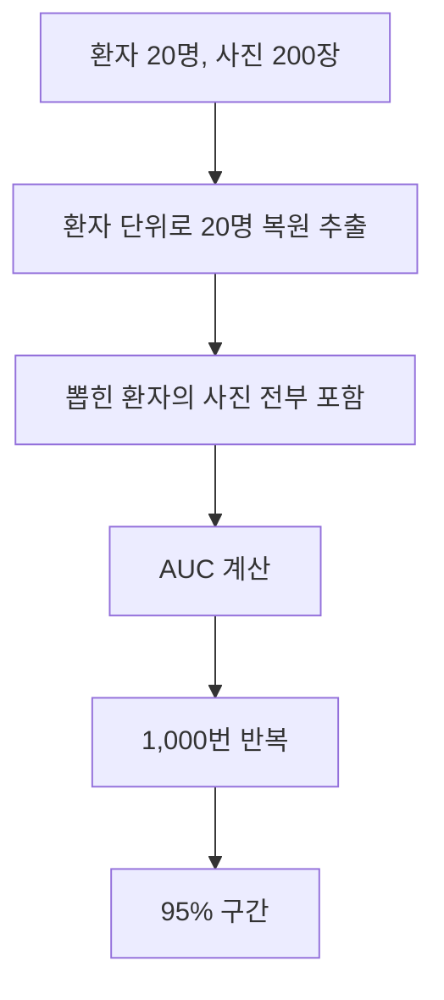
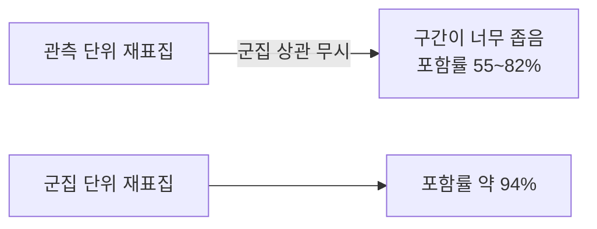

# 군집(그룹) 부트스트랩

> 한 사람·한 문서·한 장비에서 나온 **여러 관측이 서로 닮아 있을 때**, 관측이 아니라 **묶음(군집) 단위로 복원 추출**해 신뢰구간을 구하는 방법. 묶음 안의 데이터는 쪼개지 않고 통째로 뽑는다.

## 쉽게 말하면
환자 20명에게서 사진을 각 10장씩 찍어 200장을 모았다. 사진 200장을 독립 표본 200개처럼 섞어 뽑으면 "같은 사람 사진이 닮은 효과"를 무시해 실제보다 자신만만한 구간이 나온다. 진짜 독립 단위는 **환자 20명**이므로 환자를 뽑고, 뽑힌 환자의 사진은 전부 따라온다.

## 자세히
- **절차**: ① 군집 수 G개 중 G개를 복원 추출 ② 뽑힌 군집의 모든 관측을 그대로 포함(군집마다 관측 수가 달라 표본 크기가 변해도 됨) ③ 지표(AUC·정확도 등) 재계산 ④ 1,000~2,000번 반복 ⑤ 2.5%·97.5% 분위수.
- **근거(2023 돼지 ELISA 진단 연구, PMC10728486, 열어 확인)**: 같은 동물에서 여러 관측이 나올 때 기존 부트스트랩의 95% 구간 포함률이 설정에 따라 **55~82%** 까지 무너졌고, 군집 부트스트랩은 모든 설정에서 **약 93.7~94.7%** 로 명목 95%에 가까웠다. 개체 효과가 크면 군집 방식 구간이 훨씬 넓었다(예: 폭 0.157 vs 0.077). 개체 효과가 작으면 둘이 거의 같았다. 실제 데이터의 AUC 0.958은 두 방식의 구간 폭 차이가 작았다(0.0405 vs 0.0421).
- **다른 확인 출처(검색 요약)**: 눈 데이터 튜토리얼에서 단순 방식의 AUC 차이 구간이 군집·비모수 방식보다 좁았다. 분석적 대안으로 Obuchowski의 군집 ROC 분산법이 있다.
- **ML 평가에서 군집이 되는 것**: 같은 환자의 여러 영상, 같은 사용자의 여러 대화, 같은 문서에서 자른 문장, 같은 원본에서 증강한 샘플. 학습/시험 분리도 같은 단위로 해야 누수가 없다.
- **두 모델 비교**: 같은 군집 재표집으로 AUC 차이를 계산([짝지은 부트스트랩](#paired-bootstrap-model-comparison)). 각 모델의 구간을 따로 구해 겹침만 보면 불확실성을 과대평가한다(상관이 큰 경우).
- **한계**: 군집 수 G가 작으면(예: 10 미만) 불안정. 군집이 몇 개 안 되면 가정이 무너진다.

## 그림으로 보기



## 예시
```python
import numpy as np
rng = np.random.default_rng(0)
groups = np.unique(g)
def cluster_boot(y, s, g, metric, B=2000):
    out = []
    for _ in range(B):
        pick = rng.choice(groups, len(groups), replace=True)
        idx = np.concatenate([np.where(g == k)[0] for k in pick])
        out.append(metric(y[idx], s[idx]))
    return np.percentile(out, [2.5, 97.5])
```
- 챗봇 평가에서 사용자당 대화가 여러 개라면 `g=user_id`로 설정.

## 헷갈리는 것과 비교
| 방법 | 재표집 단위 | 쓸 때 |
|---|---|---|
| 일반 부트스트랩 | 관측 | 관측이 독립 |
| 군집 부트스트랩 | 군집(환자·사용자) | 군집 내 상관 |
| [부트스트랩 CI(CV)](#bootstrap-ci-for-cv) | 예제 | CV 결과 구간 |
| 층화 부트스트랩 | 클래스별 | 클래스 비율 유지 |

## 더 읽을거리
- [Nonparametric bootstrap methods for AUC interval… swine ELISA (PMC10728486)](https://pmc.ncbi.nlm.nih.gov/articles/PMC10728486/) — 군집 부트스트랩의 포함률 실험(열어 확인).
