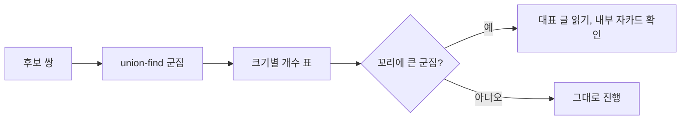
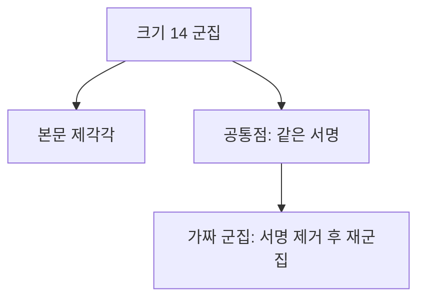

# 군집 크기 분포 그리기

> 중복 제거 전에 **군집 크기별로 군집이 몇 개인지 세어 표(히스토그램)로 보는 점검**이다. 대부분이 크기 1~2이고 꼬리에 비정상적으로 큰 군집이 있으면, 그 군집부터 열어 보면 문제의 원인(서명·틀 문구·사슬 연결)이 보인다.

## 쉽게 말하면
학교 학급 크기를 세어 보니 대부분 30명 안팎인데 한 학급만 200명이다. 이 학급을 열어 보면 "실제 학급"이 아니라 "복도에 서 있던 사람 전부"를 잘못 묶은 것일 수 있다. 분포를 먼저 보면 이런 이상을 바로 찾는다.

## 자세히
- **직접 실행**(20 newsgroups 학습셋에서 30단어 이상인 글 9,373개, 헤더·서명·인용 제거 옵션 적용 후 단어 5-그램 MinHash(128), datasketch LSH 임계 0.5, 후보 쌍을 union-find로 연결([전이적 군집화](#transitive-clustering))):

| 군집 크기 | 군집 수 |
|---|---|
| 1(중복 없음) | 8,996 |
| 2 | 154 |
| 3 | 14 |
| 4 | 2 |
| 5 | 1 |
| **14** | **1** |

  후보 쌍 251개, 군집 9,168개, 크기 2 이상 군집에 속한 글은 377개(약 4%). 크기 3 이상은 18개뿐이라 꼬리 하나가 눈에 띈다.
- **꼬리 열어 보기**: 크기 14짜리 군집의 글들은 "색맹과 원추세포", "노년각화증은 간과 무관", "뇌농양" 등 **내용이 전혀 다른 글**이었다. 원인은 모두 같은 사람의 **서명**("Skepticism is the chastity of the intellect…" 인용구와 이메일 주소)이 글 끝에 붙어 있고 본문은 짧았기 때문이다. 군집 안 91쌍 중 자카드 0.5 이상은 3쌍, 중앙값 0.31이었다. 즉 **진짜 중복 군집이 아니라 서명 때문에 생긴 가짜 군집**이다.
- **해석**: 히스토그램의 꼬리를 열어 보면 ① 보일러플레이트·서명([보일러플레이트](#boilerplate-duplicates)) ② 사슬 연결 ③ 진짜 대량 복제(스팸, 약관)를 구분할 수 있다. 이 데이터에서는 헤더·서명 제거 옵션이 완벽하지 않아 서명이 일부 남았다. 서명이 본문보다 긴 짧은 글에서 특히 잘 생긴다. 이 실험은 임계 0.5 한 값의 결과이고, 문서가 설명하듯 LSH 후보는 **검증 전 후보**(부드러운 임계값이라 거짓 양성 포함)인데 이 실험에서는 자카드 재검증 없이 연결했다. 재검증 단계를 넣으면 가짜 군집이 줄었을 것이다. 결과는 임계값에도 따라 달라진다.
- **점검 절차(제안)**: ① 군집 크기 분포표와 상위 5개 군집의 대표 글 읽기 ② 군집 내부 자카드 중앙값·최솟값 확인 ③ 비정상 군집은 규칙 보정(서명 제거 등) 후 재군집 ④ 전체 제거 후 남는 문서 수 예측.

## 그림으로 보기

## 예시
- 사내 메일 정제: 군집 상위 크기 목록을 뽑아 보니 상위 군집이 전부 "회사 면책 문구"여서 문구 제거 규칙을 먼저 추가.
- 교육: 위 코드를 돌려 크기 분포를 표로 만들고 가장 큰 군집이 왜 생겼는지 추적하는 과제.

## 헷갈리는 것과 비교
| 개념 | 차이 |
|---|---|
| 군집 크기 분포 | 군집의 규모 분포 점검 |
| [군집 크기](#duplicate-cluster-size) | 크기가 의미하는 바 |
| [전이적 군집화](#transitive-clustering) | 큰 군집을 만드는 연결 방식 |
| [제거·보존 비교](#removed-vs-kept-comparison) | 제거 결과의 질을 별도로 비교 |

## 더 읽을거리
- [datasketch MinHash LSH 문서](http://ekzhu.com/datasketch/lsh.html) — threshold는 곡선의 전환점이고 query 결과는 검증 전 후보라는 설명(열어 확인).
- [scikit-learn 실제 데이터셋 문서](https://scikit-learn.org/stable/datasets/real_world.html) — 20 newsgroups와 remove 옵션(열어 확인).
