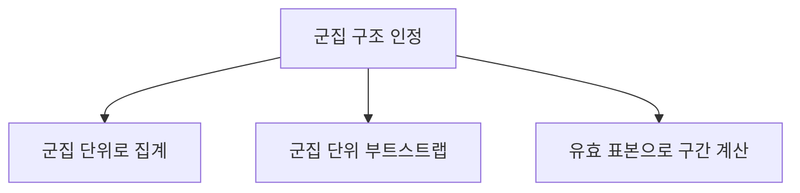

# 군집 표본의 신뢰구간

> 평가 문항이 같은 문서·같은 대화·같은 고객에서 여러 개 나왔다면 문항들은 서로 독립이 아니다. 독립이라고 보고 신뢰구간을 구하면 실제보다 훨씬 좁게 나와 과신하게 된다. 설계효과(design effect)로 유효 표본 크기를 줄여서 계산한다.

## 쉽게 말하면
설문 1,000명이라지만 50개 가족에서 20명씩 뽑았다면 같은 가족 구성원들은 서로 비슷하게 답한다. 정보량은 1,000명이 아니라 그보다 훨씬 적다. 쌍둥이에게 같은 질문을 두 번 한 것을 두 명의 의견으로 세면 안 된다.

## 자세히
- **설계효과(Wikipedia Design effect, 열람)**: 실제 표본 설계에서 추정량의 분산을 같은 크기의 단순 무작위 추출의 분산으로 나눈 비율이다. 1이면 단순 무작위와 같고 1보다 크면 덜 정밀하다. 군집 추출에서 Kish 공식은 Deff = 1 + (n* − 1)ρ이며 n*는 평균 군집 크기, ρ는 군집 내 상관(ICC)이다. 군집 크기가 다르면 평균 크기를 쓰는 것이 보수적(상한) 추정이다. 유효 표본 크기 n_eff = n / Deff다.
- **ICC(Wikipedia Intraclass correlation, 열람)**: 군집 안의 단위들이 서로 얼마나 닮았는지를 나타내며 현대적 정의로는 군집 간 분산을 전체 분산(군집 간 + 잡음)으로 나눈 값이다. 문서는 변형에 따라 값이 크게 달라질 수 있어 변형 선택이 중요하다고 주의한다.
- **직접 계산한 예**: 평가 문항 1,000개가 50개 문서에서 문서당 20개씩 나왔다. 정확도 90%일 때
  - 독립으로 가정(Wilson, n=1,000): 88.0% ~ 91.7%
  - ICC 0.05면 Deff = 1 + 19×0.05 = 1.95, n_eff ≈ 513 → 구간 87.1% ~ 92.3%로 넓어짐
  - ICC 0.3이면 Deff = 6.7, n_eff ≈ 149 → 구간이 84.1% ~ 93.9%로 눈에 띄게 넓어짐
  (위 값은 Wilson 공식에 n_eff를 넣은 근사이며, ICC는 가정한 값이다.) 이 방법은 근사이고 실제 ICC는 데이터에서 추정해야 한다.
- **현실의 군집(해석)**: 같은 문서에서 만든 여러 질문, 같은 고객의 여러 대화, 같은 프롬프트의 변형, 같은 출처에서 긁어온 문장들. 문항 간 중복이 있으면 더 심하다.
- **대응(해석)**: ① 군집 단위로 집계해 평균을 내고 군집 수를 표본 수로 본다 ② 군집을 단위로 재표본하는 부트스트랩 ③ Deff로 유효 표본 크기를 구해 구간을 넓힌다 ④ 평가 세트를 만들 때 군집 수를 늘리는 쪽이 문항 수를 늘리는 것보다 효과적이다.
- **보고**: "n=1,000(50개 문서 군집, ICC 가정 0.05)"처럼 군집 구조를 함께 적는다.

## 그림으로 보기

## 예시
- RAG 평가 세트에서 문서 한 개당 질문 20개를 만들었다면 문서 50개가 곧 표본 수에 가깝다. 정확도를 보고할 때 "문서 50개·질문 1,000개"라고 쓰고 군집을 고려한 구간을 낸다.
- 교육 활용: "표본 1,000개"라는 말을 들으면 "몇 개의 출처에서 나왔나?"를 묻는 습관을 가르친다.

## 헷갈리는 것과 비교
| 개념 | 차이 |
| --- | --- |
| [Wilson 구간](#wilson-interval) | 독립을 가정. 군집이면 n_eff를 넣어 보정 |
| ICC | 군집 내 닮은 정도 |
| 설계효과 Deff | 군집 설계가 분산을 키우는 배수 |
| [부트스트랩](#bootstrap-ci-vs-wilson) | 군집 단위로 재표본하면 종속성을 반영 |

## 더 읽을거리
- [Wikipedia: Design effect](https://en.wikipedia.org/wiki/Design_effect) — Kish 공식과 유효 표본 크기
- [Wikipedia: Intraclass correlation](https://en.wikipedia.org/wiki/Intraclass_correlation) — ICC 정의와 해석
