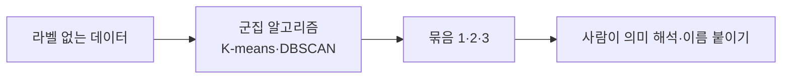
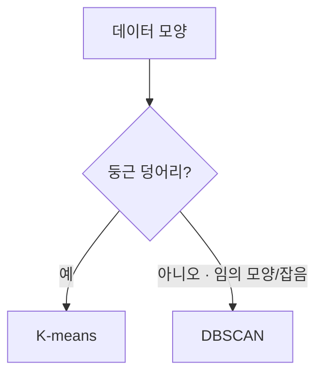

# 군집화

> **정답 라벨 없이** 데이터를 비슷한 것끼리 묶는 비지도 학습 기법. 고객 세분화, 문서 주제 묶기, 이상치 탐지의 출발점으로 쓴다. 대표 알고리즘은 **K-means**(중심 기반)와 **DBSCAN**(밀도 기반)이며, 묶음의 개수와 모양 가정에 따라 결과가 크게 달라진다.

## 쉽게 말하면
이름표 없이 섞여 있는 사진 수백 장을 "비슷한 것끼리 한 무더기로" 쌓는 일이다. 정답을 아는 사람이 없으므로 "몇 무더기가 좋은가"와 "무엇이 비슷한가"의 기준을 우리가 정해야 한다.

## 자세히
(scikit-learn 1.9.1 직접 실행, 합성 데이터 600개)
- **K-means**: 묶음 수 K를 정하고, 각 점을 가장 가까운 중심에 배정하고 중심을 다시 계산하는 과정을 반복. 둥글고 크기가 비슷한 덩어리에 알맞다.
- **K를 어떻게 정하나** — 3개의 덩어리가 있는 합성 데이터(`make_blobs`, 표준편차 1.0):

| K | 관성(inertia, 작을수록 응집) | 실루엣 점수(클수록 좋음) |
|---|---|---|
| 2 | 1795.7 | 0.459 |
| **3** | 1041.3 | **0.463** |
| 4 | 879.1 | 0.382 |
| 5 | 741.0 | 0.331 |
| 6 | 612.1 | 0.357 |

  관성은 K가 늘면 **항상 줄기** 때문에 단독으로는 못 고르고(팔꿈치 방법: 감소가 꺾이는 지점), 실루엣은 K=3에서 최대였다. K=3 결과와 실제 생성 군집의 일치도(ARI)는 0.79(1이 완전 일치). 데이터가 겹쳐 있어 완벽하지 않다.
- **모양 가정의 한계**: 초승달 두 개 데이터(`make_moons`)에서 K-means(K=2)의 ARI는 **0.252**로 낮았고, 밀도 기반 **DBSCAN**(eps 0.2, min_samples 5)은 **1.0**으로 정확히 분리했다. K-means는 둥근 덩어리를 가정하기 때문이다. DBSCAN은 묶음 수를 정하지 않아도 되고 밀도가 낮은 점을 **잡음**으로 분류하지만, eps·min_samples 설정에 민감하다.
- **주의**: ① 정답이 없으니 평가는 실루엣 같은 내부 지표와 **사람의 해석**(묶음에 의미가 있는가)에 의존, ② 특성 크기(스케일)를 맞춘다, ③ 고차원에서는 거리의 의미가 약해지므로 임베딩·차원 축소와 함께 쓴다.
- **AI 활용 예**: 문서 임베딩을 군집화해 주제 묶기, 고객 행동 데이터로 세그먼트, 이상 탐지 후보 찾기. 군집 이름은 사람이나 LLM이 요약해 붙인다.
- 한계: 위는 합성 데이터 실험이다. 실제 데이터에서 "올바른 군집 수"는 없을 수 있다.

## 그림으로 보기



## 예시
```python
from sklearn.cluster import KMeans
from sklearn.metrics import silhouette_score
for k in range(2, 7):
    km = KMeans(k, n_init=10, random_state=0).fit(X)
    print(k, km.inertia_, silhouette_score(X, km.labels_))
```
- 고객 구매 데이터를 군집화해 "신규·단골·휴면" 같은 세그먼트를 발견하고 마케팅 메시지를 달리 보내기.

## 헷갈리는 것과 비교
| 개념 | 차이 |
|---|---|
| 군집화(비지도) | 정답 라벨 없이 묶기 |
| 분류(지도) | 정답 라벨을 보고 학습해 새 데이터에 라벨 예측 |
| K-means | 중심 기반, K 지정 필요 |
| DBSCAN | 밀도 기반, 잡음 처리, K 불필요 |

## 더 읽을거리
- [scikit-learn: Clustering](https://scikit-learn.org/stable/modules/clustering.html) — 알고리즘 비교와 평가 지표.
