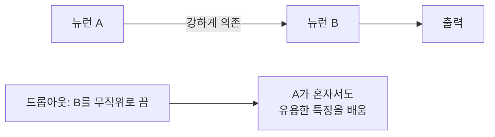

# 공적응 (Co-adaptation)

> 신경망의 뉴런들이 서로의 존재를 전제로 짝지어 동작하게 되어, 단독으로는 쓸모없고 새 데이터에는 취약해지는 현상으로, 드롭아웃이 막으려는 대상이다.

## 쉽게 말하면
조별 과제에서 한 명이 늘 다른 한 명의 실수를 메워 주는 데 익숙해지면, 짝이 빠지는 순간 두 사람 모두 제 몫을 못 한다. 모든 팀원이 혼자서도 어느 정도 해내도록 훈련시키는 것이 목적이다.

## 자세히
Srivastava 외 드롭아웃 논문(JMLR 2014, 2026-11 확인):
- 신경망은 유닛이 서로에게 **과하게 의존**하면 과적합하기 쉽다. 저자들의 해법: 학습 중 유닛을 연결과 함께 **무작위로 제거**(drop)해 특정 짝에 의존하지 못하게 한다.
- 매 학습 스텝마다 서로 다른 "얇아진(thinned)" 네트워크를 학습하는 셈이다.
- 테스트 때는 많은 네트워크를 평균하는 대신 **가중치를 줄인 하나의 전체 네트워크**로 평균을 근사한다.
- 논문 주장: 과적합을 크게 줄이고 다른 정규화 기법보다 낫다. 비전·음성 인식·문서 분류·계산생물학의 여러 벤치마크에서 최고 성능을 보고(논문 주장).
- 공적응을 직접 측정하는 단일 표준 지표는 없고, 개념적 설명 틀로 쓰인다(일반 설명).

## 그림으로 보기

## 예시
이미지 분류에서 "귀 모양 뉴런 + 수염 뉴런"이 항상 같이 켜지는 구조는 귀가 가려진 사진에서 무너진다. 드롭아웃으로 둘을 번갈아 끄며 학습하면 각각이 독립적으로 고양이를 알아본다.

## 헷갈리는 것과 비교
| 개념 | 차이 |
|---|---|
| 공적응 | 문제 상황(뉴런끼리 과의존) |
| [드롭아웃](#dropout) | 해결 기법 |
| [과적합](#overfitting) | 결과 — 공적응은 과적합의 한 원인으로 설명됨 |

## 더 읽을거리
- [Dropout: A Simple Way to Prevent Neural Networks from Overfitting (JMLR)](https://jmlr.org/papers/v15/srivastava14a.html) — 원 논문.
